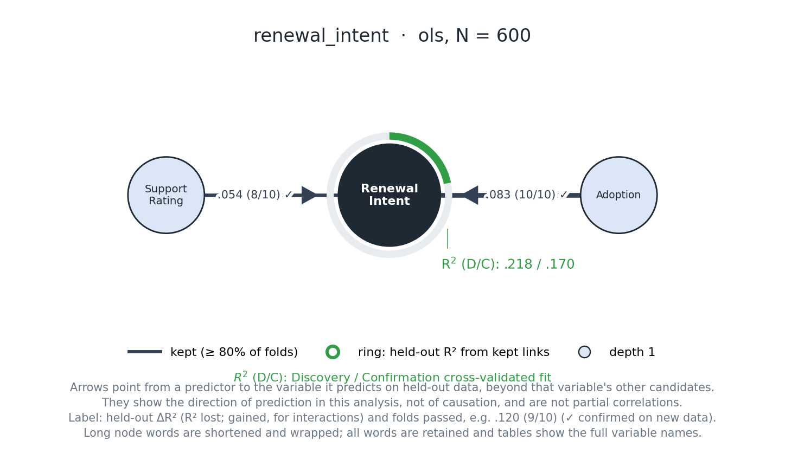
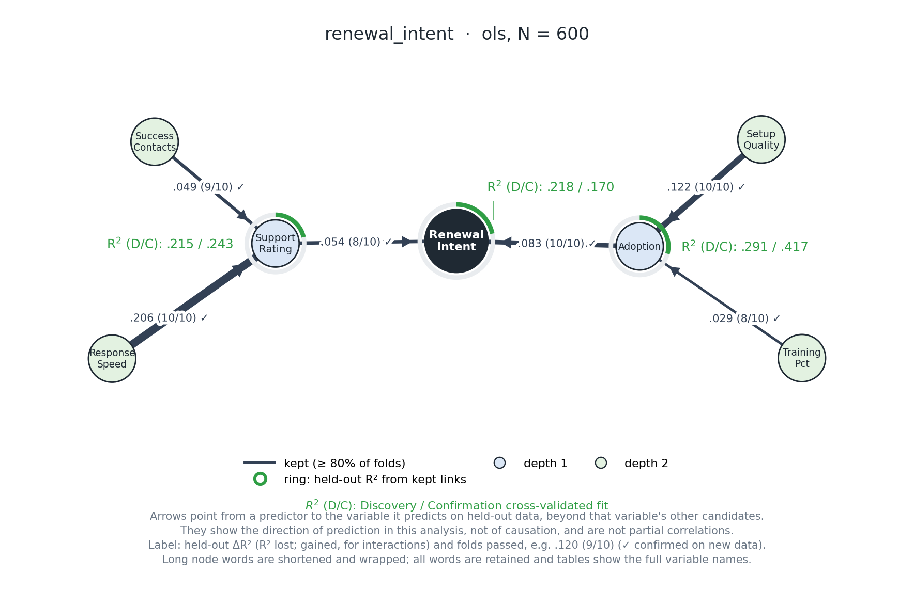
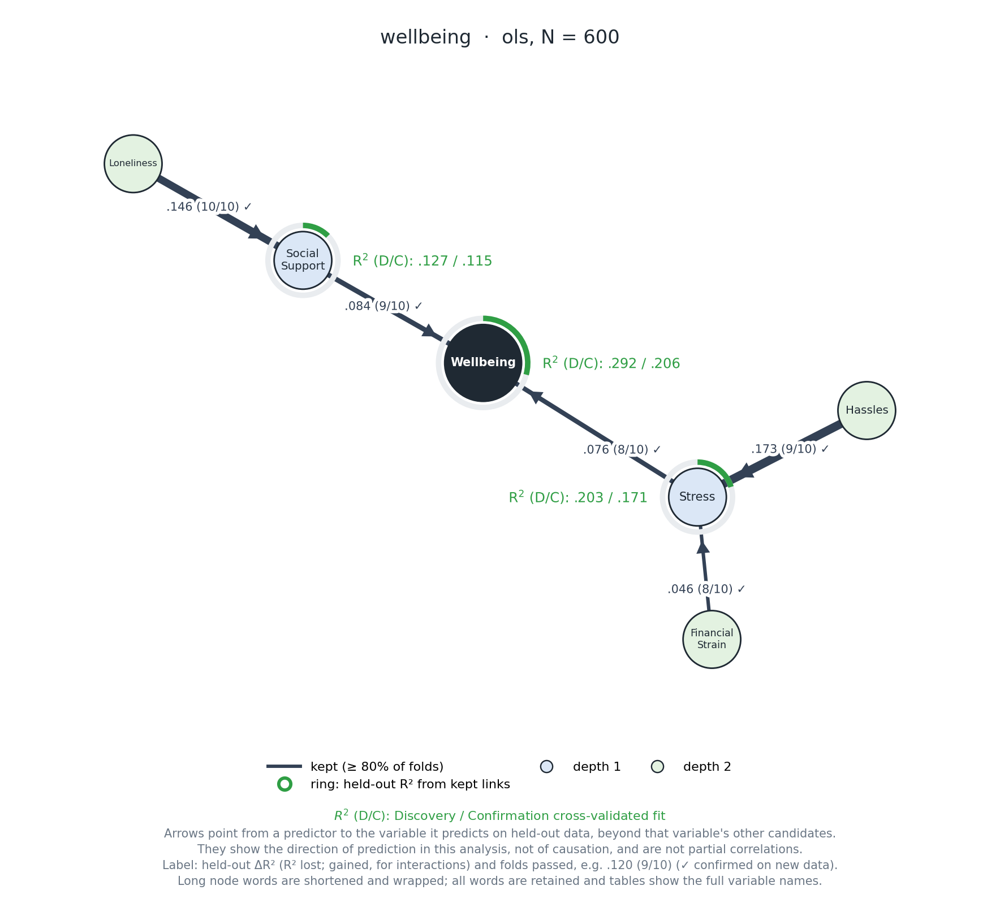
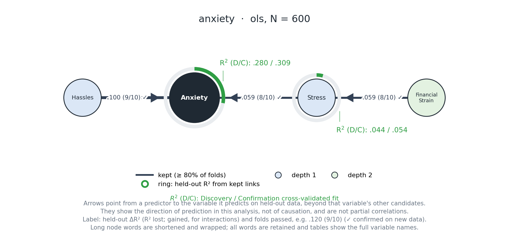
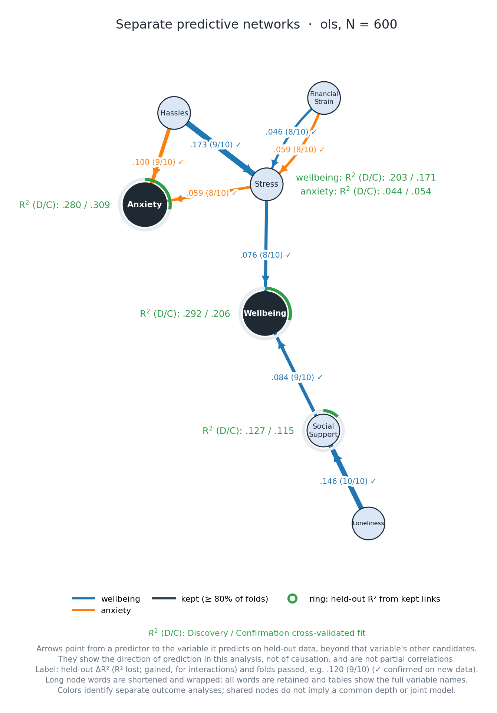

# OPEN, step by step: build your first network

> This file is the source text for the styled page [tutorial.html](tutorial.html). Edit it here first, then bring the same wording into the HTML.

Start with one question. Add a few lines, understand what they do, and inspect the result before moving on. Continue to recursive networks for well-being and anxiety, then compare them in a combined graph.

[Field guide and illustrated examples](index.html) · [API reference](api.md) · [Method reference](method.md)

## What we are going to do

Imagine you have survey data from 1,200 customer accounts. You want to know which account measures help predict **renewal intent**, a score from 1 to 7. Then ask what predicts those measures themselves. The second project applies the same sequence to well-being and anxiety in one coordinated analysis, with separate and combined network figures.

OPEN starts with a target, compares the predictive contributions of candidate variables with shuffled-noise references, and retains the more consistent contributions. It can then repeat that process with retained variables as new targets. The arrows describe prediction within these models; they do not establish causes.

We will use the supplied [fictional business dataset](../examples/tutorial/data/business_customer_renewal.csv). You need Python 3.11 or later and enough Python familiarity to run a script or notebook cell. No knowledge of OPEN is assumed.

> **Note**
>
> **How to follow along:** run steps 1–17 in order. Terminal commands are labeled separately from Python. Keep the Python blocks in the same script or notebook session, and run from the repository root, the folder containing `pyproject.toml`. Blocks labeled “Read only” show output rather than code to run. Later sections are optional branches; they start from the objects created in steps 1–17.

> **Note**
>
> **Five figures in this version:** [1. First-layer business network](#plot) · [2. Recursive business network](#depth) · [3. Well-being network](#wellbeing) · [4. Anxiety network](#anxiety) · [5. Combined outcome network](#overlay). Each figure appears alongside the code and explanation for that stage.

The runnable companion, [step_by_step.py](../examples/tutorial/step_by_step.py), collects the Python from steps 2–17 in order. Read the steps first if you want to understand each decision.
## Part 1 · steps 01–12: Your first analysis, one decision at a time
### Step 1. Install OPEN in your Python environment

If you already have the repository, open a terminal in that folder. Otherwise, get it first:

*Terminal · only if you have not cloned the repository*

```bash
git clone https://github.com/imh-ds/open.git
cd open
```

`git clone` downloads the project. `cd open` moves the terminal into its root folder.

*Terminal · from the repository root*

```bash
python -m pip install ".[visualization]"
```

`python -m pip` installs into the environment used by that Python interpreter. The dot means “this project”; `[visualization]` adds the plotting dependency. Keep the quotes. This installs the package `opennet`, which is also the name you import.

Now open a Python script or notebook using that same environment. In a notebook, check that its kernel uses the environment where you installed OPEN.

<details>
<summary>If Python cannot import OPEN or find the CSV</summary>

`ModuleNotFoundError: No module named 'opennet'` usually means the running interpreter differs from the installation environment. Check `import sys; print(sys.executable)` in your Python session, then install with that interpreter.

A `FileNotFoundError` for the example CSV usually means the working directory is wrong. Check `from pathlib import Path; print(Path.cwd())` and run from the repository root, or use an absolute path to the CSV.

</details>
### Step 2. Load the data before choosing a model

Start your Python session with one import:

```python
import pandas as pd
```

`pandas` reads and inspects tables. `as pd` gives it the short name used below.

```python
data = pd.read_csv("examples/tutorial/data/business_customer_renewal.csv")
```

`pd.read_csv(...)` reads the file into a DataFrame, a table with named columns. `data =` stores that table; it does not run an analysis.

```python
print(data.shape)
print(data.head())
```

The first line prints `(1200, 11)`: 1,200 rows and 11 columns. The second prints the first five rows. Each row should be one customer account; `renewal_intent` is the outcome and the other ten columns are candidate measures.

```python
print(data.dtypes)
print(data.isna().sum())
```

The first line checks column types. The second counts missing values by column. This example is numeric and complete. For your data, stop here to resolve text labels, missing outcomes, impossible values, and IDs that should not enter a predictive model.

> **Note**
>
> **Missingness has different rules at different stages.** The root outcome must be complete. During discovery, missing predictor values are median-imputed using each training fold; missing deeper-target values exclude rows from that target's assessment. Confirmation instead uses complete rows for each target and its frozen pool. Inspect its reported `n`; it can be smaller than the reserved sample.

<details>
<summary>When your own table is not this tidy</summary>

Real exports usually contain identifiers, text categories, and some rows without an outcome. OPEN accepts only numeric, non-boolean columns and stops with `variable '…' must be numeric` otherwise. A typical preparation looks like this; the file and column names are placeholders:

```python
raw = pd.read_csv("my_study.csv")
raw = raw.drop(columns=["respondent_id"])
raw = raw.dropna(subset=["my_outcome"])
raw["education"] = raw["education"].map({"high school": 1, "bachelor": 2, "graduate": 3})
raw = pd.get_dummies(raw, columns=["region"], drop_first=True, dtype=float)
```

The first change removes an identifier. The second drops rows missing the root outcome; record how many, because it changes the sample you report. The third codes an *ordered* category as scores, which is reasonable only if treating the steps as evenly spaced is defensible. The last turns an *unordered* category into indicator columns such as `region_south`. Keep `dtype=float`: pandas otherwise creates boolean columns, which OPEN rejects.

Each indicator is then a separate candidate, compared with the dropped reference category. Indicators from one variable are related and can appear together as a shared group. Dates and times need converting to a meaningful number, such as months since enrollment, before they can enter a model.

</details>
### Step 3. Name the question, then name the candidates

```python
outcome = "renewal_intent"
```

This is the exact name of the column you want to predict. The quotes make it a string. OPEN will look up that column in `data`.

Next, specify which other measures you want OPEN to consider:

```python
predictors = [
    "adoption", "setup_quality", "training_pct", "support_rating",
    "response_speed", "success_contacts", "price_fairness", "industry_fit",
    "tenure_months", "company_size_log",
]
```

The square brackets make a Python list. Each quoted item names one candidate column; commas separate items. These are candidates to test, not variables already selected for the final network. Leave the outcome out of this list.

We name the candidates explicitly so the research question is visible. You can omit `predictors` in an analysis call and let OPEN use eligible remaining columns, but that can accidentally include IDs, alternative outcomes, or information unavailable at prediction time.

> **Checkpoint**
>
> **Checkpoint:** you now have three objects: `data`, the table; `outcome`, one column name; and `predictors`, the candidate names. Nothing has been fitted yet.   Step 04

### Step 4. Set up a small first discovery

```python
from opennet.api import DiscoveryConfig
```

`DiscoveryConfig` bundles settings for how OPEN discovers the network. It does not hold the data or the results.

```python
config = DiscoveryConfig(
    max_depth=1,
    folds=10,
    interactions=False,
    seed=42,
)
```

Read this from top to bottom:

**`config = DiscoveryConfig(`**:
Create a settings object and store it as `config`. The open parenthesis allows the arguments to continue on separate lines.

**`max_depth=1,`**:
Search only for predictors of renewal intent. The outcome is at depth 0; its retained predictors are at depth 1. We will add another layer after understanding this one.

**`folds=10,`**:
Divide discovery rows into ten parts. Train on nine parts and assess predictions on the remaining part, rotating through all ten. The default is ten; we write it explicitly so the later fold tallies are easy to interpret.

**`interactions=False,`**:
Skip the optional pairwise interaction search for this first lesson. The package default is `True`. Turning it off makes this example easier to inspect; it does not assert that interactions are absent.

**`seed=42,`**:
Fix discovery's random partitions and random streams. The number 42 is an arbitrary reproducibility choice, not a setting that improves evidence.

**`)`**:
Finish creating the object. The trailing comma on the preceding line is valid Python.

Other discovery settings retain their defaults. You do not need to choose them all now. A fixed seed supports repeatability with the same data, code, and environment; it does not make a result reliable across samples.
### Step 5. Reserve rows for a separate confirmation stage

Before looking for links, decide how much data discovery may use:

```python
explore_fraction = 0.5
split_seed = 42
```

`explore_fraction` is the share assigned to discovery. Here, half of 1,200 gives 600 discovery rows and 600 confirmation rows. Within those 600 discovery rows, ten folds use about 540 rows for training and 60 for assessment at a time.

`split_seed` fixes the initial assignment of rows to the two stages and workflow-level random streams. It is separate from `config.seed`, which controls discovery. We set both explicitly; they do not need to have the same value.

Next, choose how confirmation will judge the frozen selected links:

```python
correction = "holm"
alpha = 0.05
```

`correction="holm"` adjusts the testable confirmation p-values for multiple testing. `alpha=0.05` is the threshold applied to adjusted p-values. These are also the defaults. They govern confirmation tests; they do not set discovery's fold thresholds.

> **Note**
>
> **Make these choices before inspecting results.** A random row split suits this fictional dataset of separate accounts. The standard workflow does not supply group-aware or time-ordered splitting and folds. Repeated observations, clusters, or forecasts need a design that respects those dependencies. With a small sample, consider discovery now and confirmation in a later independent sample rather than leaving both split parts too small. Below about 1,000 rows, `analyze` warns that splitting leaves small parts. Read that warning as a cue to use the [later-sample workflow](#new-sample), not as noise to suppress.

Changing `explore_fraction` to `0.7` would give 840 discovery rows and 360 confirmation rows here. More discovery data leaves less confirmation data. There is no universally best split or fold count.
### Step 6. Put the decisions together and run once

```python
from opennet.api import analyze
```

`analyze` splits the data, discovers a network on one part, tests frozen selected links on the other, and separately evaluates the frozen network's predictive fit.

```python
result = analyze(
    data,
    outcome=outcome,
    predictors=predictors,
    engine="ols",
    config=config,
    explore_fraction=explore_fraction,
    split_seed=split_seed,
    correction=correction,
    alpha=alpha,
)
```

Most of these lines simply pass the objects you have already made. In `outcome=outcome`, the name to the left of `=` is the function's argument; the name to the right is your variable containing `"renewal_intent"`. The same pattern applies to `predictors`, `config`, and the split and confirmation settings.

`data` is the first argument: the input table. The one new choice is `engine="ols"`, which uses ordinary least squares as the discovery learner. This is a linear starting point. OLS confirmation uses HC4 robust standard errors. We will discuss other engines later.

`result =` stores the returned `SplitResult`. It contains several related outputs, rather than just a picture. The call takes a few seconds here, because held-out assessments require many model fits; the whole companion script takes about a minute on a laptop. Expect more time with more candidates, deeper networks, repeats, interaction search, or LightGBM.

```python
print(result.summary())
```

`.summary()` makes a readable report; `print` displays it. First check its opening line: discovery and confirmation should each have 600 rows, with the split seed and correction you specified. Then read depth 1 before moving to the detailed tables.

> **Checkpoint**
>
> **Checkpoint:** this is a complete one-outcome analysis. You can stop adding settings and inspect it. Discovery, confirmation tests, and predictive fit answer different questions; the next three steps read them separately.

> **Note**
>
> **A real study runs this once.** To teach one idea at a time, this tutorial calls `analyze` again later with a deeper setting on the same split, after you have seen confirmation results. In a study, that lets confirmation results influence the next choice. Fix the outcome, candidates, variable roles, engine, depth, and settings first, then call `analyze` once. If you need to compare settings, compare them on the discovery rows only: see [Try settings before confirming](#tune).   Step 07

### Step 7. Read one discovery link

```python
discovery = result.discovery
```

`result.discovery` is the discovery-stage network. We give it a short local name so we can inspect its tables without repeatedly typing the longer expression.

```python
print(discovery.links[
    ["depth", "source", "target", "kind", "pass_rate", "tier", "r2_median"]
].to_string(index=False))
```

`discovery.links` holds the relation table. The inner list chooses columns; `.to_string(index=False)` prints them without row numbers. Start with a row whose `kind` is `"unique"`.

Read only · three rows from the supplied example, rounded

```python
source           target          pass_rate  tier     r2_median
adoption         renewal_intent   1.0        kept     0.0827
support_rating   renewal_intent   0.8        kept     0.0535
price_fairness   renewal_intent   0.7        flagged  0.0320
```

Read `source="adoption"` and `target="renewal_intent"` as “adoption helps predict renewal intent, beyond the other available candidates.” This is a conditional predictive contribution, not a correlation or a causal effect.

`pass_rate` is the proportion of discovery folds where that contribution exceeded the shuffled-noise bar. With ten folds and the default one repeat, `0.9` means 9 of 10 folds. At the default thresholds, at least 80% is `kept`, 40% to below 80% is `flagged`, and below 40% is `dropped`. Contributions below the effect floor can instead be `hidden`; we will return to that setting later.

`r2_median` is the median held-out R² contribution across folds. For a unique link it measures R² lost when that predictor is left out. A value of .08 would mean a median loss of .08 R² units in those comparisons. It is not a slope, does not give the sign of the relationship, and does not mean that a one-unit increase in adoption changes renewal intent by .08.

In this run, adoption and support rating are kept, while price fairness is flagged. The full table also retains the dropped candidates. These are results for this simulated dataset and configuration; small numerical differences can occur across dependency versions.

> **Note**
>
> **A fold pass rate is not a p-value.** The training sets overlap, so 9 of 10 passing folds are not nine independent replications. Confirmation provides the separate tests in the next step.

<details>
<summary>What if the relation is a shared group?</summary>

Correlated predictors can contribute together while providing little unique information individually. A `kind="shared"` row evaluates the loss from removing a group together. Inspect `discovery.links` for its `members` and `discovery.pairs` for pair classifications. The group contribution is not a unique effect for each member. A kept shared group can promote its ordinary members into the next layer.

</details>
### Step 8. Check which selected links were confirmed

```python
print(result.confirmation[
    ["source", "target", "kind", "n", "p", "p_adjusted", "confirmed", "note"]
].to_string(index=False))
```

This is a different table. It tests frozen selected links using the reserved confirmation rows, adjusting for each target's discovery candidate pool and any specified controls. It does not rediscover the network or test every possible pair of variables.

Read `n` first to see the complete-case sample used. `p` is the raw test p-value. `p_adjusted` accounts for the selected correction, and `confirmed` records whether the adjusted value passed `alpha`. A small p-value is not the probability that the relationship is true, and it does not measure practical importance.

For this depth-1 run, adoption's raw p-value is approximately `1.25e-15` and its Holm-adjusted p-value is `2.49e-15`. Here `e-15` means “times 10 to the power −15.” Both adoption and support rating are confirmed; price fairness is absent from this table because the default confirmation set contains only kept links.

If `p` is missing, read `note`. Shared groups and interactions have no calibrated confirmation test in the current implementation. Invalid or unidentifiable confirmation models can also leave a relation untested. `confirmed=False` alone cannot distinguish “tested but unconfirmed” from “not tested.”

By default, only kept links enter confirmation. Flagged links remain discovery leads. If no links were kept, an empty confirmation table can be a legitimate result.

<details>
<summary>If you planned to confirm flagged links too</summary>

Use the specific split-workflow function, which exposes this additional option. This is a separate analysis choice; showing flagged edges in a graph does not test them.

```python
from opennet.api import discover_and_confirm

with_flagged = discover_and_confirm(
    data, outcome=outcome, predictors=predictors,
    engine="ols", config=config,
    explore_fraction=explore_fraction, split_seed=split_seed,
    correction=correction, alpha=alpha,
    include_flagged=True,
)
```

`include_flagged=True` expands the frozen link set and can change the correction family. `analyze` does not accept this argument. Specify this choice in advance rather than adding tests because a particular flagged link looked appealing.

</details>
### Step 9. Ask how well the selected network predicts

```python
print(result.fit[
    ["target", "n", "network_size", "r2_network_explore", "r2_network"]
].to_string(index=False))
```

Read the row for renewal intent. `network_size` counts its kept incoming predictors. `r2_network_explore` is discovery cross-validated network fit; `r2_network` is confirmation cross-validated network fit.

In this example, renewal intent has two kept predictors and fit of approximately `.218 / .170`. The graph writes this as `R² (D/C): .218 / .170`: discovery R² first, confirmation R² second.

These are averages of fold R² values relative to a training-fold mean baseline. They are not necessarily the reduction in pooled prediction error. Confirmation fit refits the frozen predictor set within folds of the confirmation sample; it is not the score of one unchanged trained model deployed to new accounts.

Selection can make discovery fit optimistic. Confirmation fit may be higher or lower in a particular split, and R² can be negative if predictions are worse than the baseline. Neither statistical confirmation nor a particular R² guarantees useful decisions. For an application, also assess prediction errors, a relevant operational baseline, and the consequences of mistakes.

Individual link contributions generally do not add up to the target's network R². They compare different models, and predictors can share information.
### Step 10. Draw the result you have already computed

```python
from opennet.api import plot_discovery
```

This function draws a discovery network. We will explicitly supply the confirmation tables so the graph can also show checkmarks and confirmation fit.

```python
plot_discovery(
    discovery,
    path="renewal-depth1.png",
    confirmation=result.confirmation,
    confirmation_fit=result.fit,
)
```

The first argument is the network from step 7. `path` saves a PNG in your working directory. `confirmation` supplies link-test results; `confirmation_fit` supplies the separate fit estimates. Plotting does not refit the analysis.

Open `renewal-depth1.png`. Start at the central renewal-intent node, then follow one incoming arrow. A solid line is kept; a dotted line is flagged. An edge label such as `.080 (9/10)` combines the median R² contribution and passing-fold tally. A checkmark adds confirmation status. The green ring shows discovery network fit, while D/C text gives discovery and confirmation fit in that order.

Now make a simpler version without changing the analysis:

```python
plot_discovery(
    discovery,
    path="renewal-depth1-kept.png",
    confirmation=result.confirmation,
    confirmation_fit=result.fit,
    show_flagged=False,
)
```

The only new argument is `show_flagged=False`. It hides flagged links in this image; they remain in the tables. This is a display setting, unlike a discovery threshold, which can change selection and recursion.

[](assets/tutorial/step-by-step-depth1.png)

*The kept-only graph generated by the preceding call. Price fairness is hidden from this version, while both kept links carry confirmation checkmarks. Select the image to view it at full size.*

<details>
<summary>Make labels or spacing easier to read</summary>

```python
plot_discovery(
    discovery, path="renewal-readable.png",
    confirmation=result.confirmation, confirmation_fit=result.fit,
    spacing=1.2,
    label_size=1.2,
    abbreviate_node_labels=False,
    wrap_node_labels=False,
)
```

`spacing=1.2` spreads nodes farther apart. `label_size=1.2` enlarges text relative to its base size. The last two arguments keep full words on one line; they may require more space. Node names in the tables always retain their original spelling. For repeated styling, import `GraphStyle` from `opennet.api`, put these fields in `GraphStyle(...)`, and pass that object as `style=...`.

</details>
### Step 11. Save the tables and settings as well

```python
from opennet.api import save_split

saved_to = save_split(result, "renewal-depth1-output", plot=False)
print(saved_to)
```

`save_split` exports the already computed `SplitResult`. It does not split again. The second argument is the destination folder. `plot=False` skips creating another graph because you have already saved two.

Open the folder and look at `links.csv`, `confirmation.csv`, and `confirmation-fit.csv`. You will also find node, pair, fold, noise-bar, and discovery-fit tables; `settings.json`; `split-settings.json`; and `summary.txt`.

Use a new folder for a different analysis you want to retain: reusing a destination replaces OPEN's managed output files. The export records analysis settings, but keep the input dataset, script, and environment/package versions too.
### Step 12. Now ask what predicts the retained predictors

Only after reading the first layer do we extend it. Import a small Python utility:

```python
from dataclasses import replace

deeper_config = replace(config, max_depth=2)
```

`replace` copies the settings object with the named field changed. `config` still has depth 1; `deeper_config` has depth 2. All other fields stay the same.

```python
deeper_result = analyze(
    data,
    outcome=outcome,
    predictors=predictors,
    engine="ols",
    config=deeper_config,
    explore_fraction=explore_fraction,
    split_seed=split_seed,
    correction=correction,
    alpha=alpha,
)
```

This is the same call as before with a different configuration and result name. It reruns the workflow on the same split. It is a continuation of the example, not an independent replication. In a study, choose the intended depth in advance, or choose it on discovery rows alone as in [Try settings before confirming](#tune); adding depth can add tests and alter the adjusted confirmation values.

For example, adoption's raw confirmation p-value stays the same here, but its adjusted value changes from about `2.49e-15` to `4.98e-15` because the depth-2 network adds testable links to the Holm family. This does not mean the original discovery contribution changed.

```python
print(deeper_result.summary())
print(deeper_result.discovery.nodes.to_string(index=False))
print(deeper_result.discovery.stops)
```

The summary reports each evaluated layer. The node table lists each variable's `depth` and `parents`, where parents are the targets it predicts. `stops` explains why expansion ended for a target: `MAX_DEPTH` means the chosen limit was reached; `NOTHING_KEPT` means no ordinary candidates were promoted; `NO_CANDIDATES` means there were none left to assess.

At depth 1, OPEN predicts renewal intent. At depth 2, the ordinary variables retained at depth 1 become targets. Each target at that layer uses the same snapshot of ordinary candidates not already placed in the network. A candidate can predict more than one target in that layer.

> **Note**
>
> **Why might a plausible arrow be absent?** Once an ordinary variable has been retained at an earlier depth, it is excluded from later candidate pools in that outcome's network. If adoption was retained at depth 1, it is not tested as a predictor of support rating at depth 2. That missing arrow means “not eligible here,” not “tested and rejected.” Flagged and dropped ordinary candidates remain available at later layers. A variable's contribution depends on the pool actually assessed.

```python
save_split(deeper_result, "renewal-depth2-output", show_flagged=False)
```

This time we leave `plot` at its default, `True`. The new folder contains the full tables and `network.png`. Compare its second layer with the depth-1 plot. Depth describes predictive distance from the selected outcome, not a temporal or causal sequence.

[](assets/tutorial/step-by-step-depth2.png)

*The depth-2 business network. Follow Setup Quality and Training into Adoption, then Adoption into Renewal Intent; the other branch runs through Support Rating. These are successive predictive target models, not a causal chain.*

> **Checkpoint**
>
> **Next: use the full two-outcome example.** You now know the basic workflow and recursion. Continue through steps 13–17 to build, interpret, compare, and save the well-being and anxiety networks.  Part 2 · steps 13–17

Two outcomes, two networks, one combined view
## Part 2 · steps 13–17: Two outcomes, two networks, one combined view

### Step 13. Ask two related questions in the same participants

The first network taught us the mechanics. Now we use the fuller psychology example: which measures predict well-being, which predict anxiety symptoms, and what predicts their retained predictors? Both outcomes come from the same 1,200 fictional participants. Anxiety is a symptom score, not a clinical diagnosis.

```python
psych = pd.read_csv("examples/tutorial/data/psychology_wellbeing.csv")
print(psych.shape)
print(psych.head())
```

Start by inspecting the new table, just as before. Keep `data` for the business example and use `psych` here, so the earlier example stays available.

```python
outcomes = ["wellbeing", "anxiety"]
```

This is now a list of two column names. We want a predictive network centered on each outcome, not a single score combining the outcomes.

```python
psych_predictors = [name for name in psych.columns if name not in outcomes]
print(psych_predictors)
```

Read the list comprehension as “keep each column name unless it is one of the two outcomes.” Neither selected outcome may enter the ordinary predictor pool. Here the remaining columns are stress, hassles, financial strain, social support, loneliness, sleep quality, sleep hours, activity hours, self-efficacy, and age. Age is an ordinary candidate for this example; the later variable-role lesson explains how that differs from adjustment.

We already have `deeper_config`, which asks for two layers, uses ten folds, disables interaction discovery, and fixes the discovery seed. Keep that configuration and the original split settings while changing the dataset and outcome argument:

```python
batch = analyze(
    psych,
    outcomes=outcomes,
    predictors=psych_predictors,
    engine="ols",
    config=deeper_config,
    explore_fraction=explore_fraction,
    split_seed=split_seed,
    correction=correction,
    alpha=alpha,
)
```

`psych` supplies the new table. `outcomes=outcomes`, plural, requests the coordinated batch; do not also pass `outcome`. The remaining lines have the same jobs as before. The return value is a `MultiOutcomeResult`.

OPEN splits the rows once into 600 discovery and 600 confirmation rows. Both outcome networks share that split and the discovery fold plan, while retaining their own candidate pools, depths, and results. The default Holm family includes testable selected links across both networks. Sharing participants does not make this a joint outcome model or an estimate of correlated outcome errors.

> **Checkpoint**
>
> **Checkpoint:** you have fitted two recursive networks in one coordinated workflow. Next, inspect each network before overlaying them.   Step 14 · read the first outcome

### Step 14. Follow the well-being network from the center outward

```python
wellbeing_result = batch.by_outcome["wellbeing"]
print(wellbeing_result.summary())
```

`batch.by_outcome` holds the individual analyses. The bracketed name retrieves an ordinary `SplitResult`, so its discovery, confirmation, and fit tables work exactly as in the business example.

```python
plot_discovery(
    wellbeing_result.discovery,
    path="psychology-wellbeing.png",
    confirmation=wellbeing_result.confirmation,
    confirmation_fit=wellbeing_result.fit,
    show_flagged=False,
)
```

The first line supplies this outcome's discovered network. The two confirmation arguments supply this outcome's tests and fit. `show_flagged=False` keeps the picture focused on retained links; the tables still include the weaker leads.

[](assets/tutorial/step-by-step-wellbeing.png)

*The well-being network from the preceding call. Select the figure to inspect the labels at full size.*

First read the arrows entering Wellbeing: Stress and Social Support are kept and confirmed in this example. Its `R² (D/C)` is approximately `.292 / .206`. That is the fit of the retained incoming predictors for the well-being score, not an effect of intervening on either variable.

Now follow the branches outward. Stress and Social Support become targets at depth 2. Hassles and Financial Strain predict Stress in this path. Loneliness predicts Social Support in the retained network. Each destination has its own target model and fit; a fit beside Stress describes prediction of Stress, not another estimate of the fit for Wellbeing.

```python
print(wellbeing_result.discovery.nodes.to_string(index=False))
print(wellbeing_result.discovery.stops)
print(wellbeing_result.fit.to_string(index=False))
```

Check the table's depths and parents against the figure. Read the stop reasons too: a node sitting at the chosen depth limit is not evidence that nothing could predict it. The fit table supplies exact values and sample sizes rather than requiring you to read rounded labels.
### Step 15. Read anxiety using the same sequence

```python
anxiety_result = batch.by_outcome["anxiety"]
print(anxiety_result.summary())
```

Only the lookup name changes. This retrieves the second outcome's network from the same batch; it does not split or fit again.

```python
plot_discovery(
    anxiety_result.discovery,
    path="psychology-anxiety.png",
    confirmation=anxiety_result.confirmation,
    confirmation_fit=anxiety_result.fit,
    show_flagged=False,
)
```

[](assets/tutorial/step-by-step-anxiety.png)

*The anxiety network uses the same participants, split, folds, learner, and depth setting as the well-being network.*

Start at Anxiety. Its retained direct predictors are Stress and Hassles, and its discovery/confirmation fit is approximately `.280 / .309`. Confirmation fit can be higher or lower than discovery fit in a particular split; this difference does not rank the outcomes' predictability across all populations.

Then move outward to Stress. Financial Strain is retained as its predictor here, while Hassles → Stress is absent. This is where comparing the pictures without checking eligibility can mislead.

> **Note**
>
> **Why did Hassles → Stress disappear?** In the well-being network, Stress and Social Support were placed at depth 1, leaving Hassles available at depth 2. In the anxiety network, Stress and Hassles were already placed at depth 1. The no-reuse rule excludes Hassles from the later Stress pool in that path. **Hassles → Stress was not tested in the anxiety path.** Its absence does not mean a test rejected it.

The generator gives Hassles a larger direct weight in Stress (.38) than Financial Strain (.28), before noise and scaling. Those generating weights are not the conditional held-out ΔR² values shown on arrows. Financial Strain remains eligible in both paths, but the other candidates differ, so its conditional contribution and Stress's network fit can differ too.

```python
print(anxiety_result.discovery.nodes.to_string(index=False))
print(anxiety_result.discovery.stops)
print(anxiety_result.fit.to_string(index=False))
```

Use these tables to confirm which variables were placed at each layer and which targets were evaluated. An untested edge, a dropped edge, a hidden contribution, and a flagged edge omitted by the plotting setting are different situations.

In this run, Hassles was also evaluated as a depth-2 target, but no ordinary candidates were promoted for it: its stop reason is `NOTHING_KEPT`. Financial Strain reaches the chosen depth limit and has `MAX_DEPTH`. Those are different reasons for a branch to end; the graph alone does not explain the distinction.
### Step 16. Overlay the two networks after understanding each one

```python
from opennet.api import GraphStyle, plot_outcomes

batch_style = GraphStyle(show_flagged=False)
plot_outcomes(batch, path="psychology-panels.png", style=batch_style)
```

`GraphStyle(show_flagged=False)` creates a reusable display configuration. Unlike `plot_discovery`, the batch plotting and saving functions take these options through `style`. `plot_outcomes` takes the whole batch. Its default layout produces separate panels, useful for comparing each root and its layers side by side. Now change only the layout:

```python
plot_outcomes(
    batch,
    layout="combined",
    path="psychology-overlay.png",
    style=batch_style,
)
```

`layout="combined"` draws shared variable nodes once and preserves outcome-specific links. `path` names a new image, so the separate views remain available. This is a different view of the same computed results.

[](assets/tutorial/step-by-step-combined.png)

*The combined network. Follow the outcome colors in the legend rather than treating every visible branch as one fitted model.*

Find Wellbeing and Anxiety first. Then locate Stress, which predicts both roots and is itself a depth-2 target in both paths. Its fit differs by path: approximately `.203 / .171` for the well-being path and `.044 / .054` for the anxiety path. These are separate fits for predicting Stress under different candidate pools; the overlay does not average them.

Follow Hassles next: its role as a direct anxiety predictor explains why it is unavailable in anxiety's later Stress pool. A shared node therefore does not imply that its incoming model was identical for every outcome. Identical reused assessments can draw once in neutral gray; distinct assessments remain separate even when rounded labels happen to match.

The overlay does not fit a joint outcome model, estimate cross-outcome residual covariance, or establish a causal direction. It helps you compare separate predictive networks built through one coordinated workflow.
### Step 17. Keep the outcome labels and test family in the results

```python
print(batch.confirmation.to_string(index=False))
print(batch.fit.to_string(index=False))
```

The aggregate tables use `root_outcome` to identify which network each row belongs to. Read the outcome label before comparing a repeated target such as Stress. As before, distinguish confirmed, tested but unconfirmed, and untested relations using the p-values and `note`.

```python
from opennet.api import save_batch

save_batch(batch, "psychology-output", plot="combined", style=batch_style)
```

`save_batch` exports the individual outcome analyses and aggregate confirmation, fit, settings, and summary files. Here `plot="combined"` also saves the overlay as `outcomes-network.png`. The generated folders under `outcomes/` retain each network's full tables; the aggregate settings map the folder names to the original outcome names. Use a new destination when you want to retain another analysis.

> **Checkpoint**
>
> **You have completed the full walkthrough.** You progressed from one-layer discovery to recursive expansion, two coordinated outcome networks, separate interpretation, a combined graph, and a complete export. The following lessons revisit individual settings using the objects already defined.

<details>
<summary>Change the scope of multiple-testing correction</summary>

The default scope is `"all_outcomes"`. If your planned analysis calls for separate correction families, use the specific multi-outcome function:

```python
from opennet.api import discover_and_confirm_outcomes

per_outcome_batch = discover_and_confirm_outcomes(
    psych, outcomes=outcomes, predictors=psych_predictors,
    engine="ols", config=deeper_config,
    explore_fraction=explore_fraction, split_seed=split_seed,
    correction=correction, alpha=alpha,
    correction_scope="per_outcome",
)
```

`analyze` does not accept `correction_scope`. Per-outcome adjustment does not account for testing across the whole batch. Both workflows support `correction="bh"` as an alternative to Holm, but choosing BH does not establish FDR control under arbitrary dependence among outcomes. State the chosen test family and adjustment.

</details>
## Part 3 · optional lessons: Then change one thing and see what moves
Optional · variable roles

## Keep a variable in every model

Suppose you want to adjust for account tenure throughout, without asking what predicts tenure. First remove it from the ordinary candidate list:

```python
adjusted_predictors = [name for name in predictors if name != "tenure_months"]
```

This list comprehension keeps every candidate except `tenure_months`. A variable cannot be both an ordinary predictor and a control or covariate.

```python
adjusted_result = analyze(
    data, outcome=outcome, predictors=adjusted_predictors,
    engine="ols", config=deeper_config,
    explore_fraction=explore_fraction, split_seed=split_seed,
    correction=correction, alpha=alpha,
    controls=["tenure_months"],
)
```

The new argument, `controls`, includes tenure in every target model without testing a tenure link, drawing it, or making it a recursion target. Other contributions are assessed beyond tenure and the available candidates. Controls also enter the fit calculations even though they have no arrow.

If you want tenure adjusted for *and* its link tested and potentially drawn, replace the final argument with:

```python
covariates=["tenure_months"],
```

This line is a replacement inside the preceding call, not a separate command. Covariates stay in every target pool and never become recursion targets; their drawn nodes are tan. Do not put tenure in both roles. As an ordinary predictor, tenure could instead be retained, become a target, and leave deeper pools. Choose its role from the question before seeing which graph is more attractive.
Optional · prediction engine

## Change the model without changing the question

OLS models linear relationships in discovery. If you want regularization for many or correlated predictors, try the supported Elastic-Net learner while keeping the outcome, candidates, split, and depth fixed:

```python
elastic_result = analyze(
    data, outcome=outcome, predictors=predictors,
    engine="elastic_net", config=config,
    explore_fraction=explore_fraction, split_seed=split_seed,
    correction=correction, alpha=alpha,
)
```

Only the engine changes. Elastic-Net can shrink coefficients and may produce a different network; it remains a linear discovery model. By default, its frozen unique links are confirmed using OLS with HC4 standard errors, not Elastic-Net coefficient p-values.

For relationships that bend or reverse direction, such as a U-shaped pattern, the supported LightGBM learner offers nonlinear flexibility. Install it in the same environment first:

*Terminal · optional dependency*

```bash
python -m pip install ".[lightgbm]"
```

Then run the preceding analysis with `engine="lightgbm"` and a new result name. Its default confirmation uses the implemented combined cross-fitted GCM/PCM test and can be substantially slower. Engine suitability depends on the relationship, effective sample size, and tested conditions; see the [engine notes](engines.md) and [validation evidence](validation-evidence.md).

`confirm_engine`, an optional workflow argument, overrides the confirmation-test engine; it does not change the discovery learner. Leave it unset unless you have a reason to change that test. The accepted test engines are `"ols"` and `"lightgbm"`.

Comparisons on the same data are sensitivity analyses, not replications. Repeatedly choosing the engine with the most favorable confirmation results uses the confirmation sample for selection.
Optional · discovery settings

## Change a setting only after understanding its job

Each example below creates an alternative configuration from the original depth-1 `config`. They do not accumulate and do not run a model. To use one, pass it as `config=alternative_config` in a fresh analysis call. Record choices in advance for a real study.

### Change the number of folds

```python
alternative_config = replace(config, folds=5)
```

With 600 discovery rows, five folds use roughly 480 for training and 120 for assessment per fold. Ten folds used 540 and 60. Fewer folds mean fewer partitions and larger assessment sets; more folds require more computation. There is no validated rule mapping every sample size to a particular fold count. Fold thresholds apply to proportions, so with five folds the default 80% keep rule requires at least four passes.

### Repeat discovery partitions

```python
alternative_config = replace(config, repeats=3)
```

`repeats=3` uses three discovery partitions. With ten folds, OPEN pools 30 fold contrasts for the noise bars and pass rates. It costs more computation and measures partition sensitivity on the same observations; it creates no new independent data.

### Change the fold-pass thresholds

```python
alternative_config = replace(config, keep=0.9)
```

`keep=0.9` requires at least nine of ten passing folds rather than eight. The flag threshold remains its default `0.4`. To change that separately, use `replace(config, flag=0.5)`. Valid settings require `0 < flag <= keep <= 1`. These are discovery rules, not confirmation significance levels. Lower thresholds can enlarge a network without making it more reliable.

### Change the noise reference

```python
alternative_config = replace(config, noise_quantile=0.99)
```

The default is `0.95`. A real contribution passes when it exceeds the selected quantile of shuffled-noise contributions for that target and contrast, pooled across folds and repeats. A higher quantile generally raises the reference bar. It does not turn the fold tally into a calibrated p-value or establish an error rate for the whole network.

### Remove the small-contribution floor

```python
alternative_config = replace(config, hide_below=None)
```

The default `hide_below=0.001` marks a passing relation `hidden` when its median R² contribution is below .001. Hidden relations remain in the tables but are not drawn or promoted. `None` disables that floor. Despite its name, this setting can change recursion; it is more than a graph preference. Compare `fold_tier` with final `tier` in the link table to diagnose it.

### Enable interaction discovery

```python
alternative_config = replace(config, interactions=True)
```

This restores the package default and enables the implemented pairwise interaction search. Interaction relations measure a joint gain beyond an additive model; they appear as orange junctions. They do not promote their members for recursion by themselves and currently remain untested in confirmation. Flagged interactions are omitted from plots by default; `show_flagged_interactions=True` is the display option to show them.

<details>
<summary>Settings to revisit when the design calls for them</summary>

**`dependence_pair=0.70`**:
The default absolute Spearman threshold for identifying dependent candidate pairs and connected groups. It governs which relations receive the correlated-predictor assessments; it is not a discovery keep threshold.

**`noise_groups=10`**:
The default number of matched shuffled-noise groups per dependence component for the group reference. Increasing it adds computation; it does not add participants.

**`tuning_folds=3`**:
The default inner-fold setting for learner tuning within discovery training data. It differs from the outer `folds` used to evaluate contributions.

**`max_interaction_pairs=100`**:
The default cap on candidate interaction pairs assessed for a target when interaction search is enabled.

**`max_depth=None`**:
The package default has no explicit depth cap. Expansion still stops when no ordinary variables are promoted or no candidates remain. Choose a finite depth if that better matches the question.

See [the method reference](method.md) for how these assessments work together. Altering a setting can move outside the conditions covered by the checked-in validation evidence.

</details>
Optional · choosing settings honestly

## Try settings on discovery rows, then confirm once

In practice you rarely know the right depth or setting before seeing any output. `analyze` does everything in one call, so every trial it runs also reaches the confirmation rows. Instead, split first and keep the confirmation rows untouched while you compare settings.

```python
from opennet.api import split_sample, discover, confirm, evaluate_fit, save_discovery

discovery_rows, confirmation_rows = split_sample(
    data, explore_fraction=explore_fraction, seed=split_seed,
)
```

`split_sample` makes the same split that `analyze` would make with these arguments. It returns two DataFrames. Here the confirmation rows were already used in steps 6–12; in your own study, split first and do not look at them until the final step.

```python
for depth in (1, 2, 3):
    trial = discover(
        discovery_rows, outcome=outcome, predictors=predictors,
        engine="ols", config=replace(config, max_depth=depth),
    )
    kept = trial.links.query("tier == 'kept'")
    print(depth, len(kept), trial.stops)
```

The loop runs discovery alone at three depths and prints how many links are kept and why each branch stopped. In this example, depth 1 keeps 2 links and depth 2 keeps 6. Depth 3 also keeps 6: every depth-2 branch now stops with `NOTHING_KEPT` rather than `MAX_DEPTH`, so the network has reached its natural end. That is a reason to choose depth 2 that does not depend on any confirmation result.

```python
chosen = discover(
    discovery_rows, outcome=outcome, predictors=predictors,
    engine="ols", config=deeper_config,
)
final_confirmation = confirm(chosen, confirmation_rows, correction=correction, alpha=alpha)
final_fit = evaluate_fit(chosen, confirmation_rows, seed=split_seed)
save_discovery(
    chosen, "renewal-final-output",
    confirmation=final_confirmation, confirmation_fit=final_fit,
)
```

Freeze the chosen network, then use the confirmation rows exactly once. With `seed=split_seed`, these tables match `deeper_result` from step 12. `save_discovery` does not know about the split, so record `explore_fraction` and `split_seed` with the export yourself.

Comparing settings on discovery rows is still selection: choosing the richest network can make discovery leads look better than they are. That is what the untouched confirmation stage is for. Report which settings you compared and why you chose one.
Optional · independent confirmation later

## Discover now and confirm when new data arrive

The split workflow is convenient when one dataset can support both stages. If you instead plan a later independent sample, use `discover` directly on your discovery sample. The code below is a template for your study; the two CSV names are placeholders, not supplied files.

```python
from opennet.api import discover, confirm, evaluate_fit, save_discovery

study_data = pd.read_csv("my_discovery_sample.csv")
study_network = discover(
    study_data, outcome="renewal_intent", predictors=predictors,
    engine="ols", config=deeper_config,
)
```

`discover` uses the supplied rows for discovery without reserving a confirmation half. Its return value is a `DiscoveryResult`, like `result.discovery`. Freeze the question and selected links before collecting or inspecting the independent sample.

```python
new_data = pd.read_csv("my_independent_sample.csv")
new_confirmation = confirm(study_network, new_data, correction="holm", alpha=0.05)
new_fit = evaluate_fit(study_network, new_data)
```

`confirm` tests the frozen links; `evaluate_fit` separately cross-validates predictive fit for the frozen network. Supply the required target and pool columns with compatible coding and measurement. Do not substitute discovery rows for `new_data`.

```python
save_discovery(
    study_network, "independently-confirmed-output",
    confirmation=new_confirmation,
    confirmation_fit=new_fit,
)
```

`save_discovery` exports a discovery object with the separately supplied confirmation results. Use `save_split` for a `SplitResult` and `save_batch` for a `MultiOutcomeResult`.

## Take the same sequence to your own study

Start again at step 2 with your own CSV. Change the outcome name and candidate list before changing model settings. Choose the sampling design, variable roles, engine, depth, and confirmation plan from the question.

1. Check the unit of observation, numeric coding, missingness, and when each measure would be available.
2. Write down the outcome, candidate pool, controls, and covariates.
3. Reserve appropriate independent confirmation data, or plan to collect it later. Compare settings on discovery rows only.
4. Record the configuration, seeds, correction family, and significance threshold.
5. Read discovery links, confirmation tests, fit, and stop reasons before interpreting the figure.
6. Save the tables and settings, retain the input and script, and report planned sensitivity analyses rather than selecting the most favorable run.

**When you return to the API, choose the function by the object and task.**

| You want to… | Use |
|---|---|
| Split one dataset and run the workflow | `analyze` (`analyse` is an alias) |
| Split once, then compare settings on discovery rows only | `split_sample`, then `discover` |
| Discover without an internal confirmation split | `discover` |
| Test frozen links on independent data | `confirm` |
| Evaluate frozen-network fit on independent data | `evaluate_fit` |
| Plot one network / several networks | `plot_discovery` / `plot_outcomes` |
| Save discovery / split / batch results | `save_discovery` / `save_split` / `save_batch` |

Use the [API reference](api.md) for complete signatures and output details, the [method reference](method.md) for the assessments, and the [field guide](index.html) for illustrated interpretation. Older `Explore`-named entry points remain supported; this tutorial uses the `Discovery` names.

When reporting a link, distinguish a discovery lead, a tested but unconfirmed link, an untested relation, and a confirmed predictive association. A missing arrow alone tells you too little. Independent confirmation strengthens the evidence for the specified predictive question; it does not establish causation or guarantee performance in another population.
OPEN is research software. Tutorial data are simulated. This page runs locally without external scripts or services; its fonts load from Google Fonts when online and fall back to system fonts otherwise.
