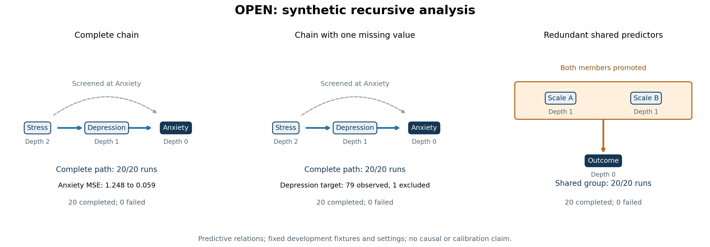
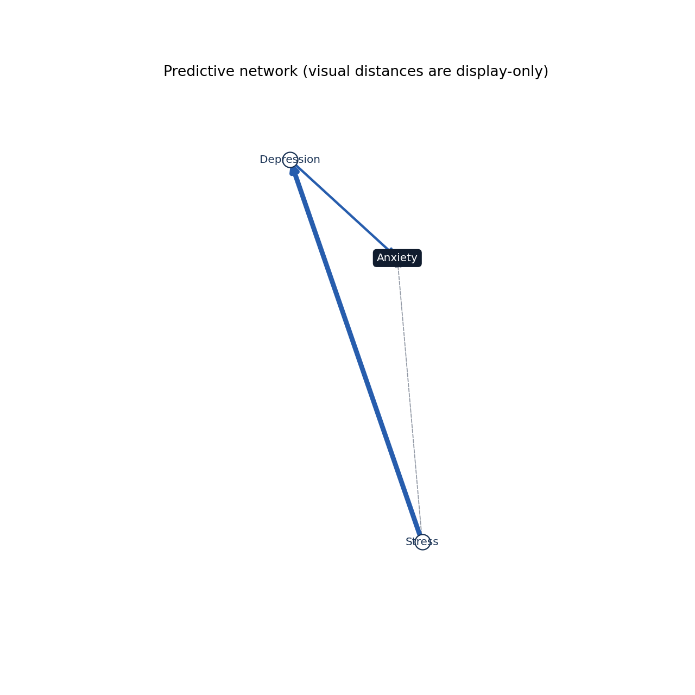

# OPEN synthetic sample demonstration

Three deterministic 80-row fixtures; 20 development resamples per fixture by default.
Each resample uses 80% of rows without replacement, two outer folds, two inner folds,
maximum depth 3, unique relevance threshold 0.15, and consensus threshold 0.70.
Settings are fixed before running; no thresholds were tuned to these outputs.

These fixtures demonstrate software behavior. They do not establish calibrated
scientific performance, real-data validity, or causal direction. Edge probabilities
are empirical frequencies across the completed whole-pipeline runs.



## chain

Completed: 20; failed: 0; structural denominator: 20.

Engine revision: `2e96b418ed17677b646d26e621d91851e2fdc115`.


### One full-sample run

| Target | Baseline MSE | Full MSE | Relative gain | Observed / missing target rows |
|---|---:|---:|---:|---:|
| Anxiety | 1.2483 | 0.0594 | 95.2% | 80 / 0 |
| Depression | 1.2488 | 0.3812 | 69.5% | 80 / 0 |

### Whole-pipeline results

| Relation | Count / completed runs | Probability |
|---|---:|---:|
| Depression -> Anxiety (PROXIMAL_UNIQUE) | 20 / 20 | 100% |
| Stress -> Anxiety (SCREENED_BY_PARTNER) | 20 / 20 | 100% |
| Stress -> Depression (PROXIMAL_UNIQUE) | 20 / 20 | 100% |
| Stress -> Depression -> Anxiety (complete unique-edge path) | 20 / 20 | 100% |

Interpretation: the generated fixture has Stress feeding Depression, then Anxiety.
Inspect the single-run classifications: Stress can predict Anxiety marginally but is
screened when Depression is available; it remains eligible and is evaluated as a
predictor of Depression at the next layer. The table reports how often the entire
unique-edge path appeared across independently rebuilt networks, rather than a
product of separate edge probabilities.

Captured numerical warnings: `{}`. Full messages/counts are
retained in [chain/warnings.json](chain/warnings.json); none were silently discarded.

## chain_missing

Completed: 20; failed: 0; structural denominator: 20.

Engine revision: `2e96b418ed17677b646d26e621d91851e2fdc115`.



### One full-sample run

| Target | Baseline MSE | Full MSE | Relative gain | Observed / missing target rows |
|---|---:|---:|---:|---:|
| Anxiety | 1.2483 | 0.0628 | 95.0% | 80 / 0 |
| Depression | 1.2637 | 0.3840 | 69.6% | 79 / 1 |

### Whole-pipeline results

| Relation | Count / completed runs | Probability |
|---|---:|---:|
| Depression -> Anxiety (PROXIMAL_UNIQUE) | 20 / 20 | 100% |
| Stress -> Anxiety (SCREENED_BY_PARTNER) | 20 / 20 | 100% |
| Stress -> Depression (PROXIMAL_UNIQUE) | 20 / 20 | 100% |
| Stress -> Depression -> Anxiety (complete unique-edge path) | 20 / 20 | 100% |

Interpretation: the generated fixture has Stress feeding Depression, then Anxiety.
Inspect the single-run classifications: Stress can predict Anxiety marginally but is
screened when Depression is available; it remains eligible and is evaluated as a
predictor of Depression at the next layer. The table reports how often the entire
unique-edge path appeared across independently rebuilt networks, rather than a
product of separate edge probabilities.

Depression is missing in sample row 0. When Depression becomes a target,
its risk uses only observed Depression values within the existing folds.
In resamples that omit row 0, no target rows need exclusion. No target value
is imputed. This is the formerly blocked recursive case.

Captured numerical warnings: `{}`. Full messages/counts are
retained in [chain_missing/warnings.json](chain_missing/warnings.json); none were silently discarded.

## shared_predictors

Completed: 20; failed: 0; structural denominator: 20.

Engine revision: `2e96b418ed17677b646d26e621d91851e2fdc115`.


### One full-sample run

| Target | Baseline MSE | Full MSE | Relative gain | Observed / missing target rows |
|---|---:|---:|---:|---:|
| Outcome | 0.9385 | 0.0200 | 97.9% | 80 / 0 |

### Whole-pipeline results

| Relation | Count / completed runs | Probability |
|---|---:|---:|
| {Scale_A, Scale_B} -> Outcome (shared) | 20 / 20 | 100% |

Interpretation: the two scales are near copies. Individually removing either
loses little prediction because the other remains; joint removal loses the
shared predictive signal. Both members can therefore be promoted together.
The group is a predictive relation and display object, not a synthetic target.

Captured numerical warnings: `{}`. Full messages/counts are
retained in [shared_predictors/warnings.json](shared_predictors/warnings.json); none were silently discarded.

## Reproduce

Run from the developed checkout with the visualization extra installed:

```powershell
python examples/run_synthetic_demo.py --output NEW_DIRECTORY --resamples 20
```

The runner refuses to overwrite an existing directory. Each case saves sample data,
configuration, a single-run diagnostic, the six-file OPEN bundle, and PNG/SVG plots.
summary.json records hashes, seeds, code revision, and exact structural denominators.
Numerical warnings remain recorded; a completed batch is an execution result,
not a claim that every fit converged. These examples exercise a two-member shared
group; they do not validate higher-order group discovery or its calibration.

## Numerical correction comparison

The earlier outputs remain in `../2026-10-07/`. Input bytes, configuration, run seeds,
and sampled row positions are identical in all three cases; only the engine revision
changed. The solver cap increased from 10,000 to 100,000; tolerance and thresholds
are unchanged. Exact comparisons are saved in [comparison.json](comparison.json).

| Case | Captured warnings before | After | Full-sample root MSE before | After |
|---|---:|---:|---:|---:|
| chain | 0 | 0 | 0.05942416 | 0.05942416 |
| chain_missing | 0 | 0 | 0.06276013 | 0.06276013 |
| shared_predictors | 268 | 0 | 0.02002660 | 0.02002660 |

The separate same-seed diagnostic of the earlier redundant-predictor batch found
12/200 selected outer fits truncated at the old cap and 249 inner tuning warnings.
At the higher cap, that diagnostic found zero warnings in either category; the
hardest selected fit took 44,861 iterations. The 268 warnings in the earlier full
demonstration also include seven warnings from its separate full-sample run.
The final demonstration captured zero warnings across all three full-sample runs
and all 60 resampled networks. All original and corrected structural denominators
remain 20 per fixture; chain paths and the two-member shared group each remain 20/20.

Verification: complete Python 3.11 suite 320 passed; Python 3.14 numerical regression
2 passed. Saved-input hashes, 64-row resample coverage, run ledgers, exported gain
arithmetic, bundle reloads, and plots were checked. Software behavior only; no
scientific calibration or causal validity is claimed.
