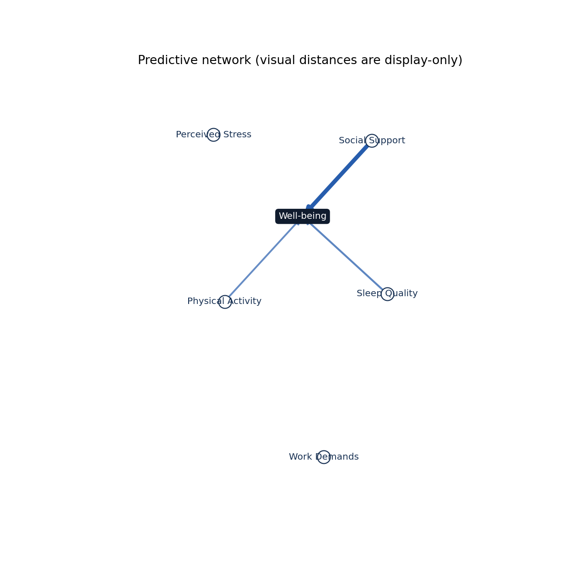
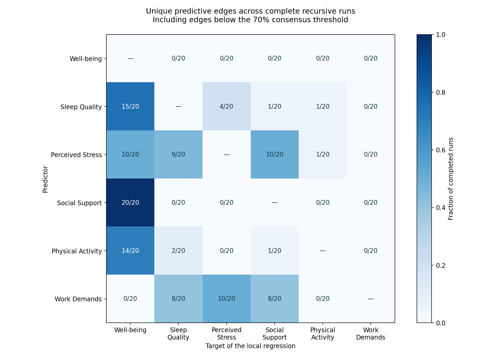
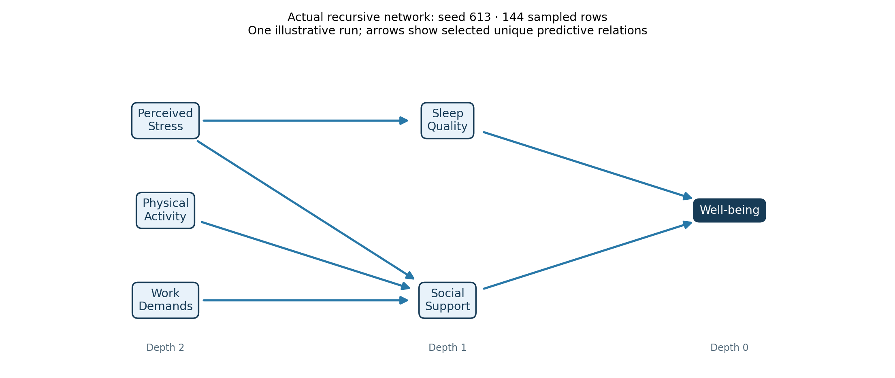

# Six-variable Well-being demonstration

Recovered original simulation: 180 independent synthetic rows, seed 613,
continuous composite scores clipped to 1–5. Root: Well-being. Candidates:
Social Support, Sleep Quality, Perceived Stress, Physical Activity, Work Demands.
These are generated values, not observed respondents or validated scales.

Engine: `0c158017f45b0d7d43eb1b5aecc57deb125d6773`. Completed: 20; failed: 0;
captured warnings: `{}`. Maximum depth: 2.
Two outer folds, two tuning folds, 80% subsamples (144 rows), seeds 613–632.
Original thresholds retained: unique/broad 0.05, total gain 0.02, group 0.10,
dependence 0.70, consensus 0.70. Only the resample count and, where stated,
depth limit differ from the original five-run example.

## Predicting Well-being

Median baseline held-out MSE: **0.4661**;
median full-model MSE: **0.2302**;
median per-run relative gain: **50.7%**.
These are separate medians, not a ratio calculated from the two median MSEs.

| Retained consensus edge | Count / complete runs |
|---|---:|
| Physical Activity → Well-being | 14/20 |
| Sleep Quality → Well-being | 15/20 |
| Social Support → Well-being | 20/20 |



## Evidence that the recursive regressions ran

| Target | Local regressions evaluated |
|---|---:|
| Well-being | 20 |
| Sleep Quality | 15 |
| Perceived Stress | 10 |
| Social Support | 20 |
| Physical Activity | 14 |
| Work Demands | 0 |

A selected node is analyzed as a target when it has remaining candidates and is
below the depth limit. All targets in a layer use the same unassigned candidate
set. Variables already assigned to that layer or closer to Well-being are excluded.
Consequently a variable selected at the root cannot also serve as an upstream
predictor of another depth-1 target in that same run. No residuals are passed on.

| Upstream unique edge | All complete networks | When target evaluated and source eligible |
|---|---:|---:|
| Perceived Stress → Physical Activity | 1/20 | 1/8 |
| Perceived Stress → Sleep Quality | 9/20 | 9/9 |
| Perceived Stress → Social Support | 10/20 | 10/10 |
| Physical Activity → Sleep Quality | 2/20 | 2/6 |
| Physical Activity → Social Support | 1/20 | 1/6 |
| Sleep Quality → Perceived Stress | 4/20 | 4/4 |
| Sleep Quality → Physical Activity | 1/20 | 1/5 |
| Sleep Quality → Social Support | 1/20 | 1/5 |
| Work Demands → Perceived Stress | 10/20 | 10/10 |
| Work Demands → Sleep Quality | 8/20 | 8/15 |
| Work Demands → Social Support | 8/20 | 8/20 |

The consensus threshold uses **all completed networks**, not the conditional
eligibility denominator. The last column explains opportunity and is descriptive;
it does not replace the configured consensus rule or establish calibrated stability.
No upstream edge passes 70% in this run.
Low whole-network frequencies can coexist with consistent local selection when
eligible, because the variable's assigned layer changes between runs.



## One actual recursive network: seed 613

The first planned run reaching the maximum observed depth is shown for illustration.
This is one network, not the consensus or a claim about stability. All its selected
variables and unique edges come from the saved run snapshot.



## First planned run: seed 613

This run is shown by its fixed order, not selected for a desirable graph.

| Target | Actual layer-frozen candidate set | Promoted predictors |
|---|---|---|
| Well-being | Sleep Quality, Perceived Stress, Social Support, Physical Activity, Work Demands | Sleep Quality, Social Support |
| Sleep Quality | Perceived Stress, Physical Activity, Work Demands | Perceived Stress |
| Social Support | Perceived Stress, Physical Activity, Work Demands | Perceived Stress, Physical Activity, Work Demands |

Full per-run evidence: [recursive regressions](recursive_regressions.csv),
[graph snapshots and stop reasons](recursion_trace.json), and
[whole-path frequencies](summary.json). Paths are counted from complete
networks, not multiplied from separate edge probabilities.

## Branch stopping reasons

| Target | Reason | Runs |
|---|---|---:|
| Perceived Stress | MAX_DEPTH | 10 |
| Physical Activity | LOW_TOTAL_GAIN | 13 |
| Physical Activity | MAX_DEPTH | 3 |
| Sleep Quality | MAX_DEPTH | 5 |
| Social Support | LOW_TOTAL_GAIN | 10 |
| Work Demands | MAX_DEPTH | 18 |

LOW_TOTAL_GAIN means that target's held-out model did not meet the gain floor.
NO_UNASSIGNED means there were no remaining variables to regress on.
MAX_DEPTH marks a selected boundary node, not a fitted regression or an execution error.

## Original example and reproduction

[Original comparison](original_comparison.json) retains the first five run seeds
and their consensus. When the original artifact directory is supplied, it also
checks the reproduced rounded CSV, identical sampled row positions, and all
19 local regression risks from the original five-run demonstration.

Matched **19** original local regressions; maximum absolute full-MSE difference **8.33e-17** (floating-point roundoff). Original rounded input and sampled rows match.

```powershell
python examples/run_survey_demo.py --output NEW_DIRECTORY --resamples 20 --max-depth 2
```

The input is saved at full precision, matching the earlier generator's in-memory
analysis. Its old CSV was rounded to six decimal places. Input hashes, config,
dependencies, run row positions and engine revision are retained in the bundle.
The runner uses existing batch, aggregation and consensus APIs; memory profiling
is disabled, so its runtime is not comparable to a profiled historical run.

## Interpretation limits

This correlated survey-style simulation exercises the recursive engine; it is
not scientific validation. Selected arrows are predictive and can run opposite
to the generating equations. For example Stress predicting Social Support does
not establish that stress causes support. A zero or omitted edge is not evidence
of independence. The five-variable candidate set, sample size, noise, regularization,
root assignment and thresholds all affect which cascades recur. Higher-order group
discovery and calibrated selection error are not validated by this demonstration.

## Matched depth-limit check

The [depth-2 report](../2026-10-07-survey/REPORT.md) and [depth-5 report](../2026-10-07-survey-depth5/REPORT.md) use the same input, 20 sampled row sets and analytical thresholds. Only the depth cap differs. Raising it adds seven local regressions (79 → 86), while root risks and the three retained root edges are unchanged. No branch in the depth-5 run hits the cap: branches end through low total gain or no remaining candidates. Maximum observed depth is 3.

The complete Work Demands → Perceived Stress → Sleep Quality → Well-being path appears in 1/20 networks. It is a measured recursive path, but falls below the 70% consensus threshold. Stress → Sleep Quality is selected in 9/9 eligible local analyses and 9/20 whole networks; changing root/layer assignment explains the denominator difference. [Exact depth comparison](depth_comparison.json).
