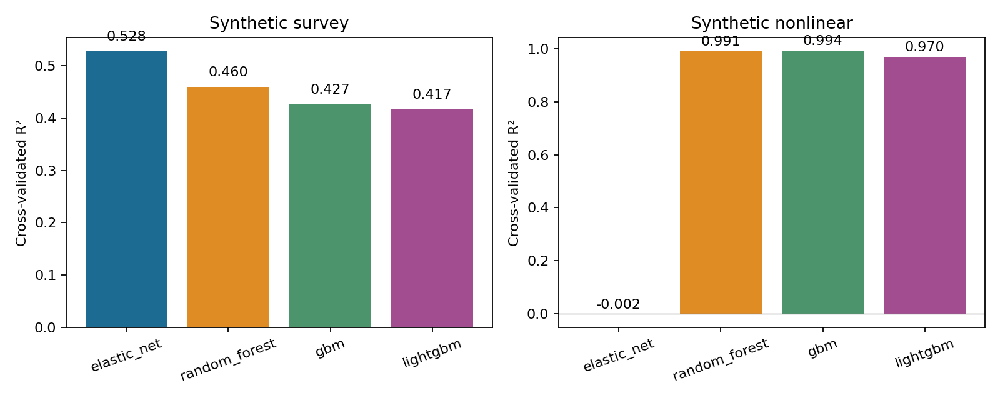
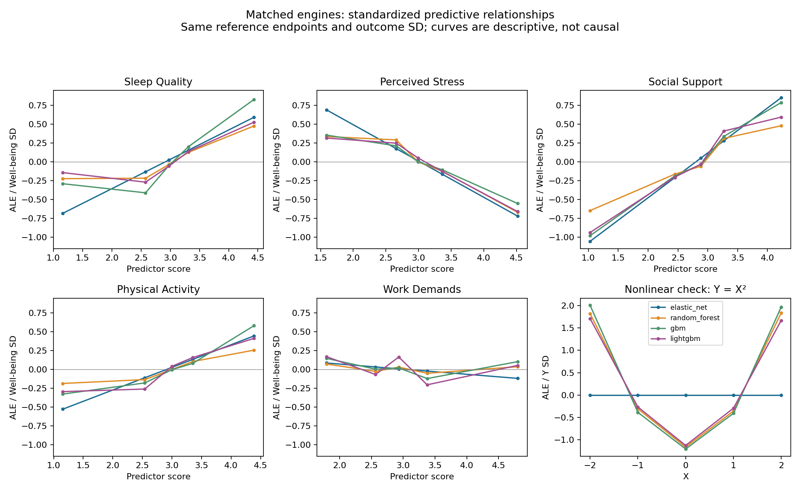

# Matched engine comparison: synthetic demonstrations

New fixed-target nested-CV comparisons; these are not the earlier 20-resample network analysis. No engine is chosen as a winner and no consensus network is pooled across engines.

Survey: the same 180 saved rows and all five Well-being candidates. Shared three outer folds, two inner folds, seed 613. ALE uses four quantile bins (including both contrast endpoints), held-out reference rows, and common reference outcome SD. Nonlinear check: 120 deterministic rows, Y = X², seed 13, same CV dimensions.

## Prediction performance

| Engine | Survey CV R² | Nonlinear CV R² |
| --- | ---: | ---: |
| elastic_net | 0.5282 | -0.0023 |
| random_forest | 0.4600 | 0.9915 |
| gbm | 0.4268 | 0.9941 |
| lightgbm | 0.4172 | 0.9702 |

## Comparable effects on Well-being

Signed standardized ALE contrast: change along the estimated prediction function from predictor Q25 to Q75. Overall curve magnitude is the empirical SD of the combined curve evaluated at observed predictor values. Both use Well-being SD units, but magnitude is unsigned and captures a U shape without endpoint cancellation. ΔCV R² is the unique loss in predictive R² after removing that predictor; it is a different quantity. These are descriptive predictive summaries, not causal effects or coefficients.

| Predictor | Engine | Q25→Q75 contrast (Y SD) | Curve magnitude (Y SD) | Unique ΔCV R² | Contrast / magnitude status |
| --- | --- | ---: | ---: | ---: | --- |
| Sleep Quality | elastic_net | +0.2868 | +0.2257 | +0.0357 | available / available |
| Sleep Quality | random_forest | +0.3435 | +0.1833 | +0.0353 | available / available |
| Sleep Quality | gbm | +0.6134 | +0.3167 | +0.0510 | available / available |
| Sleep Quality | lightgbm | +0.4081 | +0.2047 | +0.0497 | available / available |
| Perceived Stress | elastic_net | -0.3415 | +0.2628 | +0.0267 | available / available |
| Perceived Stress | random_forest | -0.4161 | +0.2439 | +0.0650 | available / available |
| Perceived Stress | gbm | -0.3188 | +0.2006 | +0.0405 | available / available |
| Perceived Stress | lightgbm | -0.3767 | +0.2306 | +0.0345 | available / available |
| Social Support | elastic_net | +0.4885 | +0.3510 | +0.1027 | available / available |
| Social Support | random_forest | +0.4745 | +0.2555 | +0.1350 | available / available |
| Social Support | gbm | +0.5242 | +0.3428 | +0.1241 | available / available |
| Social Support | lightgbm | +0.6114 | +0.3354 | +0.1560 | available / available |
| Physical Activity | elastic_net | +0.2446 | +0.1856 | +0.0319 | available / available |
| Physical Activity | random_forest | +0.2398 | +0.1222 | +0.0202 | available / available |
| Physical Activity | gbm | +0.2602 | +0.1942 | +0.0327 | available / available |
| Physical Activity | lightgbm | +0.4189 | +0.2073 | +0.0316 | available / available |
| Work Demands | elastic_net | -0.0552 | +0.0417 | +0.0009 | available / available |
| Work Demands | random_forest | -0.0257 | +0.0269 | +0.0022 | available / available |
| Work Demands | gbm | -0.1252 | +0.0602 | +0.0034 | available / available |
| Work Demands | lightgbm | -0.1370 | +0.1041 | -0.0101 | available / available |

## Joint removal diagnostic

Social Support and Sleep Quality are removed together on the same held-out observations. This is the total predictive contribution of the pair, including unique and overlapping information; it does not establish that this pair is redundant or promote a shared group into the network.

| Engine | Joint ΔCV R² |
| --- | ---: |
| elastic_net | +0.1316 |
| random_forest | +0.1763 |
| gbm | +0.2034 |
| lightgbm | +0.1996 |

## U-shaped fixture: contrast versus magnitude

| Engine | Q25→Q75 contrast (Y SD) | Overall curve magnitude (Y SD) |
| --- | ---: | ---: |
| elastic_net | +0.0000 | +0.0000 |
| random_forest | -0.0519 | +0.8980 |
| gbm | -0.0227 | +0.9642 |
| lightgbm | -0.0306 | +0.8407 |

## Interpretation and limits

In the nonlinear fixture, elastic net can only fit a straight line; the tree engines can learn the U-shaped relationship. The Q25→Q75 contrast can be near zero despite substantial overall curve magnitude. Magnitude measures typical variation of the first-order curve, not unique importance, variance explained, or all interactions. An interaction can average to a flat first-order curve while still helping prediction. Inspect the curve together with predictive R². Magnitude depends on the reference distribution and bin resolution; no universal effect-size cutoffs are assigned.

Every engine shares the data, folds and effect-size reference. Elastic net searches 25 tuning candidates; each tree engine searches four. This is not an equal-budget benchmark, an engine-selection test, or a scientific calibration. No confidence intervals are inferred from folds. Different recursive networks require separately labeled candidate sets.

[Survey JSON](survey/comparison.json), [survey effect table](survey/effects.csv), [nonlinear JSON](nonlinear/comparison.json), [nonlinear effect table](nonlinear/effects.csv), [audit](audit.json).

[Method and usage](../../../docs/engines-and-effect-sizes.md).

## Verification

Full Python 3.11 suite: **468 passed**, 29 existing warnings. Focused Python 3.14 effect checks: **15 passed**. Four-engine demonstrations captured zero warnings. Independent review verified all 24 magnitudes and found no actionable issue. Prior scoring, curves, contrasts, and plot bytes match the preceding comparison.

[Verification record](verification.json) records the independent magnitude calculations, CSV/JSON agreement, non-regression audit, and test evidence. These checks do not scientifically calibrate the magnitude or supply confidence intervals.
