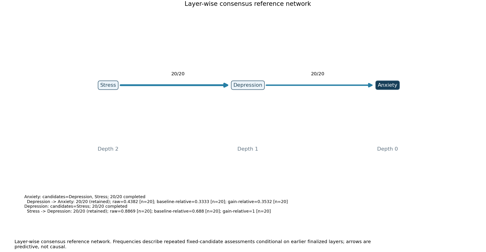
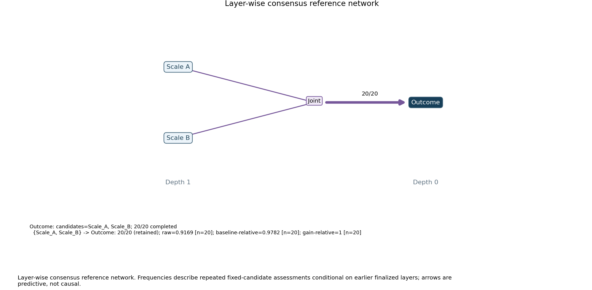

# Layer-consensus regression demonstrations

These fixed synthetic fixtures illustrate software behavior; they do not calibrate the method.

All cases use 20 assessments per target, 80% subsampling, seed 27, two outer/tuning folds,
depth cap 3, unique relevance cutoff .15, and stability cutoff .70. Settings match the historical fixtures.

| Fixture | Result | Completed assessments | Warnings |
| --- | --- | --- | --- |
| chain | {'Anxiety': 0, 'Depression': 1, 'Stress': 2} | 40/40 | 0 |
| chain_missing | {'Anxiety': 0, 'Depression': 1, 'Stress': 2} | 40/40 | 0 |
| shared_predictors | {'Outcome': 0, 'Scale_A': 1, 'Scale_B': 1} | 20/20 | 0 |

The chain expands from Anxiety to Depression, then to Stress. Each retained link is 20/20.
The identical chain with one missing Depression outcome still completes; sampled target coverage is
63 observed + 1 missing or 64 observed + 0 missing. Missing target values are excluded, never imputed.
The near-copy scales are retained jointly in 20/20 assessments. Both enter depth 1; no unique
member arrow is invented. The single joint loss contrast belongs to the pair.

## chain

[Summary](chain/summary.json), [offline audit](chain/audit.json),
[configuration](chain/config.yaml), [sample](chain/sample.csv),
[all assessments](chain/bundle/assessment_ledger.json).

## chain_missing

[Summary](chain_missing/summary.json), [offline audit](chain_missing/audit.json),
[configuration](chain_missing/config.yaml), [sample](chain_missing/sample.csv),
[all assessments](chain_missing/bundle/assessment_ledger.json).

## shared_predictors

[Summary](shared_predictors/summary.json), [offline audit](shared_predictors/audit.json),
[configuration](shared_predictors/config.yaml), [sample](shared_predictors/sample.csv),
[all assessments](shared_predictors/bundle/assessment_ledger.json).

Frequencies describe stability conditional on earlier finalized layers, not confidence,
causal direction or empirical whole-path probability. Actual counts and precision are in the saved bundles.
Fit revision is recorded per case; later audit validation and display formatting do not change fitted scores.
