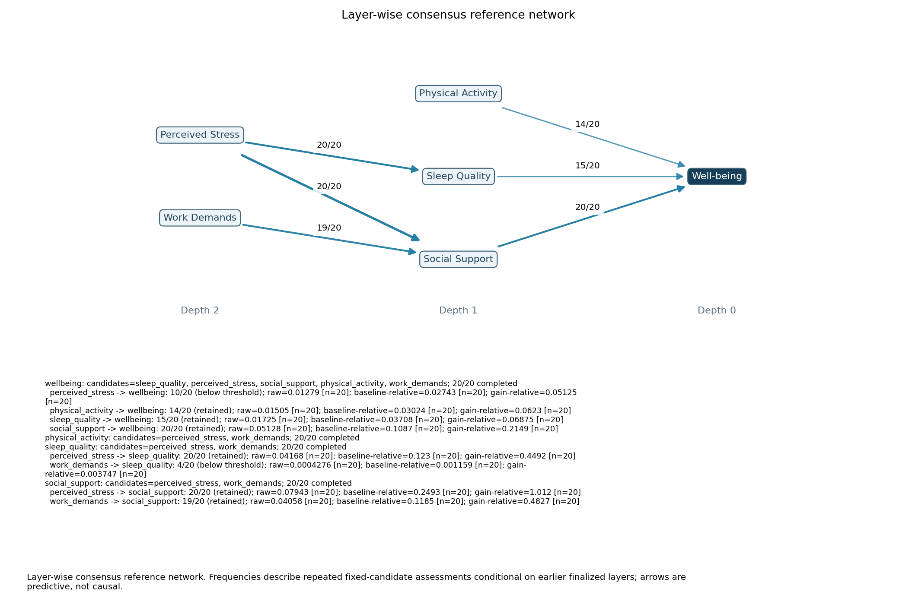

# Layer-consensus survey demonstration

**Synthetic data only.** 180 rows; Well-being is the outcome. Fixed seed 613.

Reference status: **COMPLETE**. Each scheduled target has 20 planned assessments.

[Effect-size supplement](effect_sizes/REPORT.md): recovered signed raw and standardized elastic-net coefficients, cross-validated R², unique ΔCV R², and a coefficient plot. All 160 original outer models were reconstructed and matched saved full-model MSE within 1.12e-16. These descriptive coefficients use the original candidate sets and do not change the retained network.



Layer-wise consensus reference network. Frequencies describe repeated fixed-candidate assessments conditional on earlier finalized layers; arrows are predictive, not causal.

## Simple reading of the 70% result

| Predictor of Well-being | Selected / planned | Direct link retained? |
| --- | --- | --- |
| Social Support | 20/20 | Yes |
| Sleep Quality | 15/20 | Yes |
| Physical Activity | 14/20 | Yes |
| Perceived Stress | 10/20 | No |
| Work Demands | 0/20 | No |

First, OPEN finalized the three direct predictors. Then each of those three
became a target, tested 20 times against the same remaining candidates:
Perceived Stress and Work Demands.

- Perceived Stress predicted Sleep Quality in **20/20** assessments.
- Perceived Stress predicted Social Support in **20/20** assessments.
- Work Demands predicted Social Support in **19/20** assessments.
- Work Demands predicted Sleep Quality in only **4/20**, so that link was not retained.
- Neither remaining variable supplied a retained predictor of Physical Activity.

This assigned Stress and Work Demands together to depth 2. All six variables
were then assigned, so recursion stopped normally. **Work Demands -> Stress was
not tested in this reference network:** both were assigned to the same layer,
and OPEN excludes already assigned variables. Its absence does not mean that
relation is weak or absent. Every comparison that was scheduled had all 20 fits.

These are predictions, not causes. In particular, the synthetic generating
formula uses Social Support to generate Stress, yet Stress helps predict Social
Support too. The network does not recover the causal generating order. Work
Demands helping predict Support alongside Stress is also a conditional prediction
finding, not evidence that demands cause changes in support.

The root full model had median baseline MSE **0.4661**, median full MSE **0.2302**,
and median per-assessment relative MSE reduction **50.70%**. These local CV results
match the historical run exactly. They do not validate discovery of the whole network.

At **60%**, the same nodes and links were retained as at 70%. At **80%**, only Social
Support remained a direct predictor. Sleep Quality and Physical Activity then
entered at depth 3 through newly fitted comparisons; this is a changed network,
not the 70% picture with a few arrows hidden. All three constructions completed
80/80 assessments, with zero warnings. Layer placement therefore depends on the
retention threshold even though no assessment is missing.

## What the layers mean

First finalize predictors of Well-being. Only retained sources become next-layer targets. All targets at the same depth share the remaining candidate set. Finalize that entire layer before continuing.

```text
wellbeing: candidates=sleep_quality, perceived_stress, social_support, physical_activity, work_demands; 20/20 completed
  perceived_stress -> wellbeing: 10/20 (below threshold); raw=0.01279 [n=20]; baseline-relative=0.02743 [n=20]; gain-relative=0.05125 [n=20]
  physical_activity -> wellbeing: 14/20 (retained); raw=0.01505 [n=20]; baseline-relative=0.03024 [n=20]; gain-relative=0.0623 [n=20]
  sleep_quality -> wellbeing: 15/20 (retained); raw=0.01725 [n=20]; baseline-relative=0.03708 [n=20]; gain-relative=0.06875 [n=20]
  social_support -> wellbeing: 20/20 (retained); raw=0.05128 [n=20]; baseline-relative=0.1087 [n=20]; gain-relative=0.2149 [n=20]
physical_activity: candidates=perceived_stress, work_demands; 20/20 completed
sleep_quality: candidates=perceived_stress, work_demands; 20/20 completed
  perceived_stress -> sleep_quality: 20/20 (retained); raw=0.04168 [n=20]; baseline-relative=0.123 [n=20]; gain-relative=0.4492 [n=20]
  work_demands -> sleep_quality: 4/20 (below threshold); raw=0.0004276 [n=20]; baseline-relative=0.001159 [n=20]; gain-relative=0.003747 [n=20]
social_support: candidates=perceived_stress, work_demands; 20/20 completed
  perceived_stress -> social_support: 20/20 (retained); raw=0.07943 [n=20]; baseline-relative=0.2493 [n=20]; gain-relative=1.012 [n=20]
  work_demands -> social_support: 19/20 (retained); raw=0.04058 [n=20]; baseline-relative=0.1185 [n=20]; gain-relative=0.4827 [n=20]
```

## Full-construction threshold sensitivity

| Threshold | Status | Assigned depths | Assessments | Graph |
| --- | --- | --- | --- | --- |
| 0.60 | COMPLETE | {'perceived_stress': 2, 'physical_activity': 1, 'sleep_quality': 1, 'social_support': 1, 'wellbeing': 0, 'work_demands': 2} | 80/80 completed | [graph](sensitivity/0.60/network.png) |
| 0.70 | COMPLETE | {'perceived_stress': 2, 'physical_activity': 1, 'sleep_quality': 1, 'social_support': 1, 'wellbeing': 0, 'work_demands': 2} | 80/80 completed | [graph](network.png) |
| 0.80 | COMPLETE | {'perceived_stress': 2, 'physical_activity': 3, 'sleep_quality': 3, 'social_support': 1, 'wellbeing': 0, 'work_demands': 2} | 80/80 completed | [graph](sensitivity/0.80/network.png) |

Each threshold is fitted independently on identical seeded samples. Differences upstream can change later candidate sets. These graphs are separate conditional reference networks, not image filters.

## Audit and limitations

Input SHA256: `105cec06b74d47f0ff67e0cc6e0e4fa5719d8595ef477fa58a47ea16f8db6548`. Engine revision: `52f29d4eb8e7177b14f7b329cc763647624e007d`.
Reference fits: 1044 outer, 30000 tuning; runtime 742.04s; 0 captured warnings.
Local nested CV evaluates prediction for the current candidates; it does not independently validate discovery of the entire network. Frequencies are conditional stability descriptions, not confidence or calibrated error rates. Arrows do not establish causality. No empirical whole-path probability is available. Thresholds are development defaults, not scientifically calibrated.

[Summary](summary.json), [warnings](warnings.json), [sample](sample.csv), [configuration](config.yaml),
[metadata](bundle/analysis_metadata.json), [all layer evidence](bundle/layer_evidence.json),
[assessment ledger](bundle/assessment_ledger.json), [local targets](bundle/local_targets.csv).

## Verification and execution provenance

[Offline matched-data audit](audit.json) and [verification record](verification.json)
confirm all 240 scheduled assessments completed, every evaluated target had 20
opportunities, and all three thresholds have identical root local snapshots.
Historical root risks and raw/normalized unique scores match exactly (maximum
absolute difference 0, tolerance 1e-12).

The analysis process launched from revision `9ed7aa8`. Per-fit Git HEAD snapshots
in the original metadata differ because review/validation/display corrections
were committed while the long batch ran. Those original fields are preserved.
`verification.json` records the launch revision, each observed HEAD, and identical
Git blob hashes for the numerical computation modules. Final strict reload and
plotting use revision `83e9fce`.

Compute time with allocation profiling was 743.00s (60%), 742.04s (70%), and
812.03s (80%): about 38.3 minutes total. The fits used 3,296 outer model fits and
94,000 tuning model fits. No speed improvement or scientific calibration is claimed.

Final software verification: Python 3.11 full suite **440 passed**, 29 warnings (25 constant-outcome optimizer warnings and 4 missing-CJK-font warnings in test labels); Python 3.14 focused suite **122 passed**, 4 font warnings. All real survey and fixture analyses captured zero warnings. Independent review findings were corrected with failing-then-passing regressions; final manual plot inspection also corrected hidden arrowheads.
