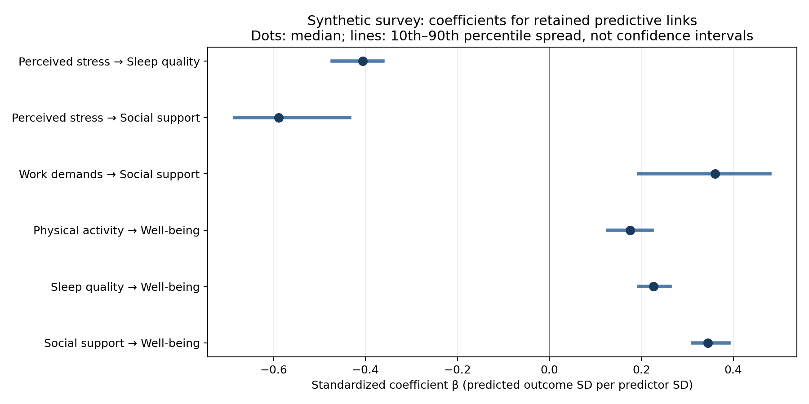

# Synthetic survey effect sizes

Recovered from the original 70% layer-consensus analysis. No selection rules or network structure changed.

## How to read the numbers

**Standardized β:** a one-SD higher predictor corresponds to β SD higher/lower predicted outcome, holding the other local candidates fixed. These are regularized elastic-net coefficients, not OLS coefficients or causal effects.

**Raw b:** predicted outcome points per one predictor point. These synthetic scales are not validated questionnaire instruments.

**ΔCV R²:** the loss in cross-validated R² after removing that predictor and refitting with the original fixed ablation hyperparameters. This is a dimensionless unique predictive contribution, not the square of β. Contributions need not add to total R².

β and b are medians of per-assessment fold medians over all 20 assessments, including assessments where the relationship did not qualify. The percentile spread describes variation across overlapping samples; it is not a confidence interval.

Cohen’s d is a standardized difference between groups; these predictors are continuous, so no artificial high/low split or conversion to d was made.

## Retained relationships

| Predictor → outcome | Raw b | Standardized β | β 10th–90th percentile | ΔCV R² |
| --- | ---: | ---: | ---: | ---: |
| Perceived stress → Sleep quality | -0.428 | -0.406 | -0.472 to -0.362 | +0.1255 |
| Perceived stress → Social support | -0.624 | -0.588 | -0.685 to -0.434 | +0.2495 |
| Work demands → Social support | +0.362 | +0.360 | +0.194 to +0.480 | +0.1185 |
| Physical activity → Well-being | +0.190 | +0.176 | +0.126 to +0.224 | +0.0311 |
| Sleep quality → Well-being | +0.271 | +0.226 | +0.194 to +0.263 | +0.0371 |
| Social support → Well-being | +0.402 | +0.344 | +0.312 to +0.391 | +0.1105 |

## All predictors of Well-being

| Predictor | Standardized β | ΔCV R² | Retained direct link? |
| --- | ---: | ---: | --- |
| Perceived stress | -0.262 | +0.0276 | No |
| Physical activity | +0.176 | +0.0311 | Yes |
| Sleep quality | +0.226 | +0.0371 | Yes |
| Social support | +0.344 | +0.1105 | Yes |
| Work demands | -0.035 | -0.0010 | No |

## Overall prediction and conditioning

- Physical activity: median local cross-validated R² = **-0.0156**.
- Sleep quality: median local cross-validated R² = **0.2452**.
- Social support: median local cross-validated R² = **0.2128**.
- Well-being: median local cross-validated R² = **0.5032**.

The Well-being coefficients adjust for all five original predictors, even though only three direct links passed the stability threshold. Sleep Quality, Social Support, and Physical Activity models each adjust for both Perceived Stress and Work Demands. Coefficients depend on these adjustment sets; they are not a single structural equation model and should not be multiplied into indirect causal effects.

R² here uses the held-out outcome variance. This differs slightly from the existing baseline-relative score, whose denominator is the error from training-fold mean predictions. Both are invariant to changing outcome measurement units, but neither guarantees comparability across different populations, measurement reliabilities, or model specifications.

## Verification

All 80 original assessments and 160 outer models were reconstructed. Maximum absolute difference from saved full-model MSE: 1.11e-16 (required < 1e-12). Raw coefficients also reproduce pipeline predictions to numerical precision. Captured warnings: 0.

[Detailed coefficients](effect_sizes.csv), [assessment-level values](assessment_effect_sizes.csv), [fold coefficients and tuning parameters](fold_coefficients.csv), [prediction performance](prediction_performance.csv), [verification](verification.json), [reproduction script](reproduce.py).

Method references: [standardized coefficients](https://easystats.github.io/parameters/articles/standardize_parameters_effsize.html), [Cohen’s d](https://easystats.github.io/effectsize/reference/cohens_d.html), [elastic-net coefficients](https://scikit-learn.org/1.7/modules/generated/sklearn.linear_model.ElasticNet.html).

Synthetic demonstration only. No post-selection confidence intervals, population effect claims, or independent validation of the discovered network are provided.
