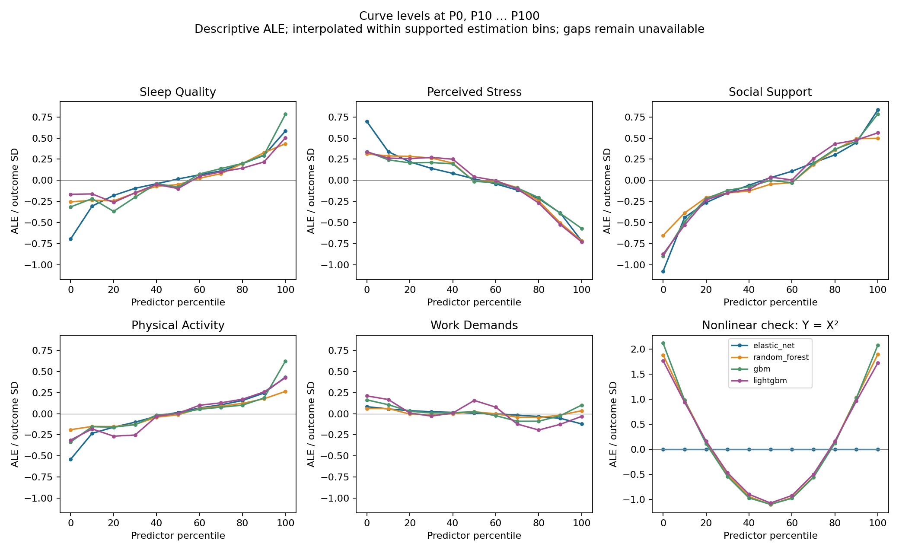
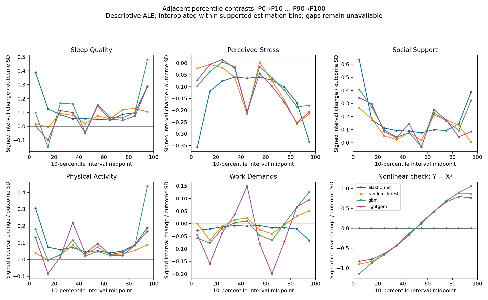
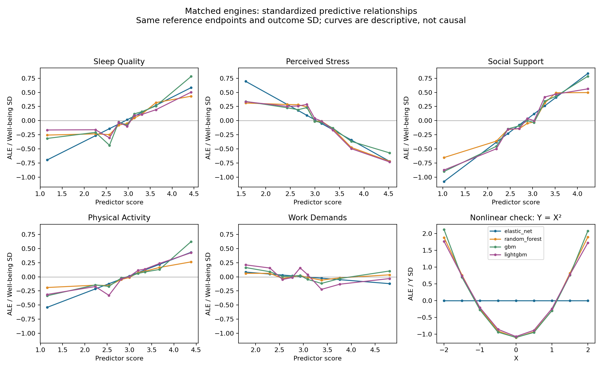

# Matched engine comparison: synthetic demonstrations

New fixed-target nested-CV comparisons; these are not the earlier 20-resample network analysis. No engine is chosen as a winner and no consensus network is pooled across engines.

Survey: the same 180 saved rows and all five Well-being candidates. Shared three outer folds, two inner folds, seed 613. Requested ALE resolution: 10 quantile bins, with Q25/Q75 boundaries also included. Held-out covariate support selected 8 nominal bins for the survey and 8 for the nonlinear fixture, before fitting any engine. Nonlinear check: 120 deterministic rows, Y = X², seed 13, same CV dimensions. Both use held-out reference rows and common reference outcome SD.

## Prediction performance

| Engine | Survey CV R² | Nonlinear CV R² |
| --- | ---: | ---: |
| elastic_net | 0.5282 | -0.0023 |
| random_forest | 0.4600 | 0.9915 |
| gbm | 0.4268 | 0.9941 |
| lightgbm | 0.4172 | 0.9702 |

## Comparable effects on Well-being

Signed standardized ALE contrast: change along the estimated prediction function from predictor Q25 to Q75. Overall curve magnitude is the empirical SD of the combined curve evaluated at observed predictor values. Both use Well-being SD units, but magnitude is unsigned and captures a U shape without endpoint cancellation. ΔCV R² is the unique loss in predictive R² after removing that predictor; it is a different quantity. These are descriptive predictive summaries, not causal effects or coefficients.

| Predictor | Engine | Q25→Q75 contrast (Y SD) | Curve magnitude (Y SD) | Unique ΔCV R² | Contrast / magnitude status |
| --- | --- | ---: | ---: | ---: | --- |
| Sleep Quality | elastic_net | +0.2868 | +0.2257 | +0.0357 | available / available |
| Sleep Quality | random_forest | +0.3608 | +0.2032 | +0.0353 | available / available |
| Sleep Quality | gbm | +0.5936 | +0.2516 | +0.0510 | available / available |
| Sleep Quality | lightgbm | +0.4133 | +0.1769 | +0.0497 | available / available |
| Perceived Stress | elastic_net | -0.3415 | +0.2628 | +0.0267 | available / available |
| Perceived Stress | random_forest | -0.4236 | +0.2892 | +0.0650 | available / available |
| Perceived Stress | gbm | -0.3263 | +0.2341 | +0.0405 | available / available |
| Perceived Stress | lightgbm | -0.4268 | +0.2964 | +0.0345 | available / available |
| Social Support | elastic_net | +0.4885 | +0.3510 | +0.1027 | available / available |
| Social Support | random_forest | +0.4672 | +0.3007 | +0.1350 | available / available |
| Social Support | gbm | +0.4907 | +0.3480 | +0.1241 | available / available |
| Social Support | lightgbm | +0.5711 | +0.3531 | +0.1560 | available / available |
| Physical Activity | elastic_net | +0.2446 | +0.1856 | +0.0319 | available / available |
| Physical Activity | random_forest | +0.2546 | +0.1283 | +0.0202 | available / available |
| Physical Activity | gbm | +0.2552 | +0.1673 | +0.0327 | available / available |
| Physical Activity | lightgbm | +0.4647 | +0.1988 | +0.0316 | available / available |
| Work Demands | elastic_net | -0.0552 | +0.0417 | +0.0009 | available / available |
| Work Demands | random_forest | -0.0290 | +0.0323 | +0.0022 | available / available |
| Work Demands | gbm | -0.1221 | +0.0650 | +0.0034 | available / available |
| Work Demands | lightgbm | -0.1751 | +0.1192 | -0.0101 | available / available |

## Percentile curves and adjacent changes

The first graph shows centered ALE levels at P0, P10 … P100. The second shows signed P0→P10, P10→P20 … P90→P100 changes, plotted at interval midpoints. Positive means the fitted prediction rises; negative means it falls; zero means a supported flat segment. These are model-effect points, not individual-person scatterplots or absolute expected outcome scores. Actual predictor values accompany each point and interval in the CSV tables.

Percentile points interpolate the supported piecewise-linear ALE curve. Coarser estimation bins do not create ten independently estimated segments. Adjacent contrasts integrate supported local bin increments; an empty bin withholds any interval crossing it, while an interval outside the gap can remain available. Tied endpoints have zero width and remain unavailable. Aggregate estimates require support in every contributing fold and use the same nonmissing-reference weights as the original contrast.

P0 and P100 are observed extremes and can be sensitive to unusual values. A 10-percentile step can span very different score distances. Nonempty bins are a minimum support check, not a guarantee of precision. These displays do not change model selection, path retention, or the consensus threshold.

[Survey percentile points](survey/percentile_points.csv), [survey adjacent changes](survey/interval_contrasts.csv), [nonlinear percentile points](nonlinear/percentile_points.csv), [nonlinear adjacent changes](nonlinear/interval_contrasts.csv).

Original score-axis curves: 

## Joint removal diagnostic

Social Support and Sleep Quality are removed together on the same held-out observations. This is the total predictive contribution of the pair, including unique and overlapping information; it does not establish that this pair is redundant or promote a shared group into the network.

| Engine | Joint ΔCV R² |
| --- | ---: |
| elastic_net | +0.1316 |
| random_forest | +0.1763 |
| gbm | +0.2034 |
| lightgbm | +0.1996 |

## U-shaped fixture: contrast versus magnitude

| Engine | Q25→Q75 contrast (Y SD) | Overall curve magnitude (Y SD) |
| --- | ---: | ---: |
| elastic_net | +0.0000 | +0.0000 |
| random_forest | -0.0519 | +0.9431 |
| gbm | -0.0227 | +0.9830 |
| lightgbm | -0.0306 | +0.8874 |

## Interpretation and limits

In the nonlinear fixture, elastic net can only fit a straight line; the tree engines can learn the U-shaped relationship. The Q25→Q75 contrast can be near zero despite substantial overall curve magnitude. Magnitude measures typical variation of the first-order curve, not unique importance, variance explained, or all interactions. An interaction can average to a flat first-order curve while still helping prediction. Inspect the curve together with predictive R². Magnitude depends on the reference distribution and bin resolution; no universal effect-size cutoffs are assigned.

Every engine shares the data, folds and effect-size reference. Elastic net searches 25 tuning candidates; each tree engine searches four. This is not an equal-budget benchmark, an engine-selection test, or a scientific calibration. No confidence intervals are inferred from folds. Different recursive networks require separately labeled candidate sets.

[Survey JSON](survey/comparison.json), [survey effect table](survey/effects.csv), [nonlinear JSON](nonlinear/comparison.json), [nonlinear effect table](nonlinear/effects.csv), [audit](audit.json).

[Method and usage](../../../docs/engines-and-effect-sizes.md).
