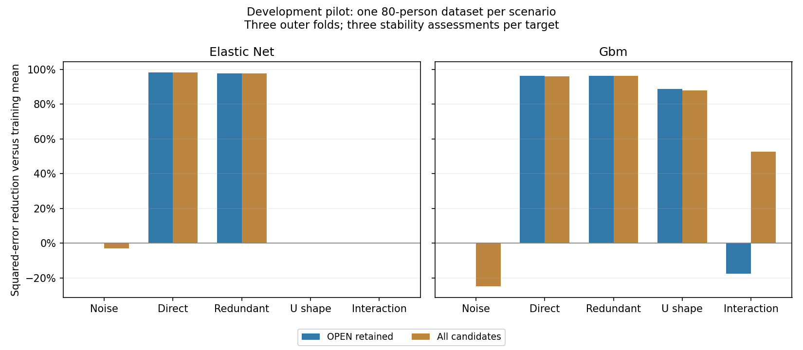

# Complete-procedure evaluation: development evidence

This checks implementation on predefined synthetic examples. It does not calibrate defaults, uncertainty, error rates or causal pathways.

[Protocol](protocol.md) · [Software verification](verification.json) · [Independent evidence audit](audit.json)

## Well-being survey example

Status: **COMPLETE**; 180 participants, three outer folds, elastic net, ten assessments per scheduled target and 70% retention.

| Model | RMSE | Predictive R² | Squared-error reduction vs baseline |
| --- | ---: | ---: | ---: |
| Training mean | 0.686 | -0.002 | 0.0% |
| OPEN retained predictors | 0.505 | 0.457 | 45.8% |
| All five candidates | 0.468 | 0.533 | 53.4% |

[Unified survey report and graphs](survey/REPORT.md). It includes the full-data descriptive reference network and root effects separately from held-out prediction. Good root prediction does not confirm indirect links.

## Predefined pilot

| Scenario | Engine | Status | Retained predictor skill | All-candidate skill |
| --- | --- | --- | ---: | ---: |
| noise | elastic_net | COMPLETE | 0.0% | -2.9% |
| direct | elastic_net | COMPLETE | 98.2% | 98.3% |
| redundant | elastic_net | COMPLETE | 97.8% | 97.8% |
| u_shape | elastic_net | COMPLETE | 0.0% | 0.0% |
| interaction | elastic_net | COMPLETE | 0.0% | 0.0% |
| noise | gbm | COMPLETE | 0.0% | -24.9% |
| direct | gbm | COMPLETE | 96.2% | 96.1% |
| redundant | gbm | COMPLETE | 96.3% | 96.3% |
| u_shape | gbm | COMPLETE | 88.8% | 88.0% |
| interaction | gbm | COMPLETE | -17.4% | 52.6% |

Zero means equal prediction to the training-mean baseline; negative means worse. A value of 50% means half as much squared prediction error, not a 50% path effect.

The direct and redundant examples retained useful predictors. Both engines retained no predictors in the noise example. Elastic net missed the U shape; GBM retained its signal and predicted well in this dataset.

**Important limitation:** the interaction-only GBM example predicted well with both original candidates, but the retained predictor sets were empty, empty, and just `b`. At B=3, two selections out of three (66.7%) fail the 70% cutoff. Some local fits also had insufficient predictive gain. Retained-model prediction was worse than the baseline, although the full model reduced squared error by 52.6%. This is an observed selection limitation in this small pilot, not a calculation exception. More runs reduce resampling noise but do not guarantee recovery; no thresholds were retuned.

Tree models can learn interactions when both inputs are supplied. The recursive selection procedure can nevertheless discard those inputs. Independent interaction discovery and default calibration need dedicated scientific evaluation.

## Reproduction and remaining gate

Run `examples/run_procedure_evaluation.py --output NEW_DIRECTORY` from the checkout with the recorded dependencies; then run `examples/audit_procedure_evaluation.py NEW_DIRECTORY`. This script rebuilds only the overview from the saved outputs. Source fingerprints and per-network revision records identify the executed implementation.

All attempted folds, warnings, training-only networks, selected sets, tuning parameters and predictions are saved. The final scientific gate needs a separately frozen larger scenario/grid/confirmation protocol, including placement and shared-class errors, interactions, measurement error, missingness and computational cost. P6 remains unaccepted.
