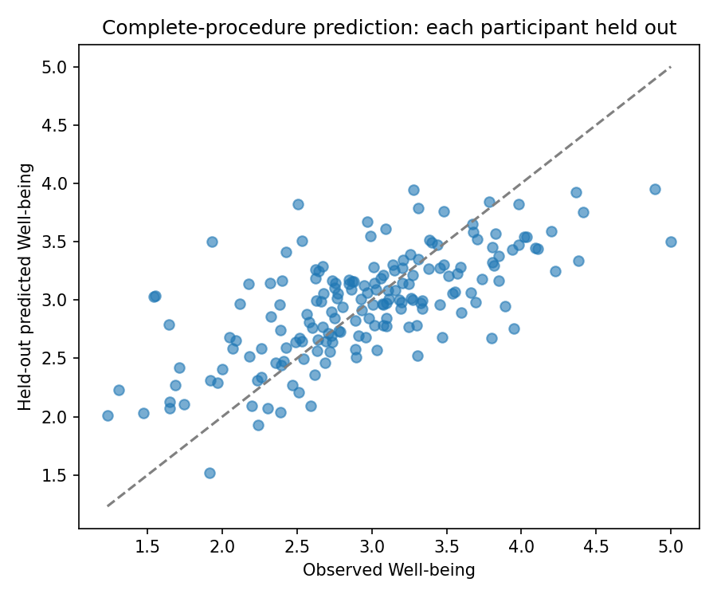
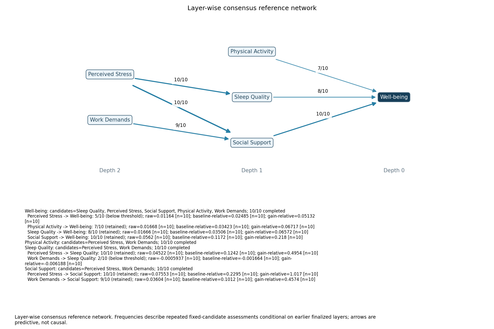
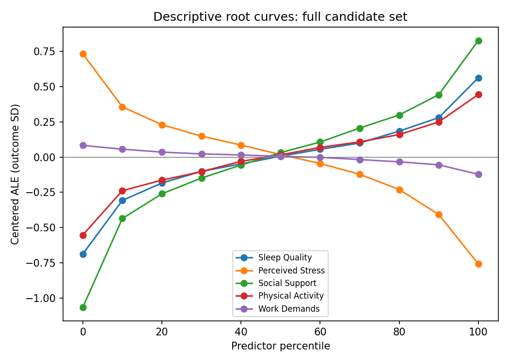

# OPEN researcher report: Well-being

Complete-procedure evaluation: **COMPLETE**; 3/3 folds completed.

This evaluates root prediction, not SEM global fit or the correctness of indirect pathways.

Engine: `elastic_net`. Retention threshold: 70%. Independent participant rows: 180.

## Does the selected predictor set predict new participants?

Each fold discovers its own complete network using training participants only. Retained direct predictors (including joint members) are then separately tuned/refitted. The all-candidate comparator is separately tuned on the same training participants. No held-out participants enter discovery, preprocessing or tuning.

| Predictor | RMSE (outcome units) | R² | Prediction skill |
| --- | ---: | ---: | ---: |
| Training-mean baseline | 0.686 | -0.002 | 0.000 |
| OPEN retained predictors | 0.505 | 0.457 | 0.458 |
| All original candidates | 0.468 | 0.533 | 0.534 |

Lower RMSE means smaller prediction errors. R² compares squared errors with the variation of the pooled held-out outcomes. Prediction skill compares errors with the training-mean baseline: 0 means equal performance; negative means worse; 0.30 means 30% less squared prediction error. It is not a path effect size.

| Fold | Status | Retained direct predictors | Failure |
| --- | --- | --- | --- |
| 0 | completed | Sleep Quality, Social Support | — |
| 1 | completed | Sleep Quality, Perceived Stress, Social Support | — |
| 2 | completed | Perceived Stress, Social Support, Physical Activity | — |

Fold predictor sets can differ. These are training-fold discoveries, not one consensus graph assembled from their arrows. Settings must be fixed before this evaluation; selecting settings after inspecting these scores needs new confirmation data.

## What does the descriptive reference network show?

The reference network is discovered separately using all supplied participants. Its relation frequencies are conditional on finalized earlier layers. This is descriptive evidence, not independent confirmation of its structure.

Reference status: **COMPLETE**.

| Relation | Retained / planned | Frequency | Margin above threshold |
| --- | ---: | ---: | ---: |
| Physical Activity → Well-being | 7/10 | 70.0% | 0.0 percentage points |
| Sleep Quality → Well-being | 8/10 | 80.0% | 10.0 percentage points |
| Social Support → Well-being | 10/10 | 100.0% | 30.0 percentage points |
| Perceived Stress → Sleep Quality | 10/10 | 100.0% | 30.0 percentage points |
| Perceived Stress → Social Support | 10/10 | 100.0% | 30.0 percentage points |
| Work Demands → Social Support | 9/10 | 90.0% | 20.0 percentage points |

A small margin means the link is close to the chosen display/retention cutoff. The cutoff is not a confidence level or false-discovery guarantee. An omitted relation does not establish independence.

| Local target | Completed / planned | Median baseline MSE | Median full MSE |
| --- | ---: | ---: | ---: |
| Well-being | 10/10 | 0.472 | 0.234 |
| Physical Activity | 10/10 | 0.383 | 0.381 |
| Sleep Quality | 10/10 | 0.336 | 0.245 |
| Social Support | 10/10 | 0.349 | 0.268 |

These local CV scores are conditional on discovered candidates, not complete-procedure validation. Targets can have different observed participants and different units; do not average their MSEs into a network fit score.

## How large and what shape are the root predictive associations?

These descriptive root effects use the **full candidate set** on the full supplied dataset. They are separate from the retained-predictor model evaluated above.

| Predictor | Unique ΔCV R² | Q25 → Q75 (outcome SD) | Curve magnitude (outcome SD) |
| --- | ---: | ---: | ---: |
| Sleep Quality | 0.020 | 0.281 | 0.221 |
| Perceived Stress | 0.021 | -0.360 | 0.277 |
| Social Support | 0.108 | 0.484 | 0.348 |
| Physical Activity | 0.034 | 0.251 | 0.190 |
| Work Demands | 0.001 | -0.055 | 0.042 |

ΔCV R² describes the prediction lost when removing one predictor; it can include interaction contributions. Q25 → Q75 describes a signed curve change. Curve magnitude describes overall average-curve variation and can remain positive for a U shape. None is a causal effect, Cohen’s d, or an additive share of explained variance. Unavailable effects reflect insufficient support or other recorded limitations.

Percentile points, adjacent contrasts, joint contributions and support evidence are in [the effect supplement](effects/comparison.json).

## What still needs checking?

- Threshold sensitivity: **not assessed by this workflow**; reconstruct the full network at other cutoffs.
- Sampling uncertainty and calibrated false-selection rates: **not assessed**.
- Same-depth peer relations and interaction-specific effect curves: **not assessed**.
- Scope: independent cross-sectional scale-level data with a continuous observed root. Grouped, longitudinal and categorical-outcome support is unavailable.
- Scientific validation: development examples do not establish reliable defaults or minimum sample sizes.

Evidence: [evaluation.json](evaluation.json), [predictions.csv](predictions.csv). Training-fold network bundles are saved in `fold_N/`; the full-data reference is in `reference/`.
