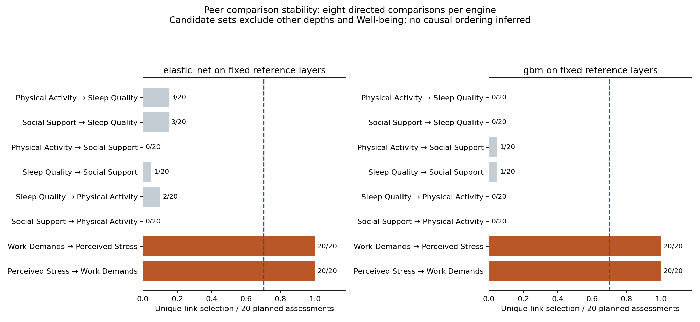
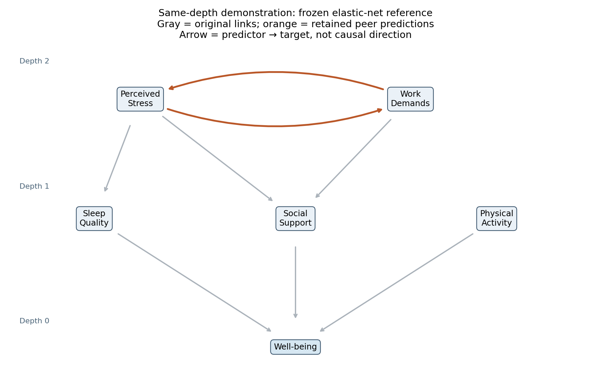

# Within-depth predictive assessment demonstration

Synthetic data only. Existing 180-row survey and audited 70% elastic-net reference layers are frozen. This standalone analysis uses existing APIs; automatic peer scheduling has not been added to the recursive engine.

## Fixed comparisons

Depth 1: each of Social Support, Sleep Quality and Physical Activity is predicted by the other two. Depth 2: Stress is predicted by Work Demands, and Work Demands by Stress. Well-being and variables from other depths are excluded from these peer models. These are conditional on the peer candidate set only: relationships can reflect common upstream influences.

Both engines use the same twenty seeds 613–632, 144-row samples (80% without replacement), two outer folds and two inner tuning folds. Elastic net searches 25 tuning candidates; GBM searches four, so this is not an equal-budget engine benchmark. A unique edge qualifies when the existing local PROXIMAL_UNIQUE class appears in at least 14/20 completed assessments. All candidate comparisons are reported, including nonretained results. Joint relations/classes remain in the full assessment evidence; a joint relation is not converted into individual unique arrows. The CSV median_unique_gain_over_baseline column is the median signed increase in held-out MSE after removing a predictor, divided by the same assessment baseline MSE; it is not an ALE magnitude or a causal effect.

## Results

| Within-depth prediction | Elastic net | GBM |
| --- | ---: | ---: |
| Physical Activity → Sleep Quality | 3/20 not retained | 0/20 not retained |
| Social Support → Sleep Quality | 3/20 not retained | 0/20 not retained |
| Physical Activity → Social Support | 0/20 not retained | 1/20 not retained |
| Sleep Quality → Social Support | 1/20 not retained | 1/20 not retained |
| Sleep Quality → Physical Activity | 2/20 not retained | 0/20 not retained |
| Social Support → Physical Activity | 0/20 not retained | 0/20 not retained |
| Work Demands → Perceived Stress | 20/20 retained | 20/20 retained |
| Perceived Stress → Work Demands | 20/20 retained | 20/20 retained |

## Illustrative overlay

The overlay combines original elastic-net edges with elastic-net peer evidence, leaving all discovery depths unchanged. GBM frequencies are a separate fixed-layer diagnostic: the reference layers were not rediscovered using GBM. A reciprocal pair is shown as two predictive arrows, never resolved into a causal direction by comparing scores.

## Interpretation

A retained peer arrow means its source helped predict the peer target with the other peer variables accounted for, consistently under the existing selection rule. It does not show that one variable causes another. A chain drawn in the overlay is a series of separately supported predictions; its indirect effect and full-path stability have not been estimated. Do not multiply curve magnitudes, contrasts or selection frequencies to obtain an indirect effect.

The original discovery used the same data: this is an exploratory post-discovery illustration, not independent confirmation of layer placement. Testing more peer pairs introduces additional selection opportunities; the existing 70% threshold is not a calibrated multiple-testing correction.

RF/GBM/LightGBM can learn feature interactions without manual product terms, but that does not guarantee recovery of every interaction. Tree size, tuning, noise and sample size matter. First-order percentile ALE curves average across the other predictors and can hide interaction structure. Assessing peer predictability is different from quantifying an interaction in the Well-being model.

[Peer edge table](peer_edges.csv), [assessment evidence](assessment_evidence.json), [audit](audit.json), [reproduction script](reproduce.py), [sample](sample.csv), [original network report](../2026-10-08-survey-layer-consensus/REPORT.md).
