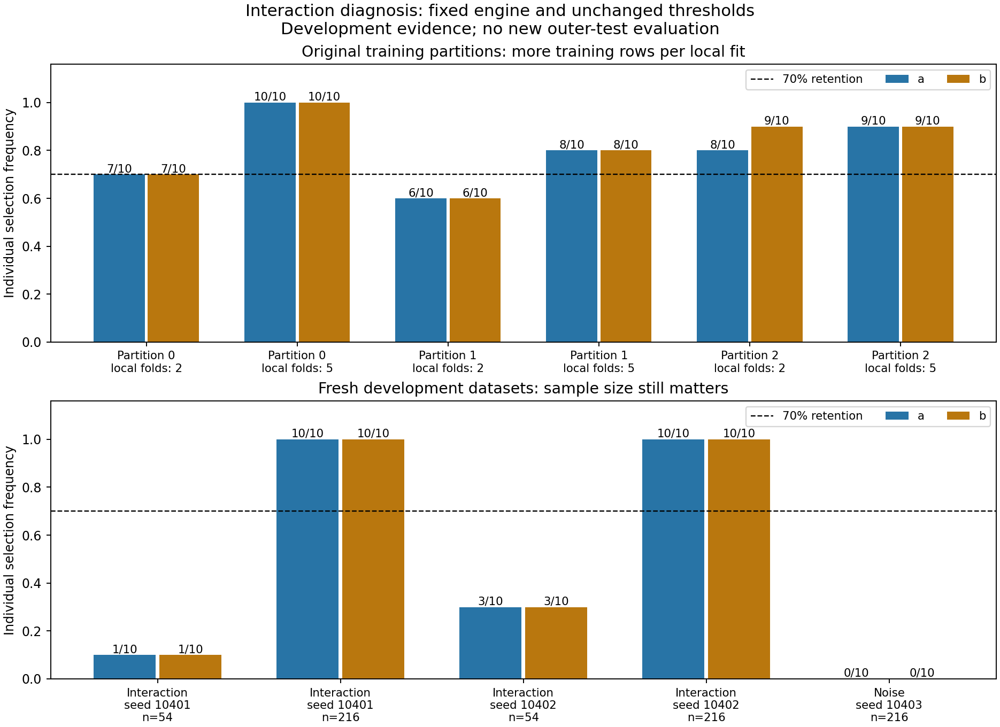

# Interaction-selection investigation

The local rule can recognize interaction inputs. In this example, small local
training sets and coarse three-assessment consensus caused lost inputs.
No production selection rule, engine, tuning grid or threshold was changed.



| Training dataset | Local folds | Assessments | a selected | b selected | Retained | Low-gain stops |
|---|---:|---:|---:|---:|---|---:|
| original-fold-0-k2 | 2 | 3 | 2/3 | 2/3 | none | 1 |
| original-fold-0-k2 | 2 | 10 | 7/10 | 7/10 | a, b | 3 |
| original-fold-0-k5 | 5 | 3 | 3/3 | 3/3 | a, b | 0 |
| original-fold-0-k5 | 5 | 10 | 10/10 | 10/10 | a, b | 0 |
| original-fold-1-k2 | 2 | 3 | 1/3 | 1/3 | none | 2 |
| original-fold-1-k2 | 2 | 10 | 6/10 | 6/10 | none | 4 |
| original-fold-1-k5 | 5 | 3 | 3/3 | 3/3 | a, b | 0 |
| original-fold-1-k5 | 5 | 10 | 8/10 | 8/10 | a, b | 2 |
| original-fold-2-k2 | 2 | 3 | 2/3 | 3/3 | b | 0 |
| original-fold-2-k2 | 2 | 10 | 8/10 | 9/10 | a, b | 1 |
| original-fold-2-k5 | 5 | 3 | 3/3 | 3/3 | a, b | 0 |
| original-fold-2-k5 | 5 | 10 | 9/10 | 9/10 | a, b | 1 |
| fresh-interaction-10401-n54 | 5 | 3 | 0/3 | 0/3 | none | 3 |
| fresh-interaction-10401-n54 | 5 | 10 | 1/10 | 1/10 | none | 9 |
| fresh-interaction-10401-n216 | 5 | 3 | 3/3 | 3/3 | a, b | 0 |
| fresh-interaction-10401-n216 | 5 | 10 | 10/10 | 10/10 | a, b | 0 |
| fresh-interaction-10402-n54 | 5 | 3 | 1/3 | 1/3 | none | 2 |
| fresh-interaction-10402-n54 | 5 | 10 | 3/10 | 3/10 | none | 7 |
| fresh-interaction-10402-n216 | 5 | 3 | 3/3 | 3/3 | a, b | 0 |
| fresh-interaction-10402-n216 | 5 | 10 | 10/10 | 10/10 | a, b | 0 |
| fresh-noise-10403-n216 | 5 | 3 | 0/3 | 0/3 | none | 3 |
| fresh-noise-10403-n216 | 5 | 10 | 0/10 | 0/10 | none | 10 |

## What happened

Nine original root assessments were reproduced against the saved evidence.
Three stopped because the full model failed the 2% predictive-gain gate.
Of the other six, five retained both inputs and one retained only b.
The original consensus therefore retained neither input in two partitions
and only b in the third. Two out of three is 66.7%, below 70%.

This was not a requirement that inputs predict well alone. For example, the
first original assessment had negative standalone contributions for both
inputs but positive conditional contributions and retained both.
Conditional ablation removes one input while the other remains; it can
detect a jointly useful input even when its standalone model is poor.

The original outer-training partitions contained 53/54 people. Subsampling
left 42/43. Two local folds trained each full model on only 21/22 people;
two-fold tuning inside that trained candidates on roughly 10/11.
Five local folds trained on 33–35 people and tuned on roughly 16–18.
The CV change alters both training size and validation partitions, so these
comparisons cannot isolate training size as the sole causal explanation.

At ten assessments, two local folds retained both in two of three original
partitions. Five local folds retained both in all three, at 10/10, 8/10,
and 9/10. More repetitions alone did not resolve the second partition.

## Viable next step

Use the existing research defaults (five local performance folds, two
repeats; the default assessment budget is 100), with settings fixed before
outer evaluation. This investigation used one repeat and ten assessments;
it has not calibrated those defaults. Do not treat a two-fold/three-run
speed check as a dependable structural analysis. More assessments estimate
repeatability more precisely; they do not make weak individual fits stronger.

Continue comparing retained-input prediction with the all-candidate model.
If selection loses substantial prediction, report a possible loss of useful
inputs; do not call absent arrows proof of no relationship. No universal
size of an acceptable performance gap has been calibrated.

Before changing selection policy, run a separate multi-seed development
study with noise, additive, redundancy, interaction and chain cases, then
freeze independent confirmation cases. Measure missed inputs, false links,
depth/class errors and prediction loss, along with actual per-fit sample
sizes and low-gain stop rates. Stop short of accepting a new policy if it
rescues interactions by routinely admitting noise or disturbing redundancy.

If adequate-data validation still loses useful combinations, a separate
prediction-preserving retention step is a candidate design: compare the
consensus input set against richer sets using training-only validation.
It would require its own tuning/validation layer and honest distinction
between stable network links and extra prediction inputs. It should not
silently promote unstable inputs into the recursive network. No such step
or interaction-group label is implemented or validated here.

## Scope and reproducibility

110 local assessments; nine exact original replays; eleven conditions.
Fresh cases are small development probes, not scientific calibration.
Only original outer-training rows are used for refitting. No new held-out
score or engine/threshold choice is made from the old test outcomes.
Prefixes and overlapping subsamples are dependent; counts are not confidence
probabilities. Original unfavorable results remain unchanged.

The new diagnostic script initially used an incorrect ledger field name,
then omitted the original outer-fold seed offset. Assertions stopped both
attempts. The corrected run verifies all nine replays; completed matching
conditions were reused only after input/configuration checks. These were
diagnostic-script errors, not discovered production-engine defects.

Reproduce from the repository root:

```powershell
python examples/investigate_interaction_selection.py
python examples/audit_interaction_investigation.py
python examples/build_interaction_investigation_report.py
```

The runner refuses an existing destination unless `--resume` is explicit.
See [protocol](protocol.md), [summary](summary.json), [audit](audit.json),
and [assessment table](assessments.csv); per-condition JSON retains local
risk arithmetic, classifications and realized samples/splits.

General CV background: [scikit-learn cross-validation guide](https://scikit-learn.org/stable/modules/cross_validation.html).
