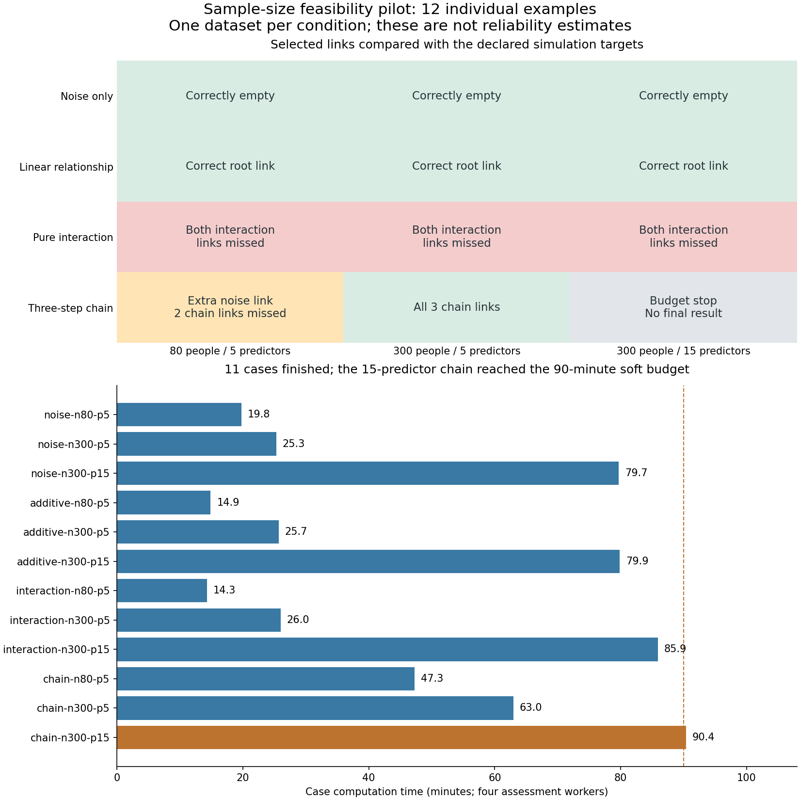

# Sample-size feasibility pilot: findings

GitHub Actions run [38099118007](https://github.com/imh-ds/open/actions/runs/38099118007) finished successfully.
**11 of 12 datasets completed. The 300-person, 15-predictor chain stopped at the soft time budget.**
The successful workflow includes explicit incomplete-case reporting; it does not mean every analysis completed.

## What the examples showed

- All three linear examples retained the intended predictor without an extra root link.
- All three noise examples retained no links.
- All three pure-interaction examples retained neither required predictor.
- The 300-person, five-predictor chain recovered all three expected links and depths.
- The 80-person chain recovered its required direct predictor, also retained an unrelated predictor, and missed both indirect links.
- The 300-person, 15-predictor chain is incomplete. It is not a statistical failure or a validated recovery.

## Prediction and structure are different

In the 300-person, five-predictor interaction example, the all-input model had independent-test skill .172,
but each required predictor was promoted in only 49/100 assessments; 51 assessments stopped for low gain.
Both fell below the unchanged 70% retention requirement, leaving an empty selected model with skill zero.
In the other interaction examples the all-input model itself predicted poorly: skill −.090 at N80/p5
and .007 at N300/p15. Those cases are not evidence of a strong fitted model whose links were merely filtered out.
The population oracle root R-squared is .60 in the signal scenarios. Independent-test oracle skills vary
with test draws. The interaction problem requires examining learning behavior as well as sample size.

The unrelated x4 predictor in the 80-person chain was promoted in 89/100 assessments and retained.
This is a false root link under the declared data generator. Repeated subsamples reuse the same dataset:
stability does not guarantee a genuine population relationship. Its cause has not been diagnosed here.

## Case-level evidence

| Case | Complete | Full-model test skill | Selected-model test skill | Oracle test skill | Seconds |
|---|---|---:|---:|---:|---:|
| noise-n80-p5 | complete | -0.210 | 0.000 | -0.000 | 1185.0 |
| noise-n300-p5 | complete | -0.058 | 0.000 | 0.002 | 1517.2 |
| noise-n300-p15 | complete | -0.048 | 0.000 | -0.000 | 4782.6 |
| additive-n80-p5 | complete | 0.493 | 0.543 | 0.594 | 891.9 |
| additive-n300-p5 | complete | 0.539 | 0.549 | 0.580 | 1541.0 |
| additive-n300-p15 | complete | 0.522 | 0.542 | 0.600 | 4791.2 |
| interaction-n80-p5 | complete | -0.090 | 0.000 | 0.598 | 859.1 |
| interaction-n300-p5 | complete | 0.172 | 0.000 | 0.631 | 1558.8 |
| interaction-n300-p15 | complete | 0.007 | 0.000 | 0.578 | 5153.6 |
| chain-n80-p5 | complete | 0.449 | 0.428 | 0.582 | 2835.3 |
| chain-n300-p5 | complete | 0.557 | 0.562 | 0.592 | 3777.1 |
| chain-n300-p15 | incomplete | unavailable | unavailable | unavailable | 5421.2 |

## Feasibility and limits

Case computation totaled 571.9 minutes (9.53 runner hours), excluding setup, artifact transfer and audit.
The full workflow ran about four hours with three concurrent case jobs.
Completed five-predictor root jobs took approximately 14–26 minutes; 15-predictor root jobs took 80–86 minutes.
The completed five-predictor chains took 47 and 63 minutes. Increasing concurrent case jobs shortens scheduling
delay but does not make an individual recursive case fit inside its deadline.

Local model/tuning fits used 51–52/34–35 people for N80 and 192/128 people for N300.
The incomplete chain preserved 116 assessments: 100 at the root and 16 in the next comparison.
Overall, 1,616 assessment checkpoints and 22,000 independent test predictions were saved;
no test predictions or final structural scores were accepted for the incomplete case.
Recorded warning count: zero. OS worker process-lifetime memory peaks were about 132–134 MB;
these cannot be summed into a simultaneous whole-job memory estimate.

This pilot has one dataset per condition, one engine, one fold configuration and clean continuous data.
Sample size, predictor count and seed differ across examples; these are not controlled estimates of factor effects.
It establishes no minimum N, reliable false-positive rate, optimal fold count or complete scientific validation.

## Recommended next step

Before dispatching a large guidance grid, investigate the pure-interaction learning/selection behavior and
the stable false root link using targeted, recorded development diagnostics. Use fresh multi-dataset
confirmation for any proposed engine/grid/selection change. Separately budget a checkpointed completion
of the unfinished chain if needed; do not silently rerun or lower B100.
The larger sample-size guidance study remains pending. Production settings were unchanged.

The original Actions report is preserved as [REPORT-from-actions.md](REPORT-from-actions.md).
See [audit.json](audit.json), the frozen [manifest.json](manifest.json), and each case directory for raw evidence.
