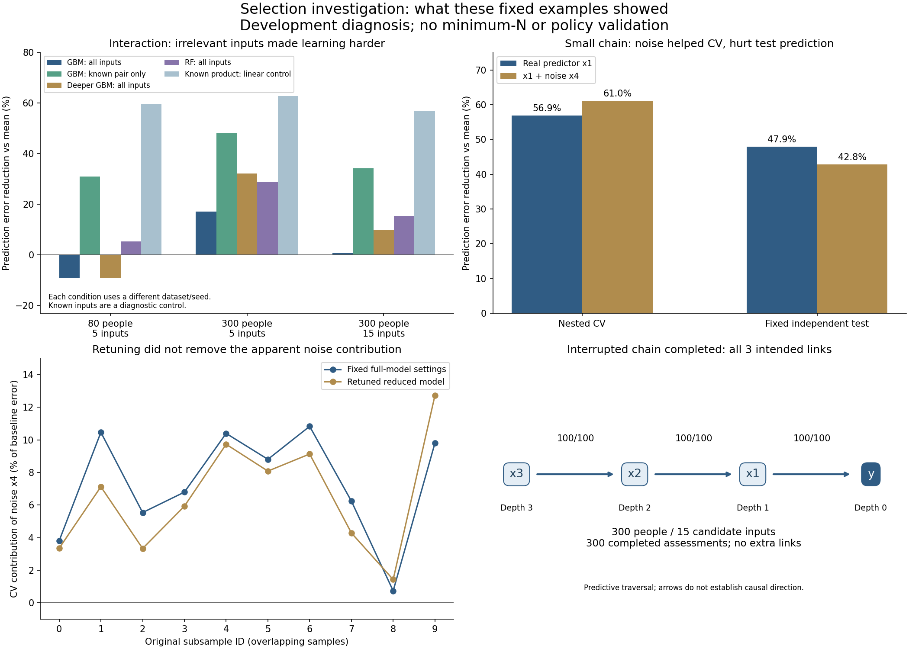

# Selection investigation: findings

[Actions run 38116199436](https://github.com/imh-ds/open/actions/runs/38116199436) succeeded: 96/96 jobs.
**All 74 diagnostics completed. The interrupted chain also completed and recovered all 3 intended links, with no extra links.**

The saved evidence was independently audited locally, including data/split identities, arithmetic and deterministic saved-setting model refits.
No production selection rule, threshold, model grid or historical denominator changed.

## What the investigation indicates

### The recursive engine finished correctly in this example

The original 300-person/15-input chain now retains x1->y, x2->x1 and x3->x2 at the intended depths.
The continuation has 300 complete assessments: 120 reused and 180 new on Actions. Each target used 100 planned assessments before the next layer advanced.
Original pilot completion remains historically 11/12; this is a separately recorded successful continuation. It does not validate arbitrary networks.

| Predictive link | Selected / planned |
|---|---:|
| x1 -> y | 100/100 |
| x2 -> x1 | 100/100 |
| x3 -> x2 | 100/100 |

The retained-input refit reduced test prediction error by 57.2% versus predicting the training mean; the all-input refit reduced it by 55.5%.
Those percentages are baseline-relative prediction skill, not a causal effect or standardized association coefficient.

### Interaction misses were also a model-learning problem

For all three original interaction datasets, restricting GBM to the two known signal inputs improved both nested-CV and fixed-test skill.
The known product-feature linear control predicted well, showing usable signal in these synthetic examples.
This supports difficulty learning the interaction amid nuisance inputs under the tested settings; it does not isolate a population cause or supply an automatic input filter.
The expanded-depth GBM grid and RF improved some all-input comparisons but did not uniformly solve the problem.

| Original discovery dataset | GBM all-input CV | GBM known-pair CV | GBM all-input test | GBM known-pair test | Product-control test |
|---|---:|---:|---:|---:|---:|
| interaction-n80-p5 | -22.2% | 11.7% | -9.0% | 30.9% | 59.8% |
| interaction-n300-p5 | 8.1% | 28.0% | 17.2% | 48.4% | 62.8% |
| interaction-n300-p15 | -8.9% | 32.6% | 0.7% | 34.3% | 57.1% |

These are matched input comparisons within each dataset. Different conditions have different seeds, so the table is not a controlled estimate of N or input-count effects.
Knowing which inputs truly matter is a diagnostic privilege in a simulation; real users do not have that information.
The earlier 49/100 link promotions at N300/p5 remain a selection-loss observation; useful full-model prediction does not guarantee stable link retention.

### The stable noise link was not explained away by ablation retuning

The small-chain x4 noise input had previously been retained in 89/100 assessments.
Across the first 10 matched original samples, its apparent CV contribution stayed positive in 10/10 even when the reduced model was separately retuned.
Mean contribution was 7.34% of baseline error with fixed settings and 6.51% with retuning.
These overlapping samples are not 10 independent population replications.
For the full small-chain discovery sample, GBM with x1 alone had CV skill 56.9% and test skill 47.9%. Adding x4 gave CV skill 61.0% but lower test skill 42.8%.
This pattern is consistent with an apparent benefit specific to this discovery dataset that failed on new test participants. It is not evidence that x4 is a real population predictor.
A 70% retention threshold describes repeatability within one dataset; this example shows that repeatability can retain a noise input.

## Limits and next step

No calculation or recursion error was identified by these checks. Statistical reliability remains unresolved: model-learning limitations and false links still need fresh independent multi-seed validation.
Do not lower the threshold, switch engines, adopt the diagnostic grid, or establish a minimum N from these previously inspected development cases.
The audit independently refits saved parameters; it does not repeat tuning searches to verify winning settings or inner tuning scores.
All 64 model comparisons include their two discovery scopes; the table above summarizes full scope only. See REPORT-from-actions.md and audit.json for every planned result.
Execution/checksum evidence is in execution.json. Finalization elapsed time excludes distributed assessment work.
