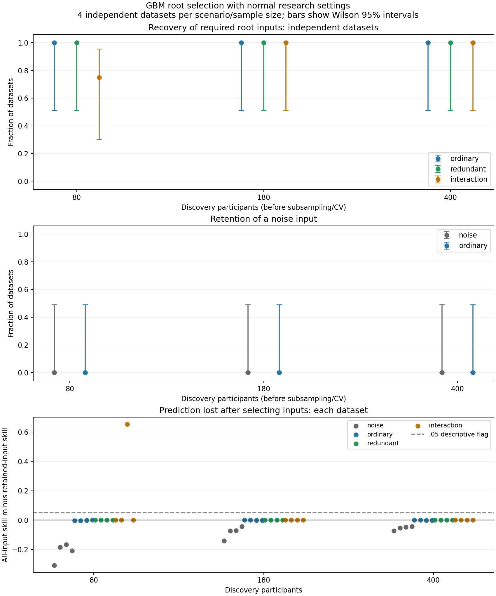

# Root-selection reliability investigation

Fixed GBM; five local folds, two repeats, three tuning folds,100 stability
assessments per dataset,80% subsampling, unchanged70% retention.
Independent test participants are generated after each discovery dataset;
they do not select inputs, engines, thresholds or settings.

Completed 48/48 datasets and 4800/4800 local assessments.
Audited 48000 independent test participants; 0 recorded warnings.



## Results by scenario and sample size

| Scenario | Discovery n | Completed/planned | Root recovered | Noise input retained | Shared group retained | Skill loss >.05 | Mean full skill | Mean retained skill | Mean loss (MC SE) |
|---|---:|---:|---:|---:|---:|---:|---:|---:|---:|
| interaction | 80 | 4/4 | 3/4 | — | — | 1/4 | 0.456 | 0.293 | 0.163 (0.163) |
| interaction | 180 | 4/4 | 4/4 | — | — | 0/4 | 0.659 | 0.659 | 0.000 (0.000) |
| interaction | 400 | 4/4 | 4/4 | — | — | 0/4 | 0.762 | 0.762 | 0.000 (0.000) |
| noise | 80 | 4/4 | 4/4 | 0/4 | — | 0/4 | -0.217 | 0.000 | -0.217 (0.031) |
| noise | 180 | 4/4 | 4/4 | 0/4 | — | 0/4 | -0.082 | 0.000 | -0.082 (0.021) |
| noise | 400 | 4/4 | 4/4 | 0/4 | — | 0/4 | -0.054 | 0.000 | -0.054 (0.006) |
| ordinary | 80 | 4/4 | 4/4 | 0/4 | — | 0/4 | 0.962 | 0.964 | -0.002 (0.001) |
| ordinary | 180 | 4/4 | 4/4 | 0/4 | — | 0/4 | 0.970 | 0.970 | -0.000 (0.000) |
| ordinary | 400 | 4/4 | 4/4 | 0/4 | — | 0/4 | 0.971 | 0.972 | -0.001 (0.000) |
| redundant | 80 | 4/4 | 4/4 | — | 4/4 | 0/4 | 0.961 | 0.961 | 0.000 (0.000) |
| redundant | 180 | 4/4 | 4/4 | — | 4/4 | 0/4 | 0.968 | 0.968 | 0.000 (0.000) |
| redundant | 400 | 4/4 | 4/4 | — | 4/4 | 0/4 | 0.974 | 0.974 | 0.000 (0.000) |

Root recovered means a retained for ordinary, both a and b retained for
interaction, at least one retained for redundancy, and neither retained for
noise. Redundant-group preservation is a separate classification result.
A retained noise input is a false input in the known simulated conditional
mean; it is not evidence about causal arrows. Skill loss is signed: a
negative loss means the retained model predicted better on that test set.
.05 is a predeclared descriptive flag, not an acceptable-gap threshold.

## Failures and local training sizes

| Discovery n | Local subsample n | Full-model fit n | Tuning-model fit n |
|---:|---:|---:|---:|
| 80 | 64 | 51–52 | 34–35 |
| 180 | 144 | 115–116 | 76–78 |
| 400 | 320 | 256–256 | 170–171 |

Each case records its local low-gain stop count, conditional contribution
and promotion/class counts. Low predictive gain is a valid nonselection,
distinct from an execution failure. Incomplete cases preserve their planned
denominators and withhold test scores and cell-level performance estimates.

## Limits and decision boundary

This is a targeted development study of one engine and one root comparison.
It does not validate deeper-layer placement, whole-network recovery,
same-depth links, other engines, weak effects, correlated interaction inputs,
non-Gaussian predictors, measurement error, missingness or real survey data.
The chosen signals are strong and the redundancy nearly exact.

There are four independent datasets per cell. Even4/4recovery has a Wilson
95% interval of approximately51%–100%;0/4noise retention has an interval of
approximately0%–49%. Therefore no observed misses does not prove reliability
and no observed false links does not establish a low false-positive rate.
The100overlapping assessments inside a dataset are not100 independent
simulation replications. Monte Carlo SE reflects variability across the
four datasets, not uncertainty of an individual edge.

The fixed protocol calls for a safeguard design if useful inputs disappear
at n400 in multiple datasets. Loss concentrated at smaller sizes supports
training-size and weak-fit diagnostics first. Neither result calibrates a
minimum sample size or accepts a new production policy. Examine shared-class
fragmentation and noise retention alongside interaction recovery.

## Reproduction and audit

```powershell
python examples/run_selection_reliability.py --workers 8 --output NEW_DIRECTORY
python examples/audit_selection_reliability.py NEW_DIRECTORY
python examples/build_selection_reliability_report.py NEW_DIRECTORY
```

The runner refuses an existing destination unless `--resume` is explicit.
Resume verifies the frozen configuration and dataset identities, validates
production-source fingerprints, and reuses atomic per-assessment checkpoints
under `.superpowers/selection-checkpoints`. Initial and resumed runner
fingerprints remain separate in the manifest. The initial interrupted run
saved only progress counts and had to replay those samples; its counters
are not accepted statistical evidence. Elapsed resumed time excludes that
lost computation and is not a pristine runtime benchmark.
`--smoke` uses deliberately tiny
settings for plumbing checks and is excluded from this study. The smoke
check compares singleton orchestration with the production batch assessor.
An initial smoke-only attribute-name error was corrected before study
dispatch; no study dataset was discarded or changed.

See [fixed protocol](protocol.md), [manifest](manifest.json),
[audit](audit.json), [case table](cases.csv), [summary](summary.json),
and [execution record](execution.json). Each case contains discovery/test
data, predictions, and compressed local evidence. Seeds and recorded hashes
allow exact sample/split reconstruction. The audit recomputes scores, local
gain/normalization and relation/class/retention counts, but does not refit
every local model or independently inspect every tuning decision.

Simulation reporting follows [Morris, White & Crowther (2019)](https://pmc.ncbi.nlm.nih.gov/articles/PMC6492164/).
