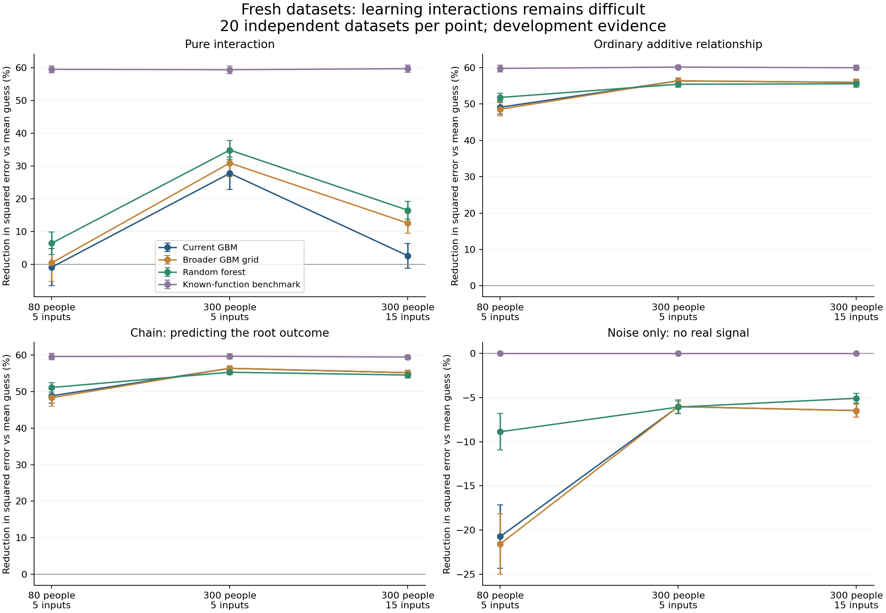

# Fresh independent learner investigation: results

All 960/960 planned method fits completed across 240 fresh datasets. All 122 Actions jobs succeeded. The local data/split/arithmetic audit passed with zero errors and exactly reproduced the Actions audit. There were 0 recorded fit warnings.

## What this means

The interaction-learning concern reproduced across independent datasets. Random forests improved prediction relative to the current GBM and met the frozen development nomination rule. They did not eliminate the difficulty. Increasing sample size helped at five inputs; adding ten nuisance inputs at N300 substantially reduced interaction performance. This pattern is specific to the tested strong pure-interaction simulations.

The known-function benchmark was given the correct product x1*x2. It recovered about 59–60% error reduction in every interaction cell, demonstrating usable signal. The tree models received all candidate predictors without supplied product terms. The benchmark therefore provides a privileged diagnostic, not a fair automated feature-discovery competitor or a requirement that users supply interaction terms.

Test skill is the reduction in squared prediction error relative to guessing the discovery-sample mean. For example, 28% means 28% less squared error; negative values mean worse than that guess. These numbers describe whole-model prediction, not path strengths or coefficients.

| Interaction condition | Current GBM | Broader GBM | Random forest | Known-product benchmark |
|---|---:|---:|---:|---:|
|N80, 5 inputs|-0.8%|0.5%|6.5%|59.5%|
|N300, 5 inputs|27.8%|30.9%|34.9%|59.4%|
|N300, 15 inputs|2.7%|12.6%|16.5%|59.7%|

With N80/p5, GBM beat the mean guess in 10/20 independent datasets and RF in 17/20. With N300/p15, GBM did so in 13/20; broader GBM and RF did so in 20/20. Beating a mean guess is a weak adequacy threshold: RF still recovered only 16.5% error reduction where the known-product benchmark achieved 59.7%. Even 20/20 observed successes has a pointwise Wilson 95% lower bound of about 84%; it does not certify a 90% reliability standard.

For ordinary additive relationships and root prediction in chains, all methods beat the mean guess in all tested datasets. Current GBM averaged about 49% at N80 and 55–56% at N300. RF differences were small: approximately +2–3 percentage points at N80 and −0.4 to −1.1 points at N300. These chain results assess root prediction only; the recursive network was not reconstructed.

In noise-only data, all tree models were worse than the mean guess on all 60 independent test datasets per method. RF nevertheless had positive nested-CV skill in 3/60 noise datasets; none had positive independent-test skill. This illustrates sampling uncertainty in CV, but does not estimate the network false-link rate: no network selection was run here.

Error bars are descriptive, pointwise 95% t intervals for mean skill over 20 independent datasets. They are not simultaneous confidence bounds for a searched method recommendation. See cell-summary.csv for all cells, Wilson success intervals and paired mean differences.

## Frozen development decision

RF improved interaction mean skill over shipped GBM by 7.1 and 13.9 percentage points at the two N300 points, exceeding the prespecified 5-point threshold at both. Its largest additive/chain loss was 1.1 points, within the 5-point allowance. Thus RF is a candidate for the next structural study, not a validated new default. Broader GBM improved interactions by 3.1 and 9.9 points at N300, so it did not meet both required thresholds.

Next: compare current GBM with RF on fresh independent datasets using the actual B100 layer-consensus pipeline. Measure correct and false links, predictive loss after selection, and complete recursive path recovery. Freeze that structural protocol and budget before dispatch. Minimum sample-size guidance and any production-default change require further disjoint confirmation. No new study is dispatched by this closeout.

## Execution and retained evidence

The workflow took 16.0 wall minutes, peaked at 20 allocated concurrent jobs, and used 222.5 summed job minutes (3.71 runner hours), including setup/transfer/audit. These are not CPU time or a controlled speedup estimate.

The archive retains all 9,600 outer-fold records and 960 final prediction sets. There are 435,200 CV prediction rows and 1,920,000 independent-test prediction rows, but only 480,000 unique test participants: each of four methods predicts the same test people. CV repetitions likewise reuse participants. There are 20 independent datasets per cell, not 100 resampling replications or millions of independent study replicates.

Every task on Actions verified fold and final predictions by deterministic refits at saved settings. The local repeated audit regenerated data/splits, checked declared grid membership, tuning fit sizes, identities and arithmetic. It did not repeat all tree refits or independently retune to verify tuning winners.

[Actions run](https://github.com/imh-ds/open/actions/runs/38133443512), [frozen protocol](../../fresh_learning_protocol.md), [original Actions report](REPORT-from-actions.md).

Raw evidence: actions-evidence.zip, 85,732,366 bytes; SHA256 `3ab8bb780b716c478eff2004f7e3967f98f5de86f7a6d90843d3ae4b2e98212f`. Archive CRC verification passed. Manifest, execution metadata, receipt and original Actions audit are preserved here. The ZIP retains complete per-task receipts, fold checkpoints, results, verification receipts and independent-test predictions; it survives Actions artifact expiry.
