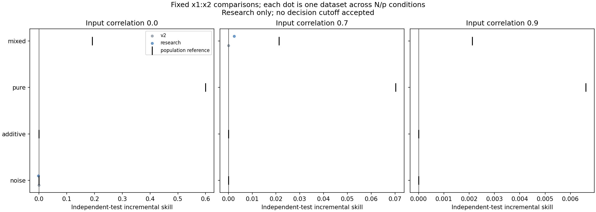

# Correlation study construction preflight

Two of the planned 240 task identities were exercised locally: noise rho=0 N=80,p=5 and mixed rho=.7 N=300,p=5. Both completed with no warnings or audit errors. The remaining 238 are intentionally unrun locally. This checks construction and saved-prediction reproduction; it is not a completed scientific study.

The production comparator and prior frozen studies are unchanged. The research comparator tunes one joint-block weight inside training CV. Results here must not be used to adopt a threshold or minimum sample recommendation. The frozen protocol is [here](../../pair_correlation_protocol.md).

Raw archive contains predictions, checkpoints, settings, timing, receipts and digest-bound saved-setting refit verification. Archive identity is recorded in receipt.json. Focused verification: 26 tests passed in 62.13 seconds; independent review found no remaining actionable issues after corrections. Local preflight used 1,768 fitting/tuning fits and 40 saved-setting refits, taking 20.66 seconds. This is not a new full-suite claim. Launch provenance will be recorded separately.

