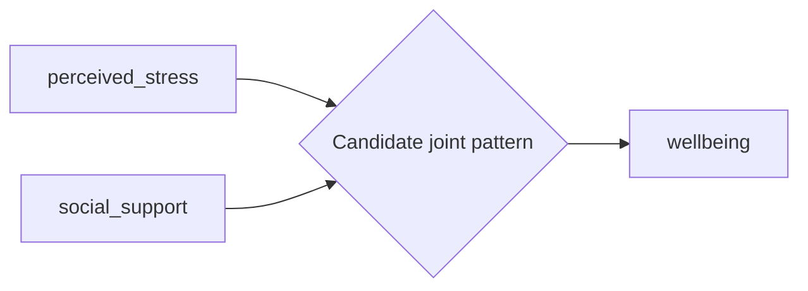
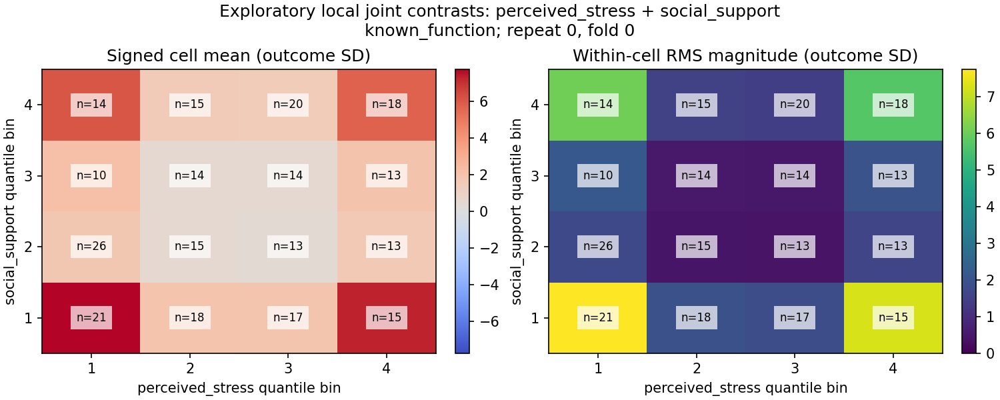

# Exploratory fitted-model interaction patterns

A junction is a candidate joint pattern in fitted predictions, not a validated population interaction. It does not establish causal moderation. Ordinary predictive arrows do not certify separate main effects.

Shortlisting is computational triage. Scores describe local mixed prediction contrasts, not variance explained, coefficients, p-values or full second-order ALE. They can include higher-order interactions. Absence of a junction is not evidence of no interaction.

## known_function

Planned folds: 1; evaluated prediction rows: 3584; additional model fits: 0.

|Pair|Supported screens / planned folds|Shortlisted folds|Supported details|Screen RMS (outcome SD)|Status|
|---|---:|---:|---:|---:|---|
|perceived_stress + physical_activity|1/1|0|0|0|complete_descriptive|
|perceived_stress + sleep_quality|1/1|0|0|0|complete_descriptive|
|perceived_stress + social_support|1/1|1|1|10.62|complete_descriptive|
|perceived_stress + work_demands|1/1|0|0|0|complete_descriptive|
|physical_activity + sleep_quality|1/1|0|0|0|complete_descriptive|
|physical_activity + social_support|1/1|0|0|1.077e-16|complete_descriptive|
|physical_activity + work_demands|1/1|0|0|0|complete_descriptive|
|sleep_quality + social_support|1/1|0|0|1.077e-16|complete_descriptive|
|sleep_quality + work_demands|1/1|0|0|0|complete_descriptive|
|social_support + work_demands|1/1|0|0|0|complete_descriptive|

Displayed 1 of 1 supported detailed candidates; rank is not statistical acceptance.

This shows the first supported detailed fold in saved order, not an aggregate population surface. Cell counts refer to sampled reference observations. Signed means may cancel when effects vary with other variables; RMS retains their magnitude. Bin corners may leave the observed manifold. Other folds and boundaries remain in comparison.json.

