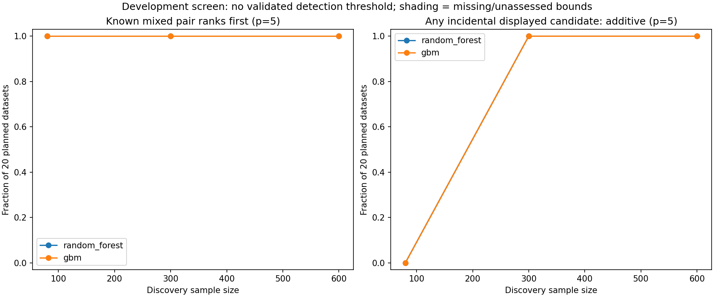

# Pair-screen development results

Completed 960/960 planned tasks; audit errors 0.
Development only. No cutoff or interaction-retention rule is accepted.

Counts retain 20 planned independent datasets per cell. Rank bounds include unassessed pairs and missing tasks.
True detail / any displayed are operational display coverage, not population detection or absence.

|Scenario|N|p|Engine|Complete|True top one bounds|True detail bounds|Any displayed bounds|Mean test skill|
|---|---:|---:|---|---:|---|---|---|---:|
|noise|80|5|random_forest|20/20|NA|NA|[0, 0]|-0.112|
|noise|80|5|gbm|20/20|NA|NA|[0, 0]|-0.245|
|noise|300|5|random_forest|20/20|NA|NA|[20, 20]|-0.065|
|noise|300|5|gbm|20/20|NA|NA|[20, 20]|-0.067|
|noise|600|5|random_forest|20/20|NA|NA|[20, 20]|-0.052|
|noise|600|5|gbm|20/20|NA|NA|[20, 20]|-0.036|
|noise|300|15|random_forest|20/20|NA|NA|[20, 20]|-0.047|
|noise|300|15|gbm|20/20|NA|NA|[20, 20]|-0.064|
|additive|80|5|random_forest|20/20|NA|NA|[0, 0]|0.397|
|additive|80|5|gbm|20/20|NA|NA|[0, 0]|0.427|
|additive|300|5|random_forest|20/20|NA|NA|[20, 20]|0.508|
|additive|300|5|gbm|20/20|NA|NA|[20, 20]|0.533|
|additive|600|5|random_forest|20/20|NA|NA|[20, 20]|0.520|
|additive|600|5|gbm|20/20|NA|NA|[20, 20]|0.545|
|additive|300|15|random_forest|20/20|NA|NA|[20, 20]|0.481|
|additive|300|15|gbm|20/20|NA|NA|[20, 20]|0.505|
|pure|80|5|random_forest|20/20|[20, 20]|[0, 0]|[0, 0]|0.067|
|pure|80|5|gbm|20/20|[18, 18]|[0, 0]|[0, 0]|0.041|
|pure|300|5|random_forest|20/20|[20, 20]|[20, 20]|[20, 20]|0.332|
|pure|300|5|gbm|20/20|[20, 20]|[20, 20]|[20, 20]|0.250|
|pure|600|5|random_forest|20/20|[20, 20]|[20, 20]|[20, 20]|0.434|
|pure|600|5|gbm|20/20|[20, 20]|[20, 20]|[20, 20]|0.341|
|pure|300|15|random_forest|20/20|[20, 20]|[20, 20]|[20, 20]|0.150|
|pure|300|15|gbm|20/20|[17, 17]|[20, 20]|[20, 20]|0.018|
|mixed|80|5|random_forest|20/20|[20, 20]|[0, 0]|[0, 0]|0.405|
|mixed|80|5|gbm|20/20|[20, 20]|[0, 0]|[0, 0]|0.376|
|mixed|300|5|random_forest|20/20|[20, 20]|[20, 20]|[20, 20]|0.508|
|mixed|300|5|gbm|20/20|[20, 20]|[20, 20]|[20, 20]|0.505|
|mixed|600|5|random_forest|20/20|[20, 20]|[20, 20]|[20, 20]|0.542|
|mixed|600|5|gbm|20/20|[20, 20]|[20, 20]|[20, 20]|0.547|
|mixed|300|15|random_forest|20/20|[20, 20]|[20, 20]|[20, 20]|0.494|
|mixed|300|15|gbm|20/20|[20, 20]|[20, 20]|[20, 20]|0.481|
|correlated_additive|80|5|random_forest|20/20|NA|NA|[0, 0]|0.425|
|correlated_additive|80|5|gbm|20/20|NA|NA|[0, 0]|0.422|
|correlated_additive|300|5|random_forest|20/20|NA|NA|[20, 20]|0.501|
|correlated_additive|300|5|gbm|20/20|NA|NA|[20, 20]|0.524|
|correlated_additive|600|5|random_forest|20/20|NA|NA|[20, 20]|0.541|
|correlated_additive|600|5|gbm|20/20|NA|NA|[20, 20]|0.557|
|correlated_additive|300|15|random_forest|20/20|NA|NA|[20, 20]|0.504|
|correlated_additive|300|15|gbm|20/20|NA|NA|[20, 20]|0.511|
|correlated_mixed|80|5|random_forest|20/20|[6, 18]|[0, 0]|[0, 0]|0.463|
|correlated_mixed|80|5|gbm|20/20|[6, 18]|[0, 0]|[0, 0]|0.433|
|correlated_mixed|300|5|random_forest|20/20|[20, 20]|[0, 0]|[20, 20]|0.523|
|correlated_mixed|300|5|gbm|20/20|[20, 20]|[0, 0]|[20, 20]|0.531|
|correlated_mixed|600|5|random_forest|20/20|[19, 20]|[0, 0]|[20, 20]|0.553|
|correlated_mixed|600|5|gbm|20/20|[19, 20]|[0, 0]|[20, 20]|0.565|
|correlated_mixed|300|15|random_forest|20/20|[20, 20]|[0, 0]|[20, 20]|0.512|
|correlated_mixed|300|15|gbm|20/20|[20, 20]|[0, 0]|[20, 20]|0.518|

See summary.csv for assessed-pair fractions and Wilson intervals; cutoff_sensitivity.csv
retains assessed/missing counts and unknown-inclusive exceedance bounds. No cutoff is selected.
