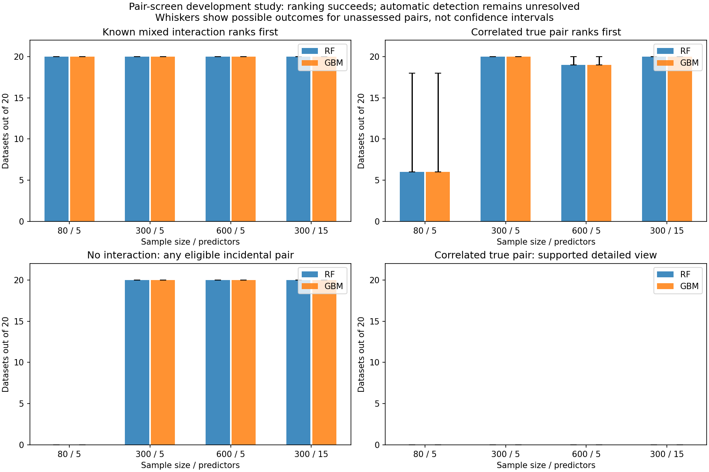

# Pair-screen study: promising rankings, unreliable automatic interaction declarations

The [Actions run](https://github.com/imh-ds/open/actions/runs/38191108998) succeeded in all 242 jobs. All 960 planned RF/GBM analyses over 480 independent datasets completed. Repeated offline audit exactly matches Actions: zero missing cases, audit errors or recorded fit warnings. No cutoff or retention rule is accepted.

## What the results mean

The known interacting pair usually ranked first. RF ranked it first 20/20 in every uncorrelated pure/mixed cell; GBM did so except pure N80,p5 (18/20) and pure N300,p15 (17/20). This supports using the score to prioritize pairs for examination under these simulated conditions. It does not certify population interactions.

The current shortlist cannot separate true interactions from incidental fitted-model nonadditivity. At N300 or N600, both engines produced at least one detail-eligible incidental candidate in 20/20 datasets in every noise, nonlinear-additive and correlated-additive cell. Candidate counts refer to eligibility before the report display cap, not the number of rendered junctions. No interaction was present in those generating functions.

Lack of a detailed plot can instead reflect lack of supported cells. At N80, each outer held-out sample has 26–27 rows; the four-by-four grid requires at least 48 observations (three in each of 16 cells). Thus no detailed grid could qualify, even though the uncorrelated known pairs usually ranked first. A zero displayed-candidate rate here is not evidence of good false-positive control.

With correlated interacting inputs (rho=.7), the known pair never obtained a supported detailed view: 0/20 in every N,p cell for each engine. At N300 it nevertheless ranked first 20/20 for both engines at p5 and p15. At N80 only 8/20 true-pair coarse comparisons were assessed, with 6 ranking first; the remaining 12 are unknown. At N600,19/20 were assessed and all19 ranked first; the remaining one is unknown. Sparse off-diagonal combinations can prevent a complete grid even in a larger dataset.

Ranking is also distinct from learning a strongly predictive model. In pure-interaction N300,p15, RF mean independent-test skill was.150 and GBM.018. High correct-pair ranking alone does not establish large predictive usefulness, accurate effect magnitude or reliable generalization in other populations.

## Compact results

|Condition|RF known pair first|GBM known pair first|True pair eligible for detailed view, RF / GBM|
|---|---:|---:|---:|
|mixed, N80, p5|20/20|20/20|0/20 / 0/20|
|mixed, N300, p5|20/20|20/20|20/20 / 20/20|
|mixed, N600, p5|20/20|20/20|20/20 / 20/20|
|pure, N300, p15|20/20|17/20|20/20 / 20/20|
|correlated_mixed, N300, p5|20/20|20/20|0/20 / 0/20|
|correlated_mixed, N600, p5|19/20 assessed successes; 1 unknown|19/20 assessed successes; 1 unknown|0/20 / 0/20|



## Cutoffs and next step

The prespecified cutoff grid is descriptive only. Increasing the score cutoff does not uniformly solve the problem: at .50, N300,p5 nonlinear-additive datasets still had an unrelated pair exceed the cutoff in 12/20 RF and 5/20 GBM cases; correlated-additive cases were 11/20 and 12/20. We did not select a cutoff after inspecting these results.

Recommended next development step: investigate an additive-versus-joint validation layer that can distinguish a useful interaction from the nonadditivity a tree model learns while approximating separate curved effects, alongside support-aware/adaptive detailed grids. Then freeze a rule and evaluate it on disjoint simulations. Neither change is implemented or dispatched by this closeout. Keep the present junctions exploratory.

Twenty independent datasets per cell provide preliminary estimates, not universal minimum-sample guidance. The full recursive network was not evaluated. Package selection/defaults and prior evidence remain unchanged.

## Evidence and reproducibility

[Original Actions report](ACTIONS_REPORT.md), [audit](audit.json), [cell summary](summary.csv), [cutoff sensitivity](cutoff_sensitivity.csv), [original plot](SUMMARY.png), [manifest](manifest.json), [execution metadata](execution.json), [archive receipt](receipt.json).

The canonical raw ZIP is split into files named actions-evidence.zip.partNN to fit repository file limits. Concatenate the parts in numeric order to reconstruct actions-evidence.zip; verify its SHA256 against receipt.json before extraction. Every unique raw fold/checkpoint, prediction file, runtime receipt, verification stamp, shard receipt and returned aggregate is retained. Duplicate downloaded shard copies were byte-checked against canonical evidence and omitted from the ZIP.

Reproduction: use the frozen source commit fe6fc446937530623afaaa258b90da6d42738327 and pinned versions in manifest.json, extract the ZIP, then run examples/pair_screen_study.py aggregate --output evidence. The closeout repeated data/split/grid/runtime/context/arithmetic/stamp checks for all 960 results; worker receipts certify saved-setting refit reproduction. It did not independently retune winners or rerun all tree fits during download review.

Runtime: 23.4 workflow minutes,346.77 summed job minutes, peak 20 allocated jobs. 28,548,128 pair-screen prediction rows; these are prediction queries, not unique participants.

In null-scenario CSV rows, true-pair rank/coverage fields are inapplicable;
the generic stored bounds must not be interpreted as detection estimates.
The original Markdown reports these as NA.

To reconstruct the archive from this directory:

```python
from pathlib import Path
import hashlib, json
receipt = json.loads(Path("receipt.json").read_text())
with Path("actions-evidence.zip").open("wb") as output:
    for part in receipt["parts"]:
        block = Path(part["name"]).read_bytes()
        assert hashlib.sha256(block).hexdigest() == part["sha256"]
        output.write(block)
assert hashlib.sha256(Path("actions-evidence.zip").read_bytes()).hexdigest() == receipt["archive_sha256"]
```
