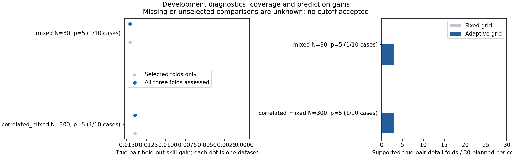

# Native pair-validation preflight

Two real RF tasks exercise training-only shortlisting, nested comparator tuning, untouched predictions, saved-setting refits and adaptive plotting. These are construction checks, not evidence that the diagnostic reliably detects interactions.

|Example|True-pair pooled CV gain|Fixed detail folds|Adaptive detail folds|
|---|---:|---:|---:|
|correlated_mixed-n300-p5-r00--random_forest|-0.0139|0/3|3/3|
|mixed-n80-p5-r00--random_forest|-0.0146|0/3|3/3|

The known pair was assessed in all three folds in both examples. A negative gain means that the joint spline model predicted worse than the separately curved model on these held-out people. Both examples have known interactions; these unfavorable gains remain in the evidence. The full fresh study will investigate whether this model family is suitable.

Adaptive grids recovered supported detail views in six of six true-pair folds; fixed grids supported none. The N80 grids were 2 by 2; correlated N300 grids were 2 by 2, 2 by 2 and 3 by 3. Coarsening improves display availability, not statistical certainty.

Offline audit: 2/240 complete, 238 still missing, 0 audit errors, 0 warnings. These exact identities will be recomputed on Actions, not counted twice. Additional comparator fitting/tuning fits: 600; comparator verification refits: 24; RF fitting/tuning fits: 104; RF verification refits: 8.

Complete and conditional pair coverage differ for incidental shortlists. The sensitivity CSV includes examined and unknown pair counts; it is not a calibrated false-positive-rate report.

[Raw evidence](raw-evidence.zip), [checksum](raw-evidence.sha256), [receipt and source hashes](receipt.json), [offline audit](audit.json), [machine-generated partial study report](REPORT.md). Extract the archive and replay the study from its recorded source context. Old frozen studies require their own recorded source commits. GitHub runtime results remain pending.

Recorded successful-task elapsed time does not include interrupted attempts or later repeated verification. No cutoff, production interaction rule, minimum sample requirement or scientific acceptance is established.
