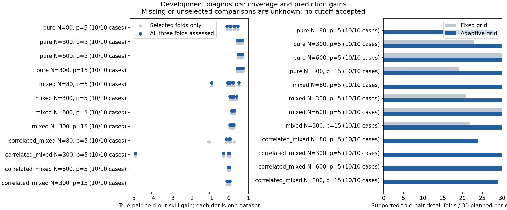

# Pair validation development results

Complete 240/240; audit errors 0.
No cutoff accepted. Unselected folds are unknown; complete and conditional gains differ.
Incidental counts cover shortlisted pairs only; they are not calibrated false-positive rates. See pair-fold coverage in summary.csv.
Failed tasks: 0. Cost includes 72000 comparator fitting/tuning fits and 2880 saved-setting comparator verification refits.

|Scenario|N|p|Complete /10|True complete pairs|True fixed / adaptive detail folds|
|---|---:|---:|---:|---:|---|
|noise|80|5|10|None|None / None|
|noise|300|5|10|None|None / None|
|noise|600|5|10|None|None / None|
|noise|300|15|10|None|None / None|
|additive|80|5|10|None|None / None|
|additive|300|5|10|None|None / None|
|additive|600|5|10|None|None / None|
|additive|300|15|10|None|None / None|
|pure|80|5|10|8|0 / 28|
|pure|300|5|10|10|23 / 30|
|pure|600|5|10|10|30 / 30|
|pure|300|15|10|10|19 / 30|
|mixed|80|5|10|10|0 / 30|
|mixed|300|5|10|10|21 / 30|
|mixed|600|5|10|10|30 / 30|
|mixed|300|15|10|10|22 / 30|
|correlated_additive|80|5|10|None|None / None|
|correlated_additive|300|5|10|None|None / None|
|correlated_additive|600|5|10|None|None / None|
|correlated_additive|300|15|10|None|None / None|
|correlated_mixed|80|5|10|4|0 / 24|
|correlated_mixed|300|5|10|10|0 / 30|
|correlated_mixed|600|5|10|10|0 / 30|
|correlated_mixed|300|15|10|9|0 / 29|

