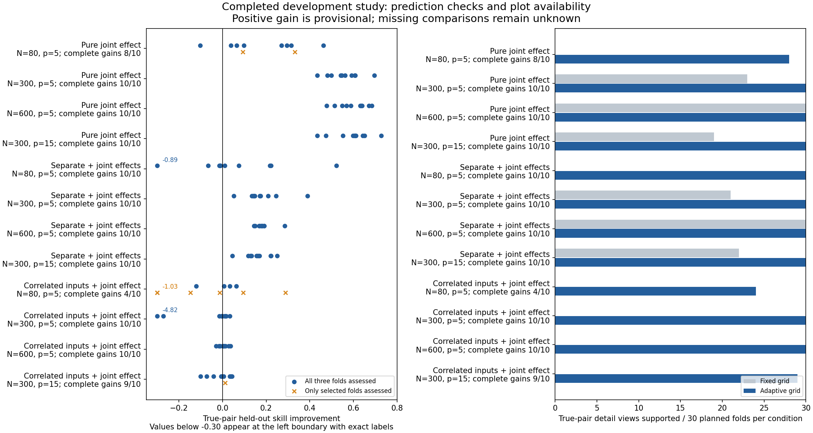

# Completed pair-validation development study

**The workflow succeeded; the method has a remaining limitation.** Adaptive plotting substantially improved display availability. The new prediction comparison showed useful gains for known interactions with independent predictors at larger N, but performed poorly with correlated predictors and sometimes produced extreme held-out predictions. It is not ready for automatic interaction acceptance or rejection.

[Actions run 38196995390](https://github.com/imh-ds/open/actions/runs/38196995390), source `ef0742fe0b72b8463ed80a02cad84931c2254922`: 122/122 jobs succeeded. Offline audit exactly matches the Actions audit: 240/240 independent RF datasets, 24 conditions with 10 replications each, no missing tasks, no audit errors and no recorded fit warnings. This is a development panel, not a confirmation or minimum-sample study.

## What worked

- Adaptive detail views were available for all 1,440 locked pair/fold examinations, versus 749 with fixed grids. Of the adaptive views, 749 retained 4 by 4 grids, 227 used 3 by 3 and 464 used 2 by 2; five were partially supported and retain masked unknown cells.
- Among known true pairs, fixed versus adaptive counts were 72 versus 118 for pure interactions, 73 versus 120 for mixed effects and 0 versus 113 for correlated mixed effects. The planned denominators were 120 folds per scenario; remaining true-pair folds were not shortlisted, not negative evidence. The adaptive views recovered all examined true-pair folds.
- For independent-input pure/mixed effects at N300 or N600 (including N300 with 15 predictors), all 60 datasets had complete three-fold true-pair assessments and gains above each prespecified cutoff through .02. At .05, 59/60 exceeded the cutoff. This result concerns these spline comparison models and simulated functions; it does not certify population moderation or RF effect sizes.

## What still failed

- N80 remained unreliable: at the illustrative prespecified .02 gain, pure interactions exceeded it in 7/10 planned datasets (8 fully assessed; two unknown, bounds 7–9), mixed effects in 4/10 (all assessed), and correlated mixed effects in 2/10 (four fully assessed; six unknown, bounds 2–8).
- With correlated inputs and N at least 300, only 6/30 planned datasets exceeded .02: 29 were fully assessed and one remained unknown (bounds 6–7). Raising N to 600 did not consistently separate the known joint contribution. Better plotting does not fix this predictive-comparison limitation.
- A specific instability was reproduced in correlated_mixed-n300-p5-r03, outer fold 1. One held-out observed value was -0.3322 and the joint prediction was 88.2759. A residualized tensor feature had training scale about 9.65e-8; standardization produced a held-out value about 1,370.6 and a contribution of 88.6659 to that prediction. That observation accounted for 91.2% of joint squared error in the fold. Joint MSE was 86.0520 versus additive MSE 3.0081; pooled gain was -4.8206. Saved-setting refits reproduce the result. This is comparator instability, not inconsistent arithmetic or an RF prediction. No patch was applied during evidence closeout.
- Poor correlated gains are not all explained by that one extreme case: N600 also had mostly near-zero gains. Separate curves may approximate much of a joint relationship when inputs are correlated; this interpretation needs further investigation, alongside basis/scaling instability. The current comparison cannot distinguish the two reliably.

## Coverage and incidental results

The cutoffs below were fixed before dispatch and remain descriptive. None is accepted as an automatic decision rule. Counts concern datasets containing at least one shortlisted incidental pair; they are not false-positive rates for the universe of possible pairs. A pair gets a complete pooled gain only if assessed in all three folds. Conditional gains use only its selected folds and can be optimistic.

|Gain cutoff|Independent-input true pairs, N≥300 /60|Correlated true pairs, N≥300 /30|Null/additive datasets: incidental complete gain /120|Null/additive datasets: incidental conditional gain /120|
|---:|---:|---:|---:|---:|
|0|60|16|9|63|
|0.01|60|9|4|50|
|0.02|60|6|2|34|
|0.05|59|0|0|13|

Across the 120 null/additive datasets, only 83 incidental pair identities had complete three-fold gains and 466 had at least one assessed fold, out of 4,050 possible pair identities across those datasets. Thus 3,967 pairs lacked a complete assessment and 3,584 were never assessed. Low complete exceedance counts cannot establish calibrated false-positive control.

## Independent test reference

After fitting on the full discovery sample and locking its shortlist, comparators predicted 1,000 independent observations per dataset. At the same descriptive .02 gain: pure N≥300 had 30/30 exceedances, mixed N≥300 had 29/30, and correlated mixed N≥300 had 4/30 (28 true pairs shortlisted, two unknown). At N80, corresponding counts were 8/10, 5/10 and 2/10 (nine correlated true pairs shortlisted). This secondary endpoint also supports the correlated-input limitation. It is not used to choose a cutoff.

## Visual summary



Left: each dot is one dataset’s true-pair gain. Blue dots require all three folds; orange crosses use incomplete selected-fold coverage. Values below -.30 are shown at the left boundary with their values labeled. Right: supported true-pair detail folds out of 30 planned per condition. A display is an explanation of fitted predictions, not proof of a true population interaction.

## Recommended next step

Keep adaptive plotting as an opt-in exploratory view. Stabilize the joint spline comparison, particularly the scaling of nearly constant residualized basis columns, before using it as an automatic validator. Investigate how correlated inputs affect the identifiable added contribution of a pair. Add a regression reproducing the extreme prediction and test a bounded revision on fresh development identities, followed by disjoint confirmation if a rule is proposed. Do not change this frozen study or select a cutoff from its results.

No production defaults, recursive selection logic, interaction rule or minimum sample recommendation changed. The scientific validation gate remains open.

## Evidence and reproduction

Raw task data, settings, folds, predictions, receipts, warning records, saved-setting refit stamps and timing are retained in the split archive. The closeout audit regenerated data/splits and checked settings, arithmetic and bound digests; it did not retune all winners or refit every task locally. The recorded unstable task was also refitted locally. All 2,040 duplicate downloaded shard files were compared byte for byte before omission.

Archive: 61,294,567 bytes, 2,049 files, SHA256 `2285dd7148e83d0ece2f9ab2e4792e3c129f979b17705490cede5a77e8149701`. Both parts are smaller than 50 MB. Hashes and sizes are in [receipt.json](receipt.json). Reconstruct in this directory using Python:

```python
from pathlib import Path
import hashlib, json, zipfile
r = json.loads(Path("receipt.json").read_text())
with Path("actions-evidence.zip").open("wb") as archive:
    for part in r["archive"]["parts"]:
        data = Path(part["name"]).read_bytes()
        assert hashlib.sha256(data).hexdigest() == part["sha256"]
        archive.write(data)
assert hashlib.sha256(Path("actions-evidence.zip").read_bytes()).hexdigest() == r["archive"]["sha256"]
with zipfile.ZipFile("actions-evidence.zip") as archive:
    assert archive.testzip() is None
    archive.extractall("replay-evidence")
```

Replay the frozen runner from source commit `ef0742fe0b72b8463ed80a02cad84931c2254922` with the pinned runtime. `aggregate --output replay-evidence` regenerates summaries and verifies worker stamps. Keep later source revisions in separate worktrees; do not rewrite this or earlier manifests. `build_findings.py` rebuilds the interpretation figure from retained dataset-level summaries.

[Offline audit](audit.json), [original Actions report](ACTIONS_REPORT.md), [cutoff sensitivity](gain_sensitivity.csv), [per-condition summary](summary.csv), [diagnosis and dataset-level summaries](findings-data.json), [frozen manifest](manifest.json), [job execution](execution.json), [artifact metadata](artifact-pages.json).

Execution: 12.33 wall minutes, 176.38 summed job minutes, peak 20 jobs. Initial fitting/tuning used 72,000 comparator fits and 12,480 RF fits; saved-setting verification added 2,880 comparator and 960 RF refits. Recorded successful-task cost excludes interrupted attempts and later repeated audits.
