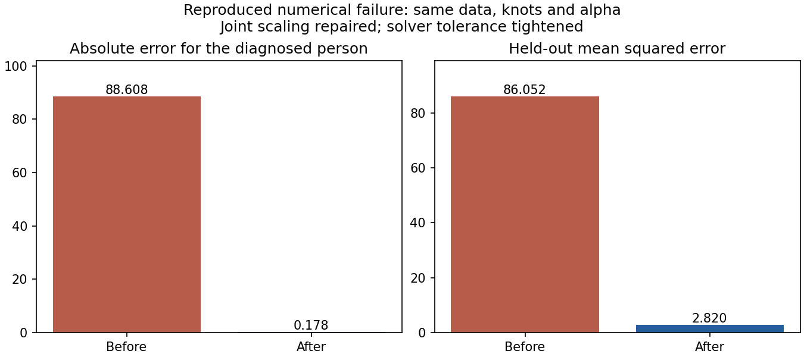

# Stabilized spline comparison (v2)

The diagnosed prediction explosion is repaired. Joint spline features no longer
get divided by their own near-zero training variation. Marginal curves remain
standardized inside training partitions. Ridge now uses LSQR tolerance `1e-8`,
which also passes the predictor-unit-change regression.

|Original held-out case|Before (v1)|After (v2, matched knots/alpha)|
|---|---:|---:|
|Prediction for observed -0.3322|88.2759|-0.5099|
|Joint held-out MSE|86.0520|2.8202|

Both before/after use the same 200 training and 100 assessment observations,
5 knots and alpha=100. The old result is retained from the frozen v1 evidence at
`ef0742fe0b72b8463ed80a02cad84931c2254922`; the current result was actually refitted.
The code change also tightens the solver tolerance, so this compares the complete
numerical repair, not feature scaling alone.

Nested v2 tuning on the same training partition gives joint MSE
3.1020 versus separate-curves MSE
3.0080, gain
-0.0174. A stable result can still be negative.
This historical regression is a repair check, not fresh scientific validation.
No predictions were clipped to pass the regression.

## Fresh construction checks

24 fresh datasets: six generating scenarios, four sample/predictor conditions,
one dataset per condition; disjoint 98/108/118-million seed ranges. Three outer
folds plus a 1,000-person independent test per dataset, with unchanged knots and
alpha grids. All transformations and tuning remain training-only. Pairs x1+x2
and x1+x3 are fixed for every case to isolate the comparator; no RF shortlisting,
network recovery or interaction-rule evaluation is performed.

All 24 completed. Initial fitting/tuning: 7200 fits;
saved-setting verification: 288 refits; elapsed
131.56s; zero recorded warnings. Verification checks both model
predictions, risk arithmetic and training-mean reference denominators.

The independent-input N300/N600 pure-effect checks retained substantial gains.
Separate-effect and noise x1+x2 gains were near zero in these examples. Small
samples and correlated-input examples often had small gains; this repair does
not resolve that limitation. The unchanged alpha grid now penalizes the natural
joint feature scale differently, so v1 cutoffs and detection results do not
validate v2. One dataset per condition cannot establish reliability, calibration
or minimum sample guidance. No cutoff or automatic interaction rule is adopted.

## Verification and reproduction

- Both native failure regressions were witnessed failing before the fix: prediction
  88.2759 and MSE 86.0520. They now pass for saved settings and nested tuning.
- Focused integration suite: 38 passed in 19.47s. Includes analytic separate/joint
  effects, split isolation, fit budgets, unit changes, adaptive plots and reports.
- Independent review: 8 tests passed; no actionable finding. Cloning/tuning,
  fold-local scaler/projection and scientific limits checked.
- No new full-suite pass is claimed. Prior frozen studies/manifests remain unchanged.

[Raw regression](regression.json), [regression sample](native-case.csv),
[fresh summary](summary.csv), [fresh audit](audit.json), [runtime/source context](context.json),
[receipt](receipt.json), [raw smoke evidence](raw-smoke-evidence.zip).
Archive SHA256 `c5f1fd04184a81a7397c5b1977d7928815ea466dbec825cf2ff0535a39f5aa50`; ZIP CRC verified.

Run `python examples/spline_stability_smoke.py --output <fresh-directory>` using
the pinned environment and source `b451fc290e8bd2df19eed7bcb1d4d058637e4e3b` to regenerate the 24 checks.
The archive retains all case samples, indices, settings, observations and
predictions. Replay old frozen studies from their recorded v1 source commits;
the v2 source should fail their source guard rather than rewriting old manifests.

Next methodological step: separately freeze a fresh development study examining
v2 joint regularization and correlated-input added contribution. No new Actions
study was launched as part of this numerical repair.
