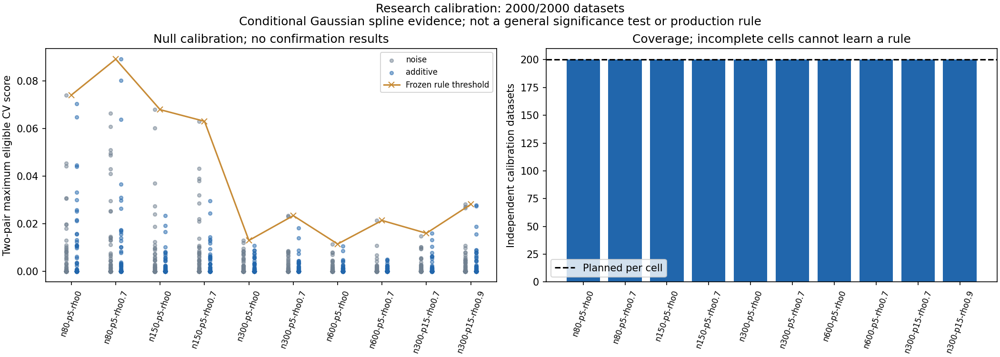

# Interaction confidence: null calibration results

All 2,000 planned null datasets completed, with no missing results, audit errors or fitting warnings. All 52 Actions jobs succeeded at the frozen source commit. These datasets contain no interactions: this stage establishes a cutoff for apparent interaction benefit that can occur without a real interaction.

## Simple interpretation

Small samples produced larger misleading gains. With five predictors, the learned cutoff is about .074–.089 at N80, .063–.068 at N150, .013–.023 at N300 and .012–.021 at N600. Thus a small positive gain cannot by itself support an interaction, particularly with a small sample. Correlated predictors can also raise the cutoff. The N300/15-predictor cutoffs are .016 (.7 correlation) and .028 (.9 correlation); this narrow study does not establish a universal rule about adding predictors.

The score measures matched prediction-error improvement divided by training-mean reference error. It is neither a regression effect size nor a probability that an interaction is real. A pair must improve on the independently tuned additive baseline overall and improve on the matched additive comparator in at least two of three outer folds before its matched score is considered. Each null dataset contributes the larger score of the two fixed tested pairs.

Each cell cutoff is the largest eligible score among its 100 pure-noise and 100 nonlinear-additive datasets. A future score must strictly exceed it. Zero calibration exceedances occur by construction and are not evidence that the false-alarm rate has been validated. Individual extreme scores affect the cutoff; the fresh confirmation stage, rather than retrospective threshold adjustment, checks whether this conservative choice is useful.

## What this does and does not establish

The calibration stage worked operationally and produced ten cutoffs. It does not yet tell us the sample size at which real interactions can reliably be detected, whether weak interactions survive these cutoffs, or whether displayed interaction patterns are trustworthy. The approved confirmation stage uses 5,200 disjoint datasets: 4,000 null cases and 1,200 interaction cases. The false-alarm gate and detection bounds are assessed separately from supported-grid pattern consistency.

Evidence is conditional on these Gaussian generators, two fixed tested pairs and the research spline comparator. It does not validate general RF/GBM networks, unrestricted pair searching, causal moderation or arbitrary real-world populations. No production confidence rule is adopted.

## Reproducible, durable evidence

The original GitHub combined artifact SHA256 was verified against the API digest, and every ZIP entry passed CRC verification. The retained archive stores every unique raw prediction/checkpoint, candidate CV trace, support/curve record, timing/verification/source receipt, shard stamp, frozen manifest and completed API snapshot. Duplicate worker copies were omitted only after byte-for-byte comparison against the combined copies. Twelve parts keep each file below GitHub's ordinary file-size limit. See receipt.json and retained-inventory.json.

Verify the parts and every retained file: `python verify_archive.py --output <fresh-directory> --extract`.

Recompute scores and all ten thresholds without fitting: `python recompute_calibration.py --input <extracted-directory>/.superpowers/pair-confidence --output <fresh-metrics-directory>`.

The original run is [38323296605](https://github.com/imh-ds/open/actions/runs/38323296605), source `cdde3cc5bb949c5bd1c8a642c326eee6764dfae3`. Total recorded job duration is 187.88 runner minutes (not billed rounded minutes), below the 1,575-minute Stage A cap. Raw complete-task cost is 1,384,000 fit/tune calls and 40,000 saved-setting verification refits; verification refits are not new replications.

Separate arithmetic verification reproduced all 16,000 pair comparisons, all 4,000 pooled pair rows and all ten thresholds, with maximum score discrepancy zero. All 2,000 calibration result hashes match the learned rule. Independent review checked threshold-setting cases and found no provenance/scientific blocker to a frozen confirmation stage. Archive verification checked all 16,059 retained files. Full offline runner audit status is recorded in VERIFICATION.md.

## Fresh confirmation launch

The audited cutoffs and disjoint Stage B manifest were separately committed and their remote Git blobs verified before dispatch. [Confirmation run38330174633](https://github.com/imh-ds/open/actions/runs/38330174633) started once at source `c213bf92c5fd5a28720497cdf238c1a0ea812d5e`: 5,200 datasets/130 forty-task shards; 4,000null and1,200signal cases. Stage B runner-minute cap3,975, within the approved combined5,550cap. These confirmation results are pending; launch does not establish scientific acceptance. See confirmation-launch.json and startup metadata.

Confirmation startup verified: preparation succeeded, all130expected workers registered, 20active/110queued, no failures at snapshot. Scientific confirmation results remain pending.
