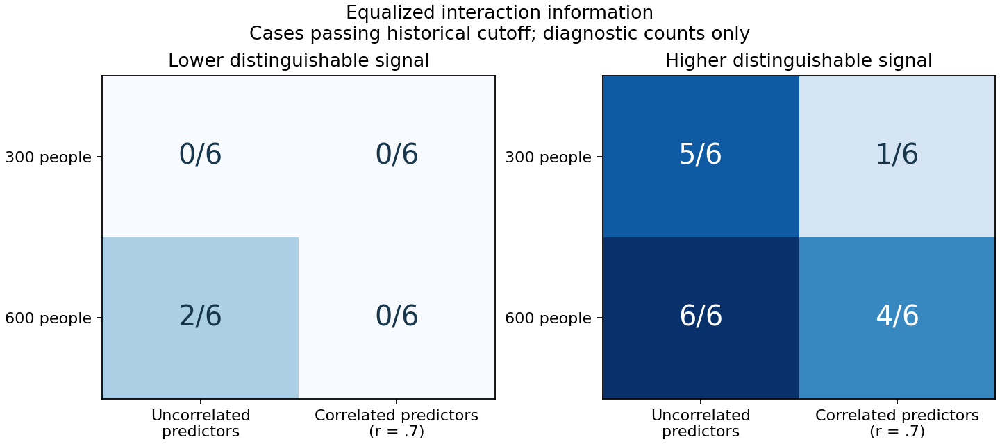
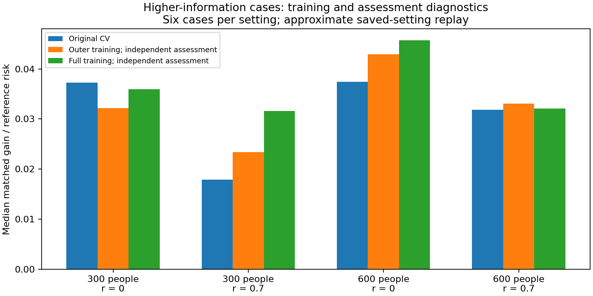

# Confidence diagnostic development: findings and interpretation

The complete fresh probe finished in this session: 60/60 datasets, eight successful Actions jobs, zero missing results, audit errors or fitting warnings. Every primary prediction/population risk calculation reproduced exactly. This is a small development investigation; it does not establish new reliability labels or retrospectively pass D-040.

## Simple findings

**The investigation points to two separate issues: limited validation precision, and loss of interaction evidence through fitting, CV and the historical cutoffs.** No arithmetic error was found in the checked predictions.

The old assurance design tested 200 null simulations per setting. Under hypothetical independent equal-rate settings with true false-alarm rate 1%, its chance of passing every simultaneous assurance check is only 0.0405%. At 600 simulations per setting, that hypothetical chance is 99.1%. These are planning calculations, not estimates of the method's true rate. The count refers to simulated datasets, not participants in a dataset. More validation simulations could improve assurance precision while retaining the same error-limit requirement. See the analytical preflight for all assumptions and calibration uncertainty.

Matching distinguishable interaction information did not remove the observed correlation gap in this probe. At the higher population information target (.04), the true pair passed the historical cutoff as follows:

| Participants | Uncorrelated predictors | Correlated predictors (r=.7) |
| --- | --- | --- |
|300|5/6|1/6|
|600|6/6|4/6|

The raw coefficients differ by design to keep the ideal population additive-versus-joint reference equal. This does not prove a general correlation effect: only six independently generated cases were tested per cell. Coefficient, noise and marginal complexity change with the matching construction.

Historical cutoffs also differ. At 300 participants, the correlated cutoff is .02344 versus .01300 without correlation; at600, .02141 versus.01151. Differences in pass counts therefore combine fitted/CV evidence and different cutoffs. At 300, all six higher-information uncorrelated cases were eligible, with one lost at the cutoff. Four of six correlated cases were eligible, with three of those lost at the cutoff. At 600, all six were eligible in both settings; two correlated cases were lost at the cutoff.

At the lower information target (.01), only 2/24 true-pair cases passed. None of the 12 targeted null cases or 48 incorrect control pairs passed. These small null counts cannot certify a rare false-alarm rate.

## What the additional replay tells us

All six higher-information correlated cases had positive independent matched prediction gains at both participant sample sizes. Thus failure at the CV/cutoff stages does not mean the fitted models contained no interaction information.

A post-hoc replay used each outer fold's fixed saved settings and assessed it on the same 1000 independent rows. It made no new tuning choices, study identities or replacement decisions. At 300 participants with correlated predictors, the median matched gains were:

| Assessment/training configuration | Median gain |
| --- | --- |
|Original CV, outer training 200/assessment 100|.01787|
|Same outer training/settings, independent assessment 1000|.02341|
|Full training 300 and its selected settings, independent assessment 1000|.03163|

These changes are consistent with both assessment variability and training/tuning-size effects. They do not isolate causal contributions: full-training models also have different selected settings, and medians summarize six cases. At 600 correlated participants, the corresponding values .03186/.03305/.03209 show no clear full-training advantage. Independent comparisons share assessment rows and are dependent diagnostics, not extra replications.

The native replay initially failed the strict 1e-9 prediction check after 74 refits. Matching software/saved settings still produced small cross-runtime numerical differences; the exact computational cause was not established. We retained this failed attempt. The completed supplemental replay used a separately declared diagnostic precision screen, without changing any primary/historical CI guard: normalized prediction drift <=1e-6 training SD and CV matched-gain difference <=1e-7. Observed maxima were 5.896e-7 and3.353e-8 respectively. These are approximate saved-setting replays, not exact model reproduction or production acceptance. Original primary gains and decisions remain based entirely on the stored CI predictions.

## Recommended next step

Prepare a revised prospective validation protocol with enough simulated null datasets to give the existing assurance requirement adequate power under explicitly chosen target rates. Keep matched-information and realistic mixed-interaction benchmarks. Set intended sensitivity scope using distinguishable signal, predictor overlap and effective training/tuning sample sizes.

Before changing prediction cutoffs or CV policy, test any specific revision on fresh development cases and recalibrate it. Do not simply lower cutoffs, declare 300/600 participants universally sufficient, or rerun the old study unchanged. A new independent confirmation is required before adopting confidence labels. The current findings support keeping interaction results exploratory while improving the validation design.

## Durable evidence

[Completed Actions run 38358091214](https://github.com/imh-ds/open/actions/runs/38358091214), source 51de3e25400f7ffb1b301b562e054eb93bff76f5. Recorded job duration 11.02 runner minutes, below the 125-minute cap. Frozen task cost: 41,520 fit/tune calls plus 1,200 saved-setting verification refits. Native construction costs and post-hoc replay are separate. Supplemental replay: 216 completed saved-setting refits plus 74 in the failed initial attempt; no supplemental tuning.

Original combined artifact: 31,794,880 bytes SHA256 055c0128d7da61dde762554229939c6eec82b3393a64d98c606a7be8659397b6 matches the GitHub digest. All 498 unique raw/source/metadata files retained; 486 worker duplicates omitted only after byte-for-byte equality checks. Retained archive: 16,372,839 bytes SHA256 f6a8d0913de88479331c9827faaf1388c89b4bcf2d3b95b0062f2d0f957e8f20. Hash, inventory and CRC checks passed. Supplemental compressed prediction vectors, failed-attempt receipt and precision diagnostics are retained separately.

Verify/extract with `python verify_archive.py --output <fresh-directory> --extract`. Recompute primary risks/decisions without fitting with `python recompute_results.py --input <extracted-directory>/.superpowers/confidence-diagnostic --output <fresh-directory>`. Verify supplemental vector arithmetic without fitting with `python verify_replay.py --input <extracted-directory>/.superpowers/confidence-diagnostic`. Repeating supplemental model refits requires the frozen source/runtime; its computational cost is additional and does not add scientific replications.
