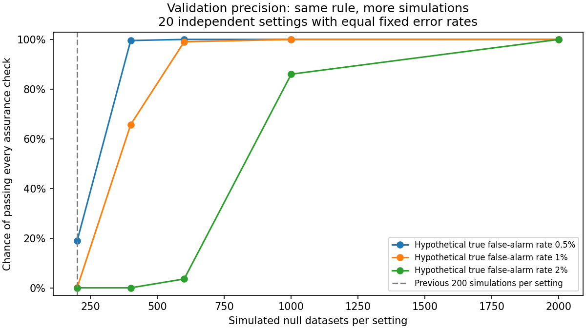

# Targeted confidence diagnostic: ready for fresh development

The analytical investigation identified limited precision in the previous assurance design. A method with a hypothetical true 1% false-alarm rate would have only a 0.0405% chance of passing all 20 checks with 200 null datasets per setting, assuming independent equal-rate settings. At 600 null datasets per setting, that hypothetical chance is 99.1%. These are planning calculations, not estimates for the actual method, and they do not pass the old study retrospectively. See ANALYTICAL.md for assumptions and calibration uncertainty.

The fitted investigation uses 60 fresh development datasets. Forty-eight compare correlated and uncorrelated predictors at matched distinguishable interaction information; twelve examine fitting behavior in the two null settings that failed assurance. Six replications per cell are diagnostic, not enough for rare-error certification.

All 37 focused tests, independent review, two-case native preflight, separate prediction arithmetic, two-worker verified resume, raw archive verification and sparse-checkout execution passed. The complete 60-case result is pending. Frozen historical thresholds are applied only to diagnose where findings are lost; none are revised. Participant sample-size guidance remains unvalidated.

Run archive verification with `python verify_archive.py --output <fresh-directory> --extract`. Recompute raw arithmetic with `python recompute_preflight.py --input <extracted-directory>/.superpowers/diagnostic-native/raw --output <fresh-directory>`.

The planned Actions run has six ten-case shards, ordinary Windows runners, two single-thread workers each, and a 125-runner-minute cap. No paid runners or automatic retries. Source/runtime/protocol and all 60 identities are frozen before dispatch.

## Frozen development launch

[Actions run38358091214](https://github.com/imh-ds/open/actions/runs/38358091214) launched once at `51de3e25400f7ffb1b301b562e054eb93bff76f5`. All74public source/manifest/evidence Git blobs were verified before dispatch; registration push38357973310 skipped all fits. Preparation passed and all six expected workers registered with no failures at startup. Launch/startup snapshots are retained here; scientific development results remain separate from this construction snapshot.
