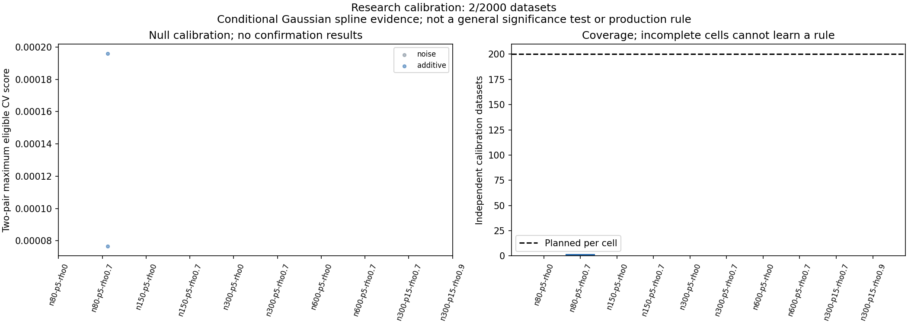

# Interaction confidence study: construction preflight

The approved research workflow is implemented and verified for a Stage A launch. This preflight does not establish that the confidence rule works scientifically.

- 36 focused tests passed (new rules/models/runner/Actions and existing matched/production pair tests). Independent review issues corrected with regression tests; final reviewer found no remaining launch blocker.
- Two planned correlated nonlinear-additive calibration identities ran, including a two-worker Windows process smoke and reuse of one already verified task. Stage A audit: 2/2000 complete, 1998 missing, no audit errors. No threshold is learned from partial coverage.
- One disposable mixed-interaction construction case (298-million seed family) ran separately and is excluded from scientific denominators. No confirmation identities were fitted.
- Total retained construction computation: 2076 fit/tune calls plus60 saved-setting verification refits. Saved-setting checks reproduce five models per comparison; they do not retune or add independent replications.
- Separate explicit raw arithmetic checks all24 pair comparisons across three cases; maximum score discrepancy0. Earlier production and frozen study sources remain unchanged. No full-suite claim.

## Planned study

Stage A: 2000 null datasets/50forty-task shards learns fixed-cell thresholds. Stage B: 5200 new datasets/130shards evaluates false alarms and detection, only after Stage A thresholds are audited, committed and frozen. Two workers/shard; standard windows-2022; maximum parallel256 subject to account limits. Combined maximum5550 runner minutes; Stage A cap1575. Ordinary Actions runners; no automatic retries or paid runners.

The primary false-alarm gate uses simultaneous95% exact upper bounds across20null strata. Good-detection guidance also needs a pointwise95% lower bound of at least.8 in that particular signal setting. Shape/support flags are separate descriptive checks. These are conditional fixed-pair Gaussian spline research endpoints, not posterior confidence, causal effects, a general p-value or an accepted production rule.

## Durable evidence

See receipt.json, retained-inventory.json, audit.json and independent-check.json. raw-evidence.zip retains all unique raw predictions, candidate CV traces, matched settings, curve arrays/support, checkpoints, timing, verification stamps, process receipts and frozen manifest. Verify/extract using `python verify_archive.py --output <fresh-directory> --extract`. Refitting requires the recorded frozen source/runtime; archive verification itself does not refit. The two planned identities will be recomputed on Actions and are not extra study replications.

Recompute raw arithmetic with `python recompute_preflight.py --input <extracted-directory>/.superpowers/confidence-preflight/raw --output <fresh-metrics-directory>`.
