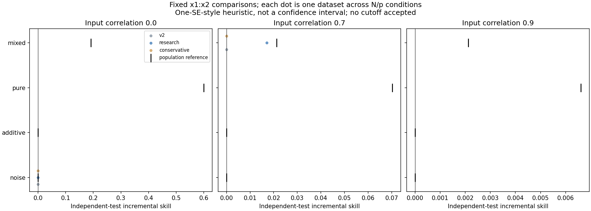

# Conservative-selection construction preflight

Two of 240 planned fresh identities completed with no audit errors or warnings. These are construction checks, not additional independent replications or an adoption decision.

The retained archive contains all candidate CV losses, selection traces, raw predictions, checkpoint costs, runtime/source receipts and verification digests. Worker verification reproduced saved settings; it did not repeat tuning. Total: 1,784 fitting/tuning fits and 56 saved-setting verification refits.

Focused regressions include the earlier failing dataset: minimum-CV outer MSE exceeds 10, while the restrained alternative is below 3. This known-case improvement motivated development; it does not validate general performance. Production defaults and earlier frozen studies are unchanged.

Fresh study: 240 datasets, 48 cells, five per cell, three competitors. Compare small-N negative-gain tails and sacrificed independent gains before recommending adoption. No cutoff, interaction certificate, minimum sample guidance or network recovery claim.

Raw evidence: [archive](raw-preflight.zip), [inventory](inventory.json), [receipt](receipt.json), [audit](audit.json), [metrics](case_metrics.csv).
