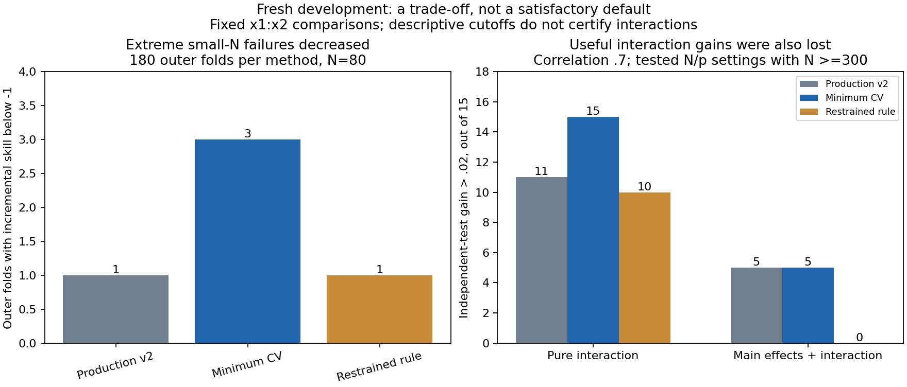

# Fresh conservative-selection study: findings

The one-SE-style penalty preference is **not recommended as the production default**. It reduces some extreme small-N errors, but does not eliminate them and suppresses useful correlated interaction gains. Production remains unchanged. This is fresh development evidence, not confirmatory validation.

[GitHub Actions run](https://github.com/imh-ds/open/actions/runs/38279504044): source `87420b857ef9cbc65f6713a9c8ed9a652727843d`, 122/122 jobs successful, 240/240 datasets, 48 cells with five datasets each; no missing/error identities, audit errors or warnings. 214,080 fitting/tuning fits plus 6,720 saved-setting verification refits. About 14.83 wall minutes, 171.40 summed job minutes. The saved-setting checks reproduce predictions; they do not repeat tuning. No additional local model-refit pass is claimed here.

## What changed in prediction

All counts below concern the fixed target pair x1:x2. Methods use the same fresh datasets. N>=300 combines three tested settings: (300,5), (600,5), (300,15), each with five replications. It does not establish a general sample-size threshold. The .02 cutoff was prespecified for descriptive comparison and is not an accepted interaction rule.

|Correlated case (rho=.7), N>=300|Production v2|Minimum CV|Restrained rule|
|---|---:|---:|---:|
|Pure interaction: independent gain >.02|11/15|15/15|10/15|
|Mixed main effects + interaction: independent gain >.02|5/15|5/15|0/15|
|Pure: median independent gain|.05824|.05914|.04239|
|Mixed: median independent gain|.00976|.01269|.00010|

At N80, across all correlations and signals, extreme target-pair outer-fold gains below -1 decrease from 3/180 with minimum-CV selection to 1/180 with restraint (production v2:1/180). This -1 threshold is a post-hoc tail description, not a frozen acceptance gate. The worst fold improves from -2.0853 to -1.3525, but the latter remains a severe failure. Folds share datasets and are not independent replications. Less extreme negative gains below -.1 remain14/180 for both research methods (production2/180).

At N80 with rho=.7/.9 only, the worst gain improves from -2.0853 to -.2438; production's worst is -.0879. Thus improvement over flexible minimum-CV selection is not evidence of superiority over production.

When predictors are uncorrelated and N>=300, both research methods retain independent gains >.02 in15/15 pure and15/15 mixed datasets. The loss is especially consequential when joint predictive information is weaker under correlation. At rho=.9, all three methods have0/15 independent gains >.02 in both pure and mixed N>=300 cases. Weak incremental gains do not establish absence of the generated interaction.

## Apparent gains are not interaction certificates

For noise-only N80 data, restrained selection produces CV gains >.02 in6/15 cases; both minimum CV and production have0/15. Across all60 noise-only datasets, restrained selection produces independent gains >.02 in3/60; the other methods have0/60. These are descriptive observations from fixed pairs and five replicates per cell, not calibrated all-pair false-positive rates.

In those three positive independent noise cases, the additive baseline uses five knots while the restrained joint model uses three; both alpha values are100 and joint weight is1. [Saved settings](noise_positive_settings.json) show the model comparison changes main-effect representation as well as adding a joint block. Gains could reflect different marginal fitting or sampling noise rather than interaction. This study did not isolate their contributions, so no cause is claimed as proved.

Recommended next diagnostic: isolate main-effect basis/regularization differences in the saved positive null cases, then consider a matched marginal comparison that separates changes in interaction contribution. A new design would need fresh development evidence. Do not adopt this selector, weaken a cutoff or dispatch another study on the strength of these results alone.

## Audit and durable evidence

- Original artifact170,702,981bytes SHA256 `b92968dad5da5e09a84225896c756209e45815f122d291de969130caaae3f829`; GitHub digest and ZIP CRC passed.
- Offline frozen audit regenerated data, checked source/runtime context, coverage, candidate grids, selection arithmetic, prediction risks and checkpoint digests. Audit JSON and all three aggregate CSV tables match Actions exactly.
- Independent explicit arithmetic recomputed all1,440 case rows and1,920 candidate-selection records without using runner aggregation/selector helpers. Maximum CV and independent gain difference9.98e-17. Of1,920 pair/comparison choices,1,234 changed from the minimum-CV winner. This is consistency verification, not independent statistical replication or re-tuning.
- Retained archive87,092,837bytes,2,287files, SHA256 `5560327ebadd36ba1ae3de6b86a6f3424c6a5dbe110e6c4ffb8e810b4bd9fade`, split into three ordered parts. All2,280 duplicated worker files were byte-verified against combined evidence before omission. Every unique task result, raw prediction, comparison checkpoint, candidate score trace, receipt, timing, verification stamp, shard identity and frozen manifest remains retained.

See [receipt](receipt.json), [inventory](retained-inventory.json), [audit](audit.json), [independent check](independent-check.json), [case metrics](case_metrics.csv), [fold metrics](fold_metrics.csv), [subgroup summary](findings_summary.csv), [selection metrics](selection_metrics.csv), [run](run.json) and [jobs](jobs.json). The original aggregate graph remains [available](conservative-summary.png).

Reassemble and verify all retained bytes using `python verify_archive.py --output <fresh-directory> --extract`, from this results directory. Recompute summary arithmetic using `python recompute_metrics.py --input <extracted-directory>/.superpowers/pair-conservative --output <fresh-metrics-directory>`. Regenerate the findings graph using `python render_findings.py`. Use the recorded frozen source and runtime for method replay; future code changes must not silently replace historical evidence.

No production adoption, calibrated significance/interaction certificate, all-pair false-positive control, RF/GBM conclusion, recursive-network recovery, minimum-N requirement or disjoint-confirmation claim follows from this study. Earlier studies and frozen denominators remain unchanged.
