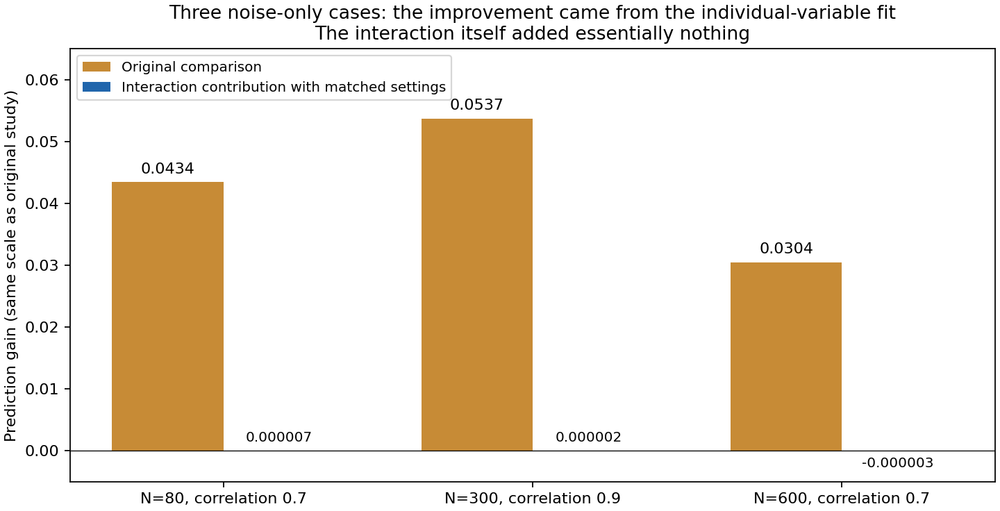

# Matched marginal-setting diagnosis

The three positive noise cases were mostly credited for a better individual-variable fit, rather than for their interaction block. Matching spline knots and ridge alpha removes their apparent interaction gains. This diagnoses a score-interpretation problem; production has not been patched or a new method validated.

## Simple interpretation

The original comparison changed two things at once: how the individual variables were fitted, and whether an interaction was included. It then reported the entire improvement as joint-model gain. In the three flagged noise cases, a three-knot individual-variable model already provides virtually all of the improvement over the original five-knot baseline. Adding the interaction changes prediction by almost nothing.

|Saved noise case|Original gain|Gain from changed individual-variable fit|Gain from adding interaction at matched settings|
|---|---:|---:|---:|
|N80, rho=.7|.043399|.043392|.000007|
|N600, rho=.7|.030400|.030403|-.000003|
|N300, rho=.9|.053685|.053682|.000002|

These are normalized prediction gains, not percentages of variance explained. All three local joint-model refits reproduce archived predictions exactly. The diagnosis is not explained by solver rounding in these cases. This does not resolve earlier cross-machine replay differences in other studies.

Across the60 saved noise datasets, the restrained method's independent gains>.02 fall from3/60 in the original comparison to0/60 with matched settings. The largest positive matched restrained gain is approximately.000074. Production and minimum-CV modes have0/60 above.02 under both comparisons. These are descriptive saved-case counts, not calibrated false-positive rates.

For the fixed30 signal controls (rho=.7, N/p=(300,5),(600,5),(300,15), five per setting and signal):

|Independent gains>.02|Original comparison|Matched comparison|
|---|---:|---:|
|Minimum CV, pure interaction|15/15|15/15|
|Minimum CV, mixed main effects + interaction|5/15|5/15|
|Restrained, pure interaction|10/15|9/15|
|Restrained, mixed main effects + interaction|0/15|0/15|
|Production v2, pure interaction|11/15|11/15|
|Production v2, mixed main effects + interaction|5/15|4/15|

Matching therefore separates the spurious marginal-fit credit while preserving useful gains in these minimum-CV controls. It does not recover signals suppressed by the restrained selector, fix tail extrapolation or establish a universal sample-size requirement.

## What a viable revision would do

Keep overall joint-model prediction improvement distinct from the gain attributable to adding a joint block at comparable marginal settings. For each selected joint model, fit an additive counterpart on the same training rows, using the same spline knots and alpha, then assess both on held-out observations. Their difference is a more specific predictive comparison. Retain the original overall-model gain as a separate quantity so legitimate improvements in marginal fitting remain visible.

This matches representation and penalty settings, not frozen marginal coefficients: the coefficients are refitted when adding the joint block. It remains a predictive model comparison, not a causal effect, a significance test or proof of moderation. Joint winner settings were chosen using training data; this post-hoc diagnostic did not optimize settings on independent outcomes. However, these datasets were already examined and selected for diagnosis, so they cannot serve as fresh validation of a revised procedure.

Recommended next implementation: add the matched-setting comparison as a research-only output and test its calculation/training-only behavior, then freeze fresh development covering noise, additive signals, real interactions, correlated inputs and small-N tails. Do not replace production scoring or declare interaction detection reliable from this replay alone. The one-SE-style penalty preference remains unqualified for adoption.

## Reproduction and evidence

Bounded diagnostic:90 existing datasets (all60noise plus30 correlated pure/mixed controls),270 mode/case rows,129 new fixed-setting fits including three joint replays; approximately9.97seconds locally. No new tuning, fresh simulation identities or GitHub Actions dispatch. The underlying D-037 source/runtime guard and raw result/checkpoint digests were verified before fitting. The source study is [retained here](../2026-10-12-conservative-selection/REPORT.md), Actions38279504044, source87420b857ef9cbc65f6713a9c8ed9a652727843d.

For each case/mode, verify the identity:

`original_gain = marginal_change_gain + matched_joint_gain`

Independent recomputation from all90 retained prediction files checks270 rows, maximum gain difference2.94e-16. The archive retains observed outcomes, original additive predictions, matched additive predictions, archived joint predictions and the three local joint replays, alongside metrics/runtime/source receipts. Archive4,242,580bytes,93files, SHA256 `4c80fe6d57923a170bf0c402e22fc8bd002e6ccceaadd58240a532439194737b`; CRC and all file hashes verified.

See [metrics](metrics.csv), [receipt](receipt.json), [independent check](independent-check.json), [raw predictions](raw-predictions.zip) and [inventory](retained-inventory.json).

Verify/extract with `python verify_archive.py --output <fresh-directory> --extract`. Replay fixed-setting fits with `python replay.py --input <D037-extracted-directory>/.superpowers/pair-conservative --output <fresh-directory>`, from this results directory, in the pinned source/runtime. Check prediction arithmetic with `python verify_metrics.py --input <extracted-directory>`. Regenerate the graph with `python render_findings.py`. Earlier frozen sources, observations, denominators and production algorithms are unchanged. This evidence-only diagnostic does not claim a full test-suite run or general scientific validation.
