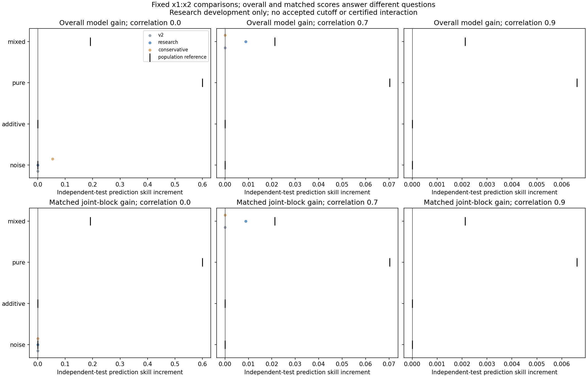

# Matched interaction-comparison construction preflight

Two of240 planned fresh identities completed with no warnings or audit errors. These are construction checks, not additional independent replications or an adoption decision.

Matched additive counterparts use the selected joint model's same knots/alpha and training rows. All raw predictions and settings are retained. Overall gain = marginal-change gain + matched gain, with assessment risks pooled before ratios. These are predictive comparisons, not certified interactions or causal effects.

Preflight cost:1,832 fitting/tuning fits,104 saved-setting verification refits. Seven new regressions plus eight production comparator tests passed. The regression replays a known noise case: overall gain>.04, matched gain<.0001 in magnitude. That known-case check motivates fresh testing, not validation of a revised method.

Full study frozen240 datasets,48cells5each, fresh208/218/228million seeds; noise/additive/pure/mixed, correlated inputs and small-N cases; three competitors and fixedtwo pairs. Production remains unchanged. Full scientific results pending.

Evidence: [raw archive](raw-preflight.zip), [inventory](inventory.json), [receipt](receipt.json), [audit](audit.json), [case scores](case_metrics.csv).
