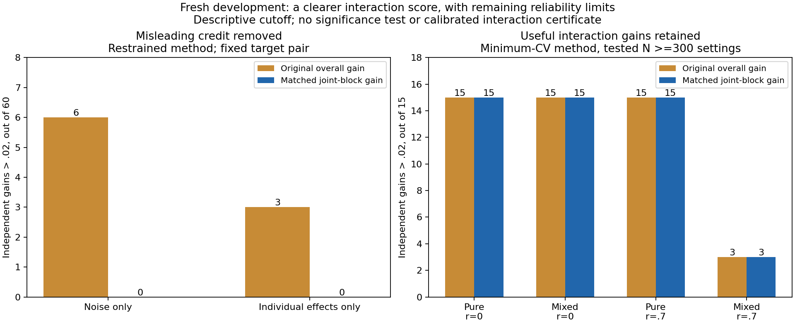

# Fresh matched interaction-comparison study: interpretation

The matched comparison successfully separates improvement from changed individual-variable fitting from improvement due to adding a joint block. Fresh results support keeping it as an interaction-specific **research output**, alongside overall prediction gain. They do not establish a calibrated interaction decision rule or justify automatic production adoption.

## What this means simply

Previously, a model could look better because it fitted individual variables differently, and that improvement could be credited to its interaction. Holding spline knots and ridge alpha comparable makes the question more specific: does adding the interaction help prediction at these marginal settings?

In this fresh study, nine sizable independent gains in the restrained method occurred where the generator contained no interaction: six noise cases and three additive-only cases. All nine fall below the same descriptive cutoff with the matched score. Meanwhile, useful gains remain in known real-interaction cases. The scoring problem has been addressed in the research workflow; interaction detection itself still has reliability limits.

[Completed Actions run](https://github.com/imh-ds/open/actions/runs/38293442091), frozen source `08a66f06af03f0bb2f72d85ce40d65ad51fc81a2`:122/122jobs successful,240/240datasets,48cells5each,0missing/error identities,0audit errors/warnings.219,840fitting/tuning fits plus12,480worker saved-setting verification refits;15.00wall minutes,198.02summed job minutes. Worker checks reproduce saved predictions, not tuning. No additional local model-refit pass is claimed here.

## Main findings

Fixed target pair x1:x2, independent1000-row assessments; .02 is a prespecified descriptive cutoff, not an accepted significance or interaction test.

|Restrained method, no generated interaction|Original overall gain>.02|Matched gain>.02|
|---|---:|---:|
|Noise-only datasets|6/60|0/60|
|Individual-variable effects only|3/60|0/60|

The maximum matched restrained gain in noise is .000053; additive-only maximum .000162. All three methods have0/60 target-pair independent matched gains>.02 in both null signal classes. This is encouraging development evidence, not proof of zero false-positive risk.

For the minimum-CV weighting method, matched scoring preserves the following independent gains:

|Known real interaction; tested N>=300 settings|Original overall gain>.02|Matched gain>.02|
|---|---:|---:|
|Pure interaction, uncorrelated inputs|15/15|15/15|
|Mixed main effects + interaction, uncorrelated inputs|15/15|15/15|
|Pure interaction, correlation .7|15/15|15/15|
|Mixed main effects + interaction, correlation .7|3/15|3/15|

N>=300 combines (300,5),(600,5),(300,15), five datasets per setting. It does not establish a general minimum sample size. For minimum-CV matched scores, pure rho.7 median independent gain is .06817; mixed rho.7 median .01547. Stronger interactions are clear; smaller increments remain harder to detect.

The restrained selector remains a different hypothesis, not qualified by fixing score interpretation. Its matched gains>.02 at rho.7,N>=300 are14/15 pure and2/15 mixed; production v2 has12/15 pure and5/15 mixed. These five-per-cell observations do not establish a universally superior selector.

## What remains unresolved

**CV alone can still produce misleading positives.** Minimum-CV target-pair noise scores>.02 fall from3/60overall to2/60matched in outer CV, while independent assessment has0/60. The restrained method's target noise CV scores fall5/60->0/60 and additive3/60->0/60. The control x1:x3 pair also has no independent matched gains>.02 in the120 pure/mixed datasets across all three methods, but minimum-CV control scores exceed.02 in2mixed and4pure outer-CV cases. Positive matched CV gain is therefore not an interaction certificate. Large independent assessment samples in this simulation do not mean users with small datasets have equivalent evidence.

**Small-sample errors persist.** Across180target-pair outer folds at N80 per method, minimum-CV matched gains are below-.1 in10folds (worst-.53027); restraint has3folds (worst-.21413); production has0(worst-.00184). This study has no gains below-1 in these target folds. Tail cutoffs-.1/-1 are post-hoc descriptions, not frozen acceptance gates; folds share datasets and are not independent replications. Scoring separates contributions; it does not repair prediction extrapolation.

**Highly correlated inputs leave little extra predictive room in these generators.** At rho.9,N>=300, all three methods have0/15independent matched gains>.02 in both pure and mixed cases. The generated interaction remains real; Gaussian population incremental references are about.00661pure and.00213mixed, below the descriptive .02cutoff. These references are not bounds on fitted gains. Absence of gains above a fixed cutoff cannot establish absence of an interaction.

**A positive matched gain can coexist with poor overall performance.** For `matched--pure-rho0.7-n300-p15-r01`, production v2 has overall gain-.01040 but matched gain+.06682. Adding the joint block helps relative to its same-setting additive counterpart, while the full model still loses to the separately tuned additive baseline. This is why both scores should remain visible. The matched score is a conditional model comparison, not automatically the benefit over the strongest additive model.

## Recommended next use

Retain matched joint-block gain alongside overall gain in experimental interaction reporting. Explain each separately and keep CV/independent assessment and stability evidence visible. Do not turn a positive score into a certified network edge or causal moderation claim. A future acceptance rule needs fresh null/error calibration and small-sample reliability work; do not accept .02 or alter production defaults based on this development study alone.

Matched models use identical knots/alpha and training rows, not identical frozen marginal coefficients. Coefficients are refitted with the joint block. The three identities—overall gain, marginal-change gain and matched gain—describe predictive fitting differences, not isolated causal effects. Current scientific scope is fixed-pair spline comparisons; this does not validate RF/GBM screening, all-pair error control, recursive network recovery or ordinal psychology data.

## Durable evidence and verification

Original artifact242,085,818bytes SHA256 `4af40185a2a526dbaa00d79e11cd500c6518f7dd6c2d22bb0d9baf5ad3d88a10`; GitHub digest and ZIP CRC verified. Offline frozen audit regenerated data and checked source/runtime, selected settings, all candidate selection traces, matched settings, score decomposition, raw prediction risks, coverage and checkpoint digests. Audit JSON and all three aggregate CSVs match Actions exactly.

Separate explicit raw-prediction arithmetic checked1,440summary rows/5,760pair comparisons and all six CV/independent overall/matched/marginal scores. Maximum difference1.81e-16. This checks calculation consistency, not independent scientific replication or new tuning.

Retained archive123,491,681bytes/2,287files SHA256 `c5f0baa94182e0ca3b948e9d2a7ef4629a2d9f8e4e7274f0a6ee0557f184cdd1`, four ordered parts. All2,280duplicate worker files were byte-verified against combined evidence before omission. Every unique result, prediction vector, candidate-score trace, comparison checkpoint, receipt, timing, verification stamp, shard identity and frozen manifest remains retained.

See [receipt](receipt.json), [inventory](retained-inventory.json), [audit](audit.json), [independent arithmetic](independent-check.json), [case metrics](case_metrics.csv), [fold metrics](fold_metrics.csv), [subgroup summary](findings_summary.csv), [run](run.json) and [jobs](jobs.json). The original overall/matched overview is [retained](matched-summary.png).

Verify/extract with `python verify_archive.py --output <fresh-directory> --extract`. Recompute with `python recompute_metrics.py --input <extracted-directory>/.superpowers/pair-matched --output <fresh-metrics-directory>`. Regenerate the findings graph with `python render_findings.py`. Use the recorded frozen source/runtime for model replay. Earlier studies, sources and denominators remain unchanged. This evidence closeout makes no production adoption, confirmation or full-test-suite claim.
