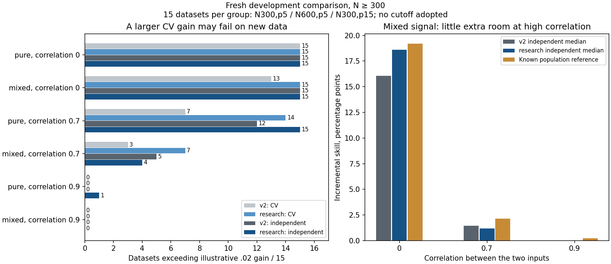

# Completed joint-shrinkage and correlation investigation

**The study completed cleanly. Looser joint tuning helped one setting, but did
not solve the difficult correlated mixed-effect case. Keep production defaults
unchanged.**

[Actions run 38208169760](https://github.com/imh-ds/open/actions/runs/38208169760)
used frozen source `57280d969f75521ef23a4034a9e398bf16b04a76`.
122/122 jobs succeeded; 240/240 datasets completed, all 48 cells had their
five planned replications, and there were zero missing tasks, audit errors or
recorded warnings. The local offline audit exactly matches the Actions audit.
The run took 11.83 wall minutes and 169.92 summed job minutes. It performed
212,160 fitting/tuning fits and 4,800 saved-setting verification refits.

This compares the stabilized experimental spline model against a research
version that tunes a shared weight for the joint terms. It uses two fixed pairs;
there is no RF shortlisting, automatic interaction decision, or network-recovery
endpoint. See the [frozen protocol](../../pair_correlation_protocol.md).

## What the comparison shows

The table uses the prespecified .02 gain as an illustrative yardstick. It is
not an accepted cutoff. Every entry has **15 planned and completed datasets**:
five each at N300,p5; N600,p5; N300,p15. Each independent assessment has 1,000
fresh observations after fitting the full discovery dataset.

|Known signal and input correlation|Current CV > .02|Research CV > .02|Current independent > .02|Research independent > .02|
|---|---:|---:|---:|---:|
|Pure product, 0|15/15|15/15|15/15|15/15|
|Mixed direct + product, 0|13/15|15/15|15/15|15/15|
|Pure product, .7|7/15|14/15|12/15|15/15|
|Mixed direct + product, .7|3/15|7/15|5/15|4/15|
|Pure product, .9|0/15|0/15|0/15|1/15|
|Mixed direct + product, .9|0/15|0/15|0/15|0/15|

The improvement for the pure-product signal at correlation .7 survives
independent testing: median independent gain rises from .05135 to .07551.
The mixed signal does not show that improvement. At correlation .7 its CV
counts improve, but independent counts do not; median independent gain falls
from .01456 to .01195. These are descriptive paired development results, not
confirmatory evidence or universal sample-size guidance.

## Why similar predictors leave little extra room

In these particular Gaussian simulations, separate curves can already represent
much of the product relationship when the inputs move together. The known
population gain from adding the remaining joint pattern to the best additive
curves is:

|Input correlation|Pure-product population gain|Mixed-signal population gain|
|---:|---:|---:|
|0|.60000|.19200|
|.7|.07029|.02126|
|.9|.00661|.00213|

Thus a mixed interaction may exist in the generating equation while offering
only about 2.1 percentage points of extra predictive skill at correlation .7,
or .2 at correlation .9. A .02 cutoff would exceed the latter population
reference even for perfect population additive/joint models. The table does
not justify choosing a new cutoff after seeing the results.

These are analytic references for the stipulated Gaussian signals, not universal
identifiability criteria or strict bounds on finite fitted-model gains. Sampling
variation and imperfect baseline curves can yield estimated gains above them.
Weak extra gain must not be presented as proof that an interaction is absent.

## Why the expanded tuning grid should not be adopted yet

Some small-sample models generalize poorly despite successful fitting.
In `pure-rho0.9-n80-p5-r00`, research pooled outer-CV gain is -1.09256.
Its second outer fold selected weight100, knots5, alpha100 and had joint MSE
14.05755 versus additive MSE2.11391, with fold gain -3.09410. Production chose
knots3, alpha10 in that fold and had essentially zero extra gain. Multiplying
the joint block by100 makes its relative ridge penalty alpha/100 squared,
so this is a much less restricted joint model.

That dataset's final full-discovery research model instead selected weight1,
knots3, alpha10, exactly matching production; independent gain was +.0000251.
The severe failure concerns an outer-CV fit, not that dataset's independent
assessment. It warrants investigating small-sample tuning, support in the tails
and projection conditioning; it does not establish recurrence of the earlier
tiny-column scaling bug, which this frozen study does not use.

At the same descriptive .02 threshold, the unrelated x1:x3 control pair has
positive CV comparisons in 2/240 current versus 5/240 research datasets;
independent counts are 2/240 for each. For x1:x2 in the 120 noise/additive
datasets, CV counts are 0 versus1 and independent counts1 versus0. These
fixed-pair checks are not calibrated all-pair false-positive rates.

**Recommendation:** retain current production defaults and treat interaction
comparisons as exploratory. First diagnose the saved small-N failure, then
freeze one bounded change for fresh development testing. Do not expand the
tuning grid again or claim sample-size requirements from five replications
per cell. No further run was dispatched during this closeout.

## Verification and retained evidence

- The original combined artifact's 131,916,181 bytes match its GitHub SHA256
  `4e733a8e8503bd1bab1e15987c91541b0a858eca522b3043d334a2ea06d0fbde`; ZIP CRC passed.
- 2,280 duplicated worker files were checked byte-for-byte against the merged
  originals before omission. The retained archive contains all 240 raw results,
  predictions, comparison checkpoints, settings, receipts, timing, verification
  stamps, shard identities, original aggregate outputs and frozen manifest.
- The retained archive is 66,020,610 bytes, 2,287 files, SHA256
  `c5c95dcc81a3abd78558456c4f52958007994493eb90f8631292ccf23cce3e77`.
  Two ordered parts stay below GitHub's file-size warning. Exact part/file
  identities are recorded in [receipt.json](receipt.json) and
  [retained-inventory.json](retained-inventory.json).
- Independent AI review recomputed all 960 case-summary rows from raw predictions:
  maximum CV gain difference 3.89e-16; independent gain difference 4.43e-16.
- Additional local saved-setting refits covered 40 models across the severe
  small-N case and one correlated mixed N300 case. They differed from worker
  predictions by at most 2.8532e-7 and MSE by at most 5.1971e-8. The frozen
  helper's 1e-9 replay assertion fails locally on the first baseline difference
  of 8.6596e-9. **These are not counted as strict local passes.** The helper
  remains unchanged; no historical tolerance or result was rewritten. The
  exact source of the small cross-machine differences has not been isolated.
  Details are retained in [local-refit-differences.json](local-refit-differences.json).

Reassemble and check every archived file with
`python verify_archive.py --output <fresh-directory> --extract`, run from this
results directory. The helper does not contact GitHub or refit models.
To rerun the frozen analysis, use the recorded source commit and pinned runtime;
do not silently replay it with future changed sources. Production source,
previous frozen studies and their denominators remain unchanged. This evidence
closeout made no new full-test-suite or automatic-method-acceptance claim.
