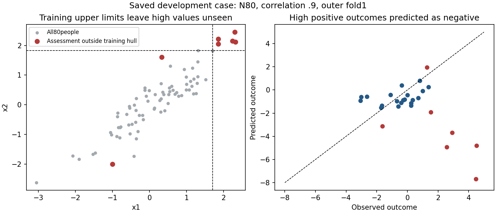

# Small-sample joint-model failure: diagnosis

The saved D-036 failure is reproduced: a flexible joint model extrapolates in
the wrong direction beyond its training range. The lower inner-CV error does
not transfer to the outer assessment. This is a research comparator failure,
not failure to run the recursive engine or evidence of an arithmetic error.

The dataset is `pure-rho0.9-n80-p5-r00`, seed148000200, split168000200,
outer fold1. There are 53 training and27 assessment observations; inner tuning
fits use35,35,36 observations. Original evidence remains in the
[completed study](../2026-10-12-pair-correlation/REPORT.md).

## Trace of the failure

- Minimum inner-CV MSE chooses weight100, knots5, alpha100: inner MSE1.98111
  versus2.06478 for weight1, knots3, alpha10. The apparent advantage is .08367.
- The winner's across-fold sample SD/sqrt3 is .22670. A one-SE-style band
  therefore also includes the restrained model and weight10, knots3, alpha10.
- On the outer assessment, the selected model has MSE14.05755, while the
  weight1 alternative has2.11255. At row70, observed4.48339 and generating
  mean4.73745 contrast with predicted-7.69932. The joint block contributes
  -8.23804 to that prediction; the marginal block contributes+.78397.
- Five observations exceed the training ranges of x1/x2; they account for
  91.774% of joint-model squared error. For example, row70 x1=2.29885 and
  x2=2.45229 exceed training maxima1.70767 and1.83406. All five largest
  errors are outside the training pair's convex hull.
- Replacing LSQR with SVD, or tightening LSQR tolerance to1e-12, changes
  predictions by at most about8.09e-7. The marginal projection has rank13 and
  a nonzero singular-value condition number891.64. These checks do not prove
  universal numerical safety; they show rounding error cannot explain this
  saved failure's large prediction/risk discrepancy.

## Bounded research response

Keep the same candidate grid and add a conservative selection policy: among
candidates whose mean inner-CV MSE is within one heuristic fold-SE of the
minimum, prefer the strongest joint penalty alpha/weight squared. Break ties
by fewer knots, larger marginal alpha, then smaller weight. This ranking is
a prespecified penalty preference, not a universal ordering of total model
complexity across spline bases. Keep the minimum-CV model as a competitor.
It selects the weight1/knots3/alpha10 alternative in this development case.

The [Stanford course notes](https://web.stanford.edu/class/stats202/notes/Resampling/Kfold-CV.html)
describe the one-SE parsimony heuristic. The uncertainty band is **not** a
confidence interval or a significance test: CV folds share training data, as
discussed by [Bates, Hastie and Tibshirani](https://arxiv.org/abs/2104.00673).
No assessment outcomes enter selection. Do not clip predictions, remove the
five difficult observations, or rewrite the original study.

This saved case informed development. It cannot validate the new policy.
Freeze fresh identities before further testing; retain production defaults
until evidence supports a separate adoption decision. The candidate may
reduce genuine interaction gains or still extrapolate poorly. It remains
experimental and cannot certify an interaction is absent.

## Replay and evidence

`reproduce.py`, run from the repository root with the frozen D-036 sources
and pinned runtime, regenerates the CV search, candidate assessment risks,
prediction components and solver comparisons under `.superpowers/small-n-diagnosis`.
Raw discovery data, all24 candidate scores, all27 assessment predictions,
training ranges and singular values are retained here. Candidate outer risks
are diagnostic only and are not inputs to the proposed selector.
