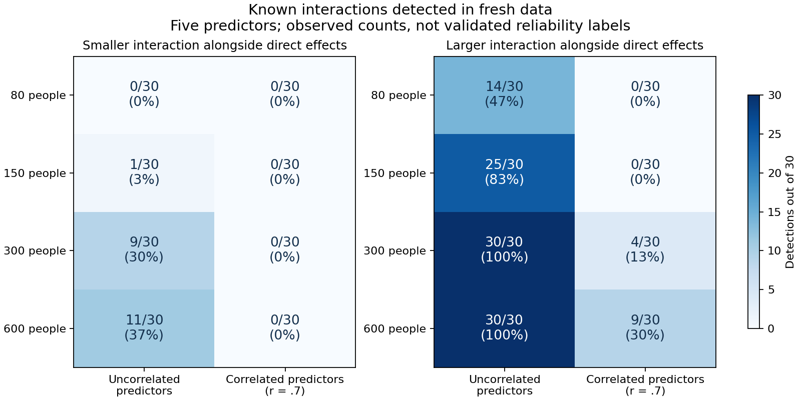

# Interaction confidence confirmation: plain-language findings

The run completed successfully at frozen source c213bf92c5fd5a28720497cdf238c1a0ea812d5e: all 5,200 datasets, all 132 jobs, zero missing results, audit errors or fitting warnings. Software execution succeeded. The proposed confidence rule did not meet the full prespecified scientific gate.

## What the results mean

**Interactions are detectable, but this rule is not yet reliable across all tested conditions.** Sample size matters, and overlap between predictors matters greatly. A missed interaction is not evidence that no interaction exists.

For a larger interaction alongside ordinary direct effects, with five predictors:

| People | Uncorrelated predictors | Correlated predictors (r=.7) |
| --- | --- | --- |
|80|14/30 found|0/30 found|
|150|25/30 found|0/30 found|
|300|30/30 found|4/30 found|
|600|30/30 found|9/30 found|

These are observed detection counts. They are not accepted sample-size recommendations: the global false-alarm gate failed. Smaller mixed interactions were difficult even without predictor overlap (0, 1, 9 and 11 detections out of 30 at N80,150,300,600); all corresponding correlated settings had zero detections. When interaction is the only systematic signal, detection is much better in favorable settings (30/30 at N300/600 with uncorrelated predictors). Thus interactions are possible to recover, but favorable pure-interaction examples do not establish reliability for more realistic mixtures.

Predictor overlap also changes how distinguishable the interaction is in this generator. At the same mixed-interaction coefficient .8 and overall population prediction strength, its analytic distinct-joint reference is .192 with uncorrelated predictors and .0213 at r=.7. Separate curved predictor effects can explain much of the correlated pattern. Thus this comparison does not hold distinct interaction information constant; poor detection under correlation is not by itself evidence of a software defect or a universal inability to model interactions. These references are not bounds on fitted scores or empirical detection guarantees.

## False alarms: rare overall, insufficient assurance in two settings

There were 19 false interaction findings among 4,000 interaction-free datasets (0.475% overall). 18 of 20 null settings met their prespecified upper-bound requirement. Two did not:

| Setting | False alarms | Observed rate | Simultaneous 95% upper bound |
| --- | --- | --- | --- |
|N = 300, 5 predictors, uncorrelated, pure noise|5/200|2.5%|7.39%|
|N = 300, 15 predictors,r=.7, nonlinear additive outcome|3/200|1.5%|5.81%|

The requirement was that every bound be at most 5%. Those upper bounds are uncertainty limits, not estimated false-alarm rates. This result means insufficient evidence for the promised assurance across the full tested panel; it does not prove that the true false-alarm rate exceeds 5%. The pooled low rate cannot override the per-setting requirement. No guidance flags qualify, including otherwise favorable detection settings; do not retrospectively accept selected cells.

The assurance requirement is stringent with only 200 null datasets per setting: three false alarms already fail the simultaneous bound despite an observed rate of only 1.5%. The next diagnostic should assess calibration variability and confirmation precision before treating this as a model defect. As a hypothetical calculation, at a true 1% false-alarm rate a single setting has only about a 67.7% chance of observing at most two alarms in 200 datasets. This is an illustration of the test design, not an estimate of any setting's true rate and not a change to the frozen acceptance rule.

The cutoffs remain exactly as frozen before confirmation. Raising them using these confirmation data would invalidate the independent test. More conservative cutoffs could also make the already weak detection worse.

## Does a detected interaction produce a trustworthy plot?

Of 1,200 known-interaction datasets, 535 passed the prediction decision. Of these, 474 had enough common grid support to assess the plot and 61 did not. 457 showed consistent patterns across folds; five of those consistent detected patterns failed the prespecified similarity diagnostic against the known true interaction. Consistent-looking is not the same as correct. These descriptive checks do not repair the failed confidence gate. Across all 1,200 alternatives, 29 stable-looking patterns failed that truth diagnostic; 24 were nonqualifying and should not be described as accepted displayed findings. Three incorrect control-pair inclusions occurred in signal datasets.

## Recommended next step

Keep interaction findings exploratory. Run a targeted investigation on **fresh development identities** before another large frozen study:

1. Diagnose the two false-alarm assurance failures: calibration-tail variability, confirmation precision versus model/comparator behavior. Do not alter thresholds to make this confirmation pass. Consider whether greater calibration coverage or a revised calibration rule is justified only after that development evidence.
2. Diagnose correlated mixed-interaction misses: separate weak distinct interaction information, model/comparator limitations and the decision cutoff. Increasing N alone did not resolve the problem. Compare against the known generator's distinct joint information; its analytic reference is context, not a bound on fitted CV gains.
3. Investigate support and shape agreement so a prediction finding can be reported without overstating a curve when support is sparse.

Any revised rule needs a newly frozen independent confirmation. No new study was launched during this results closeout. No production confidence rule, universal minimum sample size, general RF/GBM claim or causal interpretation is adopted.

## Evidence and provenance

[Completed run 38330174633](https://github.com/imh-ds/open/actions/runs/38330174633); frozen source c213bf92c5fd5a28720497cdf238c1a0ea812d5e. Recorded summed job duration 583.57 runner minutes (not billing-rounded minutes), within the Stage B 3,975-minute cap. Complete-task cost: 3,598,400 fit/tune calls plus 104,000 saved-setting verification refits; those refits are not fresh scientific replications.

Full artifact SHA256 96d0c5d5cb2afc20fc73f4ac6da05c379bf23de4fa2983e2c9dd44c05e47befd matches GitHub API digest. Every unique raw prediction, CV trace, curve/support/checkpoint, timing/source/verification receipt, shard stamp and frozen artifact is retained in partitioned evidence; duplicate worker copies are removed only after byte-for-byte equality checks. See receipt.json, retained-inventory.json and VERIFICATION.md. Offline verification status is documented separately; completed Actions audit is preserved in audit.json.

Verify/extract the retained archive with `python verify_archive.py --output <fresh-directory> --extract`. Audit predictions/records and independently reproduce decisions and bounds without fitting with `python verify_results.py --input <extracted-directory>/.superpowers/pair-confidence --output <fresh-directory> --workers 4`. Original research-bound graph is SUMMARY.png; the simpler observed-count graph is INTERPRETATION.png.

Offline verification completed: all 5,200 raw datasets and 130 shard stamps passed; all 41,600 pair comparisons and 10,400 pooled scores reproduced exactly. Independently recomputed intervals and summary decisions match the saved audit. No models were refitted during closeout. See VERIFICATION.md.
