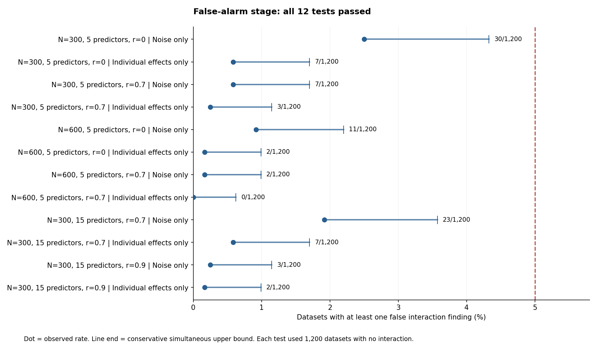

# False-alarm validation passed in every tested condition

The method rarely reported an interaction when the simulated data contained none. All six predictor/sample conditions passed both their noise-only and individual-effects-only checks. This is prospective evidence for controlling false findings under the tested simulations with Gaussian predictors and the frozen spline comparator.

Of 14,400 datasets, 97 had at least one false interaction finding (0.674% overall). This pooled percentage is descriptive; qualification used each condition separately. The worst observed rate was 30/1,200 = 2.50%; its conservative upper bound was 4.33%, below the predeclared 5% limit. All 12 bounds passed.

| Sample N | Predictors | Predictor correlation | Noise false findings /1,200 | Individual-effects-only false findings /1,200 | Both null checks |
|---:|---:|---:|---:|---:|---|
| 300 | 5 | 0 | 30 | 7 | Passed |
| 300 | 5 | 0.7 | 7 | 3 | Passed |
| 600 | 5 | 0 | 11 | 2 | Passed |
| 600 | 5 | 0.7 | 2 | 0 | Passed |
| 300 | 15 | 0.7 | 23 | 7 | Passed |
| 300 | 15 | 0.9 | 3 | 2 | Passed |



What this means: the false-alarm hurdle is cleared. What remains to test: how often the method finds genuine interactions and whether displayed relative patterns are reliable. Quiet results alone cannot establish detection power. No universal minimum sample size, full-network recovery or other-engine qualification follows from Stage A.

The rule and historical cutoffs were unchanged. This was a fresh, larger validation with adequate replication; it supplies a more precise prospective estimate. The earlier D-040 failed outcome remains unchanged and is not retrospectively accepted.

All 14,400 planned identities completed with no missing cases, audit errors, warnings or unknown attempt costs; all 182 jobs successful. Independent raw checks reproduced 115,200 pair-risk comparisons,57,600 population-risk comparisons and all 12 binomial bounds, maximum score difference 0; no additional model fitting.

All six conditions qualify to proceed to the preapproved Stage B: 10,800 frozen alternative datasets across 135 shards. Stage B selection and its Stage A audit must be committed and publicly verified before dispatch. It tests true-pair detection, incorrect control-pair inclusion and conditional supported-pattern fidelity separately. Quantitative amplitude accuracy remains outside the pattern criterion.

Durable evidence:180 raw shard archives and their original inventories/hashes, all 129,780 unique raw files, plus original Actions summaries/source/runtime/API receipts. The original 3,260,914,459-byte artifact SHA256 is 637796dd54106150ef6579d7c68fcf2937c2de1eaeb9e2eb411e42e820f8b104. Retained inner-archive payload is 3,307,771,746 bytes. Archives are published in six bounded groups; publication status is recorded separately.

Reproduce without fitting:

```
python recompute_results.py --input . --output FRESH_VERIFICATION_DIRECTORY
```

Pinned runtime: Python3.11.9/numpy1.26.4/pandas2.2.3/scipy1.11.2/scikit-learn1.3.0. The verifier imports no project model or decision code. The failed initial structural audit tests and corrected verifier are retained in tests/test_prospective_null_evidence.py.
