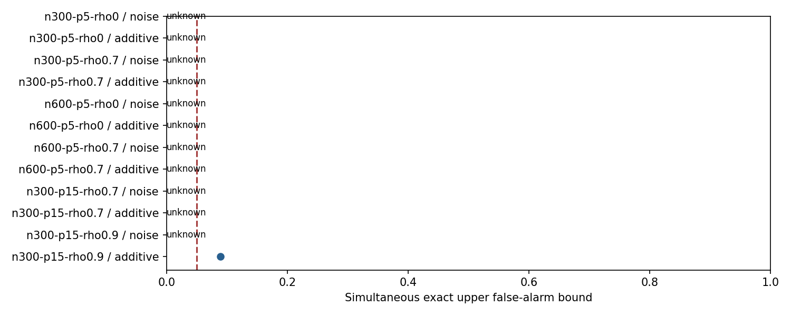

# Prospective interaction reliability

Stage null: 80/14400 planned datasets completed; 14320 missing; 0 audit errors.
Missing and errored results are unknown. No incomplete stratum receives a support label.

This tests two fixed pairs with one frozen Gaussian spline method. It does not certify other engines, causal moderation or the full recursive network.
Curve-pattern support checks relative direction/pattern at common supported locations, not magnitude, pointwise accuracy or the full surface.

Conditions passing both null-class gates: 0/6.
Meaning: only these conditions may proceed to testing reliable interaction detection. A failing null gate is insufficient assurance about false alarms, not proof that interactions do not exist.

| Condition | Null type | False alarms / completed | Upper bound | Status |
|---|---|---:|---:|---|
| n300-p5-rho0 | noise | 0/0 | unknown | unknown_incomplete_stratum |
| n300-p5-rho0 | additive | 0/0 | unknown | unknown_incomplete_stratum |
| n300-p5-rho0.7 | noise | 0/0 | unknown | unknown_incomplete_stratum |
| n300-p5-rho0.7 | additive | 0/0 | unknown | unknown_incomplete_stratum |
| n600-p5-rho0 | noise | 0/0 | unknown | unknown_incomplete_stratum |
| n600-p5-rho0 | additive | 0/0 | unknown | unknown_incomplete_stratum |
| n600-p5-rho0.7 | noise | 0/0 | unknown | unknown_incomplete_stratum |
| n600-p5-rho0.7 | additive | 0/0 | unknown | unknown_incomplete_stratum |
| n300-p15-rho0.7 | noise | 0/0 | unknown | unknown_incomplete_stratum |
| n300-p15-rho0.7 | additive | 0/0 | unknown | unknown_incomplete_stratum |
| n300-p15-rho0.9 | noise | 0/0 | unknown | unknown_incomplete_stratum |
| n300-p15-rho0.9 | additive | 0/80 | 0.0894 | unknown_incomplete_stratum |

Observed-rate miss means the measured rate misses the requirement; it is descriptive. Uncertain despite an observed rate meeting the target means the bound is still too imprecise to qualify. Neither is a certificate of the underlying population rate.

