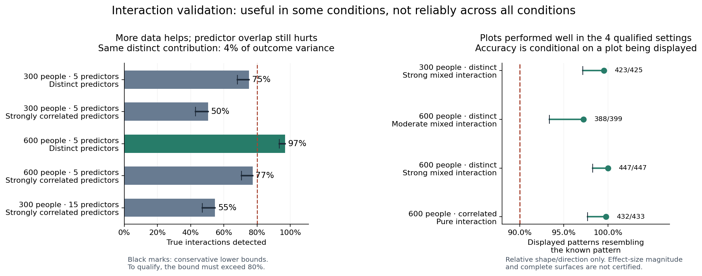

# Interaction reliability: conditional success, not general reliability

[Completed Actions run](https://github.com/imh-ds/open/actions/runs/38450851403)

The method can detect interactions and show useful patterns, but it is not reliable across all tested conditions. All 10,800 datasets completed. Only **4 of 24 tested combinations** passed both the predictive and plotted-pattern requirements.

## What this means simply

The method is usually cautious about inventing interactions, but caution has a cost: it misses many real interactions when effects are weak or predictors overlap strongly. A missing interaction therefore cannot be interpreted as evidence that the interaction does not exist.

More data helped in the controlled-strength comparison below. Both predictor-correlation settings have the same distinct interaction contribution: 4% of outcome variance. Each percentage is based on 450 datasets.

| Sample size | Predictors | Relationship between predictors | Real interactions found | Reliability requirement met? |
|---:|---:|---|---:|---|
| 300 | 5 | Distinct (correlation 0) | 338/450 = 75.1% | No |
| 300 | 5 | Strongly correlated (0.7) | 227/450 = 50.4% | No |
| 600 | 5 | Distinct (0) | 436/450 = 96.9% | Yes |
| 600 | 5 | Strongly correlated (0.7) | 348/450 = 77.3% | No |
| 300 | 15 | Strongly correlated (0.7) | 246/450 = 54.7% | No |

The requirement applies to the conservative lower confidence bound, not just the percentage. For example, 600 people did not guarantee reliable detection when predictors were strongly correlated. The 15-predictor example does not establish that increasing the predictor count caused a decline; its result is similar to the five-predictor counterpart.

## Which settings qualified?

| Tested setting | Interaction | Detected / 450 | Displayed / 450 | Correct relative patterns / displayed |
|---|---|---:|---:|---:|
| 300 people, 5 predictors, correlation 0 | Mixed, fixed coefficient 0.8 | 447 | 425 | 423/425 = 99.5% |
| 600 people, 5 predictors, correlation 0 | Mixed, distinct contribution 4% | 436 | 399 | 388/399 = 97.2% |
| 600 people, 5 predictors, correlation 0 | Mixed, fixed coefficient 0.8 | 450 | 447 | 447/447 = 100% |
| 600 people, 5 predictors, correlation 0.7 | Pure, fixed coefficient 0.8 | 438 | 433 | 432/433 = 99.8% |

“Mixed” includes separate additive effects plus an interaction. “Pure” contains the interaction without separate additive effects. Equal coefficients do not imply equal distinct standardized strength across predictor-correlation settings.

These four combinations passed the null tests, the unrelated-pair control test, the detection test, and the conditional relative-pattern test. Their plots performed well **when displayed**, which does not guarantee a plot in every dataset or validate effect-size magnitude or every point on a surface.

## Why the other settings did not qualify

Six combinations passed the detection criterion; four also passed the unrelated-pair control criterion. The other two were pure interactions with uncorrelated predictors: both detected 450/450 true interactions, but also flagged the unrelated control pair in 22/450 and 12/450 datasets. These observed rates are 4.9% and 2.7%; their conservative upper bounds exceed 5%. They did not provide enough assurance to certify the false-alarm limit. This is not proof that either population false-alarm rate exceeds 5%.

Twenty-two combinations passed the unrelated-pair control criterion. Eleven passed the conditional pattern criterion considered separately, but a correct plot among a small selected subset cannot rescue poor detection. Only four passed the combined requirements. At predictor correlation 0.9, the tested interactions were found in only 1–6 of 450 datasets. Those benchmarks use smaller feasible distinct-information targets than the 4% comparison, so they cannot isolate correlation's effect from signal strength.

## Practical recommendation

Treat interaction findings as exploratory unless the study's conditions have been validated. Retain the distinction between detecting an interaction and validating its displayed relative pattern. Do not turn these simulations into a universal minimum sample size, automatically label any study with 600 people reliable, or interpret absence from the graph as absence of an interaction.

The independent saved-vector arithmetic review is now complete, and [researcher guidance](../../prospective_interaction_guidance.md) explains these evidence levels and the actual tuning sample sizes. The large raw archives are committed locally; publishing and verifying those archives remotely remains a separate archival closeout task. The present evidence does not justify a general production confidence claim or automatic confidence labels for individual studies.

## Verification and scope

The source matches the frozen public commit `110ddfd617e8d9694d27688998d1d4cb1f719700`, run attempt 1. All 137 jobs (135 workers, preparation and aggregation) succeeded. No missing datasets, skipped identities, audit errors, warnings, failed tasks or unknown fitting costs were reported. Actions audited the saved prediction and curve records.

The independent local summary verifier checked all 10,800 dataset identities, 21,600 pair records, score/threshold decisions, and all 72 endpoint bounds and support decisions. `verify_archives.py` verified the original artifact's API digest, raw inventories, CRCs, contexts, source hashes and attempt costs and retained all 135 raw shards locally.

The final [independent vector audit](independent-vectors-final/check.json) independently reconstructed generated outcomes, CV indices and saved tuning winners; checked 86,400 pair prediction-risk calculations, 43,200 ideal-population diagnostics and 86,400 curve calculations; then reproduced all dataset decisions and all 72 endpoint bounds. All 10,800 cases and 97,335 raw files passed. Recomputed prediction gains had a maximum difference of zero from their saved values. The four qualified combinations are unchanged. This uses saved predictions and tuning losses as inputs, rather than independently retraining models or validating numerical effect-size accuracy. See [verification details](VERIFICATION.md).

Known Actions fitting costs are 7,473,600 fitting/tuning calls and 216,000 saved-setting verification refits. Local evidence checks add no model fits. All denominators and thresholds remain frozen; this study does not rescue the historical failed confirmation study.

This is evidence for two prespecified pairs and one frozen Gaussian spline procedure. It does not certify RF, boosting, the complete recursive network, causal moderation, ordinal data or arbitrary predictor screening. The complete Actions artifact and all extracted raw shard archives are retained locally, with hashes and receipts; summary evidence is suitable for publication separately from the large raw archive transfers.

