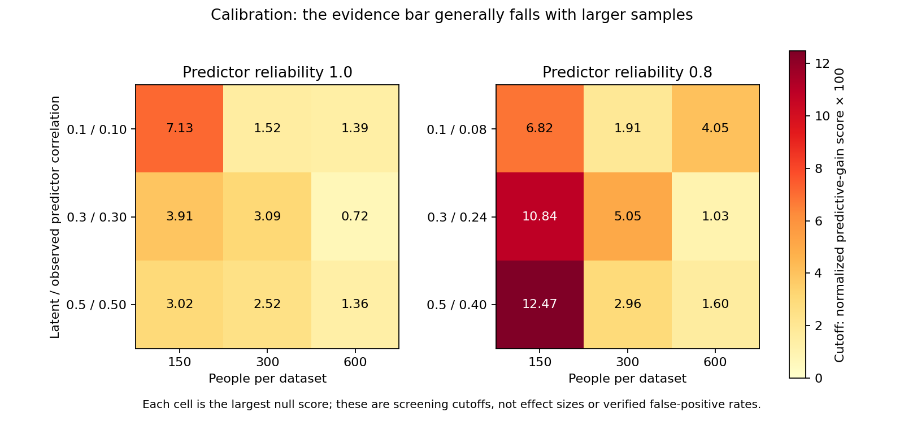

# Calibration findings for applied researchers

All **3,600 planned no-interaction datasets completed**, all 47 Actions jobs succeeded, and a fresh replay of all 45 raw shards reproduced every result row and all 18 cutoffs. No missing datasets, warnings, audit errors, failed attempts or unknown attempt costs. The replay fitted no new models. See `verification.json` and the preserved CI/replay audits.

## What the result means

**A small positive prediction improvement is weak evidence of an interaction.** In 1,437/3,600 datasets (39.9%), at least one candidate received a positive score after the basic CV screen, even though no measured-input interaction existed. This is the before-cutoff candidate frequency, not the false-positive rate of the final calibrated rule.

The practical purpose of calibration is to raise the evidence bar above those chance improvements. The fixed cutoff for each context is the largest eligible null score observed across both candidate pairs and both null classes. A candidate must strictly exceed it. All calibration scores fall at or below their learned cutoffs by construction; this does not establish zero future false positives.

|People per dataset|Positive candidate before cutoff|Range of learned cutoffs across the six contexts|
|---:|---:|---:|
|150|517/1,200 (43.1%)|0.0302–0.1247|
|300|495/1,200 (41.3%)|0.0152–0.0505|
|600|425/1,200 (35.4%)|0.0072–0.0405|

The sizes of the largest chance improvements generally decline as sample size increases. This supports greater caution with smaller studies. It does **not** yet show that N300 or N600 can reliably detect meaningful interactions. A higher cutoff could also exclude weaker genuine interactions; the next stage measures that trade-off. These cutoffs use maxima of finite simulations, so individual contexts need not change monotonically with sample size.

The score is added predictive value beyond separately modelled effects, normalized to a mean-only prediction reference. Cutoffs are screening statistics, not beta coefficients, Cohen's d or measures of psychological importance. Effect interpretation still uses the conditional curves and standardized contrasts after selection and support checks.

The two panels have different observed correlations because measurement error attenuates the latent correlation. The observed-additive null is defined directly on the measured predictors; differences between reliability panels alone cannot establish the effect of measurement error on real-interaction detection.

## Rules and reporting implications

- Keep the interaction cutoff in addition to the positive overall CV gain and improvement in at least two outer folds. Basic eligibility alone is too permissive in these simulations.
- Keep the learned cutoffs fixed for the fresh development assessment. Do not lower them after seeing which real interactions fail.
- Retain the separate plot-support and fold-pattern checks. Selecting an interaction does not automatically establish that its displayed shape or magnitude is accurate.
- Report a failed interaction screen as **insufficient evidence**, rather than proof that no interaction exists. Weak effects and limited sample sizes remain possible explanations.
- The configurable 70% network-link retention setting serves a different purpose: recurrence/stability of network links. This calibration supplies an interaction-score screen, not a replacement retention percentage.
- Do not yet publish a universal minimum N, production-confidence label or a claim of a verified false-positive rate. These results concern five continuous Gaussian predictors, two fixed candidate pairs and the current weighted-spline procedure; other engines, ordinal scores and wider pair searches require separate evidence.

The next approved stage uses 10,800 fresh, disjoint datasets: observed predictive nulls, weaker product/saturating mixed interactions, a strong reference and a separately labelled measurement-induced structure diagnostic. It checks fresh false alarms, true-interaction detection, display coverage and conditional-pattern/magnitude diagnostics. Its 80-replicate summaries are descriptive, not simultaneous qualification.

## Evidence and preservation

CI run: [38477737386](https://github.com/imh-ds/open/actions/runs/38477737386), source `9ece0250e04a6213b397dd871961759db6f0fdd3`, attempt1. Frozen base manifest `12e6b9e023f15d3e8d19656e7e4b7403884ba6a4c7ddc05d4d8629dae3d9c560`.

All 32,445 raw files are preserved in 45 lossless ZIPs (803,750,422 compressed bytes), with per-file inventories/digests and API provenance. Six local Git commits preserve raw evidence separately from findings. Large raw archives are not yet publicly published; summary, audit and threshold publication are checked separately. `raw-index.json` and `raw-preservation-commits.json` record the local preservation boundary. Original downloaded evidence remains retained as well.

`recompute_calibration.py` reproduces the descriptive summaries/chart from `ci-audit.json`. Its shared-axis label error was reproduced and corrected before publication; both reliability panels now show their own observed correlations. The frozen model/calibration code was unchanged. Full raw replay uses the frozen runner's `aggregate --stage calibration` command with the preserved `raw/` input folder, or the original downloaded combined artifact.
