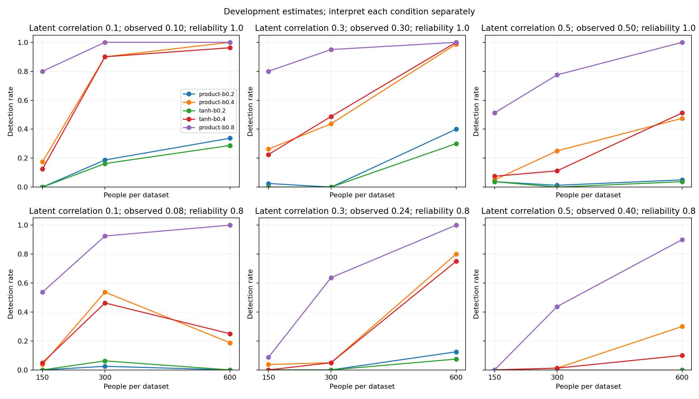
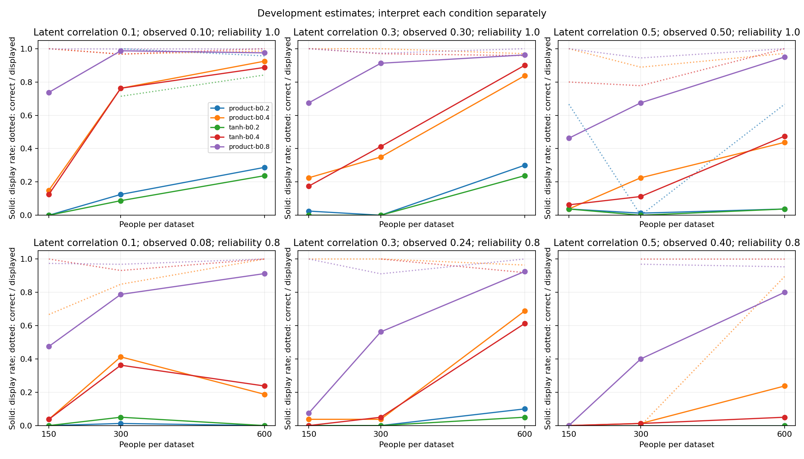

# Realistic interaction development study

Completed 10800/10800 planned datasets; 0 unknown; 0 audit errors.

This is a development map. It does not certify individual findings or establish a universal minimum sample size.

Each calibration cutoff is the largest eligible score across both candidate pairs and both observed-input null classes. Development uses new datasets.

Displayed/80 measures how often a usable plot appeared. Correct/displayed measures its pattern agreement when assessed. Zero plots leave pattern accuracy unresolved.

Intervals are exact two-sided 95% descriptive intervals, without correction for the many comparisons. Incomplete groups cannot support recommendations.

Noisy latent-additive cases represent measurement-induced predictive structure, not false latent-moderation discoveries.

Magnitude errors and standardized contrast RMSE are descriptive; pattern agreement alone does not prove accurate effect sizes.

N150 uses outer training100 / inner66–67; N300 uses200 /133–134; N600 uses400 /266–267. Independent assessment adds no training participants.

|Context (latent gamma / observed rho / reliability)|Benchmark|Detected|Unrelated pair|Displayed|Correct pattern / displayed (unknown)|
|---|---|---:|---:|---:|---:|
|N150 / 0.1 / 0.10 / 1.0|noise|0/80|0/80|0/80|unresolved (0 unknown)|
|N150 / 0.1 / 0.10 / 1.0|observed-additive|0/80|0/80|0/80|unresolved (0 unknown)|
|N150 / 0.1 / 0.10 / 1.0|product-b0.2|0/80|0/80|0/80|unresolved (0 unknown)|
|N150 / 0.1 / 0.10 / 1.0|product-b0.4|14/80|0/80|12/80|12/12 (0 unknown)|
|N150 / 0.1 / 0.10 / 1.0|tanh-b0.2|0/80|0/80|0/80|unresolved (0 unknown)|
|N150 / 0.1 / 0.10 / 1.0|tanh-b0.4|10/80|0/80|10/80|10/10 (0 unknown)|
|N150 / 0.1 / 0.10 / 1.0|product-b0.8|64/80|1/80|59/80|59/59 (0 unknown)|
|N150 / 0.1 / 0.08 / 0.8|noise|0/80|0/80|0/80|unresolved (0 unknown)|
|N150 / 0.1 / 0.08 / 0.8|observed-additive|0/80|0/80|0/80|unresolved (0 unknown)|
|N150 / 0.1 / 0.08 / 0.8|product-b0.2|0/80|0/80|0/80|unresolved (0 unknown)|
|N150 / 0.1 / 0.08 / 0.8|product-b0.4|3/80|0/80|3/80|2/3 (0 unknown)|
|N150 / 0.1 / 0.08 / 0.8|tanh-b0.2|0/80|0/80|0/80|unresolved (0 unknown)|
|N150 / 0.1 / 0.08 / 0.8|tanh-b0.4|4/80|0/80|3/80|3/3 (0 unknown)|
|N150 / 0.1 / 0.08 / 0.8|product-b0.8|43/80|0/80|38/80|37/38 (0 unknown)|
|N150 / 0.1 / 0.08 / 0.8|latent-additive|0/80|0/80|0/80|unresolved (0 unknown)|
|N150 / 0.3 / 0.30 / 1.0|noise|0/80|3/80|0/80|unresolved (0 unknown)|
|N150 / 0.3 / 0.30 / 1.0|observed-additive|0/80|1/80|0/80|unresolved (0 unknown)|
|N150 / 0.3 / 0.30 / 1.0|product-b0.2|2/80|0/80|2/80|2/2 (0 unknown)|
|N150 / 0.3 / 0.30 / 1.0|product-b0.4|21/80|0/80|18/80|18/18 (0 unknown)|
|N150 / 0.3 / 0.30 / 1.0|tanh-b0.2|0/80|0/80|0/80|unresolved (0 unknown)|
|N150 / 0.3 / 0.30 / 1.0|tanh-b0.4|18/80|0/80|14/80|14/14 (0 unknown)|
|N150 / 0.3 / 0.30 / 1.0|product-b0.8|64/80|0/80|54/80|54/54 (0 unknown)|
|N150 / 0.3 / 0.24 / 0.8|noise|0/80|0/80|0/80|unresolved (0 unknown)|
|N150 / 0.3 / 0.24 / 0.8|observed-additive|0/80|0/80|0/80|unresolved (0 unknown)|
|N150 / 0.3 / 0.24 / 0.8|product-b0.2|0/80|0/80|0/80|unresolved (0 unknown)|
|N150 / 0.3 / 0.24 / 0.8|product-b0.4|3/80|0/80|3/80|3/3 (0 unknown)|
|N150 / 0.3 / 0.24 / 0.8|tanh-b0.2|0/80|0/80|0/80|unresolved (0 unknown)|
|N150 / 0.3 / 0.24 / 0.8|tanh-b0.4|0/80|0/80|0/80|unresolved (0 unknown)|
|N150 / 0.3 / 0.24 / 0.8|product-b0.8|7/80|0/80|6/80|6/6 (0 unknown)|
|N150 / 0.3 / 0.24 / 0.8|latent-additive|0/80|0/80|0/80|unresolved (0 unknown)|
|N150 / 0.5 / 0.50 / 1.0|noise|1/80|1/80|0/80|unresolved (0 unknown)|
|N150 / 0.5 / 0.50 / 1.0|observed-additive|0/80|1/80|0/80|unresolved (0 unknown)|
|N150 / 0.5 / 0.50 / 1.0|product-b0.2|3/80|0/80|3/80|2/3 (0 unknown)|
|N150 / 0.5 / 0.50 / 1.0|product-b0.4|4/80|0/80|3/80|3/3 (0 unknown)|
|N150 / 0.5 / 0.50 / 1.0|tanh-b0.2|3/80|0/80|3/80|3/3 (0 unknown)|
|N150 / 0.5 / 0.50 / 1.0|tanh-b0.4|6/80|1/80|5/80|4/5 (0 unknown)|
|N150 / 0.5 / 0.50 / 1.0|product-b0.8|41/80|0/80|37/80|37/37 (0 unknown)|
|N150 / 0.5 / 0.40 / 0.8|noise|0/80|0/80|0/80|unresolved (0 unknown)|
|N150 / 0.5 / 0.40 / 0.8|observed-additive|0/80|0/80|0/80|unresolved (0 unknown)|
|N150 / 0.5 / 0.40 / 0.8|product-b0.2|0/80|0/80|0/80|unresolved (0 unknown)|
|N150 / 0.5 / 0.40 / 0.8|product-b0.4|0/80|0/80|0/80|unresolved (0 unknown)|
|N150 / 0.5 / 0.40 / 0.8|tanh-b0.2|0/80|0/80|0/80|unresolved (0 unknown)|
|N150 / 0.5 / 0.40 / 0.8|tanh-b0.4|0/80|0/80|0/80|unresolved (0 unknown)|
|N150 / 0.5 / 0.40 / 0.8|product-b0.8|0/80|0/80|0/80|unresolved (0 unknown)|
|N150 / 0.5 / 0.40 / 0.8|latent-additive|0/80|0/80|0/80|unresolved (0 unknown)|
|N300 / 0.1 / 0.10 / 1.0|noise|1/80|1/80|1/80|0/1 (1 unknown)|
|N300 / 0.1 / 0.10 / 1.0|observed-additive|0/80|1/80|0/80|unresolved (0 unknown)|
|N300 / 0.1 / 0.10 / 1.0|product-b0.2|15/80|0/80|10/80|10/10 (0 unknown)|
|N300 / 0.1 / 0.10 / 1.0|product-b0.4|72/80|0/80|61/80|59/61 (0 unknown)|
|N300 / 0.1 / 0.10 / 1.0|tanh-b0.2|13/80|0/80|7/80|5/7 (0 unknown)|
|N300 / 0.1 / 0.10 / 1.0|tanh-b0.4|72/80|0/80|61/80|59/61 (0 unknown)|
|N300 / 0.1 / 0.10 / 1.0|product-b0.8|80/80|0/80|79/80|79/79 (0 unknown)|
|N300 / 0.1 / 0.08 / 0.8|noise|1/80|2/80|1/80|0/1 (1 unknown)|
|N300 / 0.1 / 0.08 / 0.8|observed-additive|1/80|0/80|1/80|0/1 (1 unknown)|
|N300 / 0.1 / 0.08 / 0.8|product-b0.2|2/80|0/80|1/80|1/1 (0 unknown)|
|N300 / 0.1 / 0.08 / 0.8|product-b0.4|43/80|0/80|33/80|28/33 (0 unknown)|
|N300 / 0.1 / 0.08 / 0.8|tanh-b0.2|5/80|0/80|4/80|3/4 (0 unknown)|
|N300 / 0.1 / 0.08 / 0.8|tanh-b0.4|37/80|0/80|29/80|27/29 (0 unknown)|
|N300 / 0.1 / 0.08 / 0.8|product-b0.8|74/80|1/80|63/80|61/63 (0 unknown)|
|N300 / 0.1 / 0.08 / 0.8|latent-additive|0/80|0/80|0/80|unresolved (0 unknown)|
|N300 / 0.3 / 0.30 / 1.0|noise|0/80|0/80|0/80|unresolved (0 unknown)|
|N300 / 0.3 / 0.30 / 1.0|observed-additive|0/80|0/80|0/80|unresolved (0 unknown)|
|N300 / 0.3 / 0.30 / 1.0|product-b0.2|0/80|0/80|0/80|unresolved (0 unknown)|
|N300 / 0.3 / 0.30 / 1.0|product-b0.4|35/80|0/80|28/80|28/28 (0 unknown)|
|N300 / 0.3 / 0.30 / 1.0|tanh-b0.2|0/80|0/80|0/80|unresolved (0 unknown)|
|N300 / 0.3 / 0.30 / 1.0|tanh-b0.4|39/80|0/80|33/80|32/33 (0 unknown)|
|N300 / 0.3 / 0.30 / 1.0|product-b0.8|76/80|0/80|73/80|71/73 (0 unknown)|
|N300 / 0.3 / 0.24 / 0.8|noise|0/80|0/80|0/80|unresolved (0 unknown)|
|N300 / 0.3 / 0.24 / 0.8|observed-additive|0/80|0/80|0/80|unresolved (0 unknown)|
|N300 / 0.3 / 0.24 / 0.8|product-b0.2|0/80|0/80|0/80|unresolved (0 unknown)|
|N300 / 0.3 / 0.24 / 0.8|product-b0.4|4/80|0/80|3/80|3/3 (0 unknown)|
|N300 / 0.3 / 0.24 / 0.8|tanh-b0.2|0/80|0/80|0/80|unresolved (0 unknown)|
|N300 / 0.3 / 0.24 / 0.8|tanh-b0.4|4/80|0/80|4/80|4/4 (0 unknown)|
|N300 / 0.3 / 0.24 / 0.8|product-b0.8|51/80|0/80|45/80|41/45 (0 unknown)|
|N300 / 0.3 / 0.24 / 0.8|latent-additive|0/80|0/80|0/80|unresolved (0 unknown)|
|N300 / 0.5 / 0.50 / 1.0|noise|0/80|0/80|0/80|unresolved (0 unknown)|
|N300 / 0.5 / 0.50 / 1.0|observed-additive|0/80|0/80|0/80|unresolved (0 unknown)|
|N300 / 0.5 / 0.50 / 1.0|product-b0.2|1/80|0/80|1/80|0/1 (0 unknown)|
|N300 / 0.5 / 0.50 / 1.0|product-b0.4|20/80|0/80|18/80|16/18 (0 unknown)|
|N300 / 0.5 / 0.50 / 1.0|tanh-b0.2|0/80|0/80|0/80|unresolved (0 unknown)|
|N300 / 0.5 / 0.50 / 1.0|tanh-b0.4|9/80|0/80|9/80|7/9 (0 unknown)|
|N300 / 0.5 / 0.50 / 1.0|product-b0.8|62/80|1/80|54/80|51/54 (0 unknown)|
|N300 / 0.5 / 0.40 / 0.8|noise|0/80|0/80|0/80|unresolved (0 unknown)|
|N300 / 0.5 / 0.40 / 0.8|observed-additive|0/80|0/80|0/80|unresolved (0 unknown)|
|N300 / 0.5 / 0.40 / 0.8|product-b0.2|0/80|0/80|0/80|unresolved (0 unknown)|
|N300 / 0.5 / 0.40 / 0.8|product-b0.4|1/80|0/80|1/80|0/1 (0 unknown)|
|N300 / 0.5 / 0.40 / 0.8|tanh-b0.2|0/80|0/80|0/80|unresolved (0 unknown)|
|N300 / 0.5 / 0.40 / 0.8|tanh-b0.4|1/80|0/80|1/80|1/1 (0 unknown)|
|N300 / 0.5 / 0.40 / 0.8|product-b0.8|35/80|0/80|32/80|31/32 (0 unknown)|
|N300 / 0.5 / 0.40 / 0.8|latent-additive|0/80|0/80|0/80|unresolved (0 unknown)|
|N600 / 0.1 / 0.10 / 1.0|noise|0/80|0/80|0/80|unresolved (0 unknown)|
|N600 / 0.1 / 0.10 / 1.0|observed-additive|0/80|0/80|0/80|unresolved (0 unknown)|
|N600 / 0.1 / 0.10 / 1.0|product-b0.2|27/80|0/80|23/80|22/23 (0 unknown)|
|N600 / 0.1 / 0.10 / 1.0|product-b0.4|80/80|0/80|74/80|73/74 (0 unknown)|
|N600 / 0.1 / 0.10 / 1.0|tanh-b0.2|23/80|0/80|19/80|16/19 (0 unknown)|
|N600 / 0.1 / 0.10 / 1.0|tanh-b0.4|77/80|0/80|71/80|71/71 (0 unknown)|
|N600 / 0.1 / 0.10 / 1.0|product-b0.8|80/80|0/80|78/80|78/78 (0 unknown)|
|N600 / 0.1 / 0.08 / 0.8|noise|0/80|0/80|0/80|unresolved (0 unknown)|
|N600 / 0.1 / 0.08 / 0.8|observed-additive|0/80|0/80|0/80|unresolved (0 unknown)|
|N600 / 0.1 / 0.08 / 0.8|product-b0.2|0/80|0/80|0/80|unresolved (0 unknown)|
|N600 / 0.1 / 0.08 / 0.8|product-b0.4|15/80|0/80|15/80|15/15 (0 unknown)|
|N600 / 0.1 / 0.08 / 0.8|tanh-b0.2|0/80|0/80|0/80|unresolved (0 unknown)|
|N600 / 0.1 / 0.08 / 0.8|tanh-b0.4|20/80|0/80|19/80|19/19 (0 unknown)|
|N600 / 0.1 / 0.08 / 0.8|product-b0.8|80/80|0/80|73/80|73/73 (0 unknown)|
|N600 / 0.1 / 0.08 / 0.8|latent-additive|0/80|0/80|0/80|unresolved (0 unknown)|
|N600 / 0.3 / 0.30 / 1.0|noise|0/80|2/80|0/80|unresolved (0 unknown)|
|N600 / 0.3 / 0.30 / 1.0|observed-additive|2/80|0/80|2/80|0/2 (2 unknown)|
|N600 / 0.3 / 0.30 / 1.0|product-b0.2|32/80|0/80|24/80|23/24 (0 unknown)|
|N600 / 0.3 / 0.30 / 1.0|product-b0.4|79/80|0/80|67/80|65/67 (0 unknown)|
|N600 / 0.3 / 0.30 / 1.0|tanh-b0.2|24/80|0/80|19/80|17/19 (0 unknown)|
|N600 / 0.3 / 0.30 / 1.0|tanh-b0.4|80/80|0/80|72/80|69/72 (0 unknown)|
|N600 / 0.3 / 0.30 / 1.0|product-b0.8|80/80|0/80|77/80|77/77 (0 unknown)|
|N600 / 0.3 / 0.24 / 0.8|noise|1/80|0/80|0/80|unresolved (0 unknown)|
|N600 / 0.3 / 0.24 / 0.8|observed-additive|0/80|0/80|0/80|unresolved (0 unknown)|
|N600 / 0.3 / 0.24 / 0.8|product-b0.2|10/80|0/80|8/80|6/8 (0 unknown)|
|N600 / 0.3 / 0.24 / 0.8|product-b0.4|64/80|0/80|55/80|53/55 (0 unknown)|
|N600 / 0.3 / 0.24 / 0.8|tanh-b0.2|6/80|0/80|4/80|3/4 (0 unknown)|
|N600 / 0.3 / 0.24 / 0.8|tanh-b0.4|60/80|1/80|49/80|45/49 (0 unknown)|
|N600 / 0.3 / 0.24 / 0.8|product-b0.8|80/80|0/80|74/80|74/74 (0 unknown)|
|N600 / 0.3 / 0.24 / 0.8|latent-additive|0/80|0/80|0/80|unresolved (0 unknown)|
|N600 / 0.5 / 0.50 / 1.0|noise|0/80|0/80|0/80|unresolved (0 unknown)|
|N600 / 0.5 / 0.50 / 1.0|observed-additive|0/80|0/80|0/80|unresolved (0 unknown)|
|N600 / 0.5 / 0.50 / 1.0|product-b0.2|4/80|0/80|3/80|2/3 (0 unknown)|
|N600 / 0.5 / 0.50 / 1.0|product-b0.4|38/80|0/80|35/80|34/35 (0 unknown)|
|N600 / 0.5 / 0.50 / 1.0|tanh-b0.2|3/80|0/80|3/80|3/3 (0 unknown)|
|N600 / 0.5 / 0.50 / 1.0|tanh-b0.4|41/80|0/80|38/80|38/38 (0 unknown)|
|N600 / 0.5 / 0.50 / 1.0|product-b0.8|80/80|1/80|76/80|76/76 (0 unknown)|
|N600 / 0.5 / 0.40 / 0.8|noise|0/80|0/80|0/80|unresolved (0 unknown)|
|N600 / 0.5 / 0.40 / 0.8|observed-additive|0/80|0/80|0/80|unresolved (0 unknown)|
|N600 / 0.5 / 0.40 / 0.8|product-b0.2|0/80|0/80|0/80|unresolved (0 unknown)|
|N600 / 0.5 / 0.40 / 0.8|product-b0.4|24/80|0/80|19/80|17/19 (0 unknown)|
|N600 / 0.5 / 0.40 / 0.8|tanh-b0.2|0/80|0/80|0/80|unresolved (0 unknown)|
|N600 / 0.5 / 0.40 / 0.8|tanh-b0.4|8/80|0/80|4/80|4/4 (0 unknown)|
|N600 / 0.5 / 0.40 / 0.8|product-b0.8|72/80|0/80|64/80|61/64 (0 unknown)|
|N600 / 0.5 / 0.40 / 0.8|latent-additive|0/80|0/80|0/80|unresolved (0 unknown)|

Read each panel separately: rising detection with N suggests a sample-size limitation in that condition. Compare reliability panels to see the additional loss from measurement error. A strong reference succeeding while weaker signals fail suggests limited sensitivity, rather than complete inability to model interactions.
