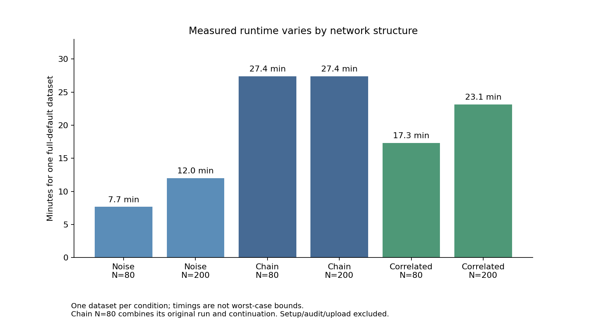

# Completed scenario timings: what they mean

**The run succeeded.** All four new datasets completed, passed their saved-calculation audit and produced the expected networks. Together with the two earlier chain cases, all six examples have the intended structure and zero warnings. This is encouraging execution evidence; one dataset per condition does not establish reliability rates or release readiness.

|Condition|N80 model time|N200 model time|What the network found|
|---|---:|---:|---|
|Noise|7m39s|11m59s|No links, correctly avoiding findings when there is no signal|
|Chain|27m22s*|27m24s|X1 -> X2 -> Y, with the correct depths and no extra links|
|Correlated direct predictors|17m20s|23m08s|Both X1 -> Y and X2 -> Y, with neither nuisance predictor promoted|

The N80 chain time combines its original attempt and continuation; it is not an uninterrupted measurement. The chain cases were reused with zero new fits in this timing run. Times exclude setup, evidence audit and upload.

The correlated predictors have population correlation .4. Both were retained in these two examples, showing that the procedure can retain their separate predictive contributions under these particular conditions. This is not general validation for multicollinearity. The noise cases evaluated 100 target-resample assessments each; the correlated and chain cases evaluated 300 each. The additional recursive assessments are real work, including checking whether the last promoted targets have further predictors.



## Execution and independent audit

[Run 38645875109](https://github.com/imh-ds/open/actions/runs/38645875109), attempt 1, source f1c1e3851bc19504a3ff6131c2f6bc3524ce5450, completed successfully. All four model jobs, all uploads and the no-fit aggregation job succeeded. Elapsed wall time was about 30 minutes. The five active jobs used 73 summed elapsed runner-minutes, below the 256-minute reservation; no other study stage launched.

Local independent replay, with fitting boundaries disabled, passed **1,400 assessments and 2,510,253 observation-loss checks**: 800 new-case assessments plus 600 saved chain assessments. It verified original generated rows/configuration, samples/splits, fitted-parameter reuse, risk/contrast arithmetic, finalized layers/edges/depths, receipts, archive hashes and agreement with the Actions aggregate. The completed evidence has zero warnings and no unknown assessment costs. The saved assessments record 98,112 outer and 4,200,000 tuning fits across all six cases; replay performed zero fits.

The quarantined invalid local development-test output documented in the [launch history](../scenario-timing-launch/README.md) remains excluded. None of its files was used here. The original failed preflights remain failed; this completed timing study does not reclassify them.

## What this means for the validation budget

We now have actual timings for all six conditions. Applying each observed case time to the 79 remaining datasets in its original cell projects about **9,074 remaining model-computation minutes**. Only 9,344 minutes remain reserved for those study jobs, leaving 270 minutes for 474 jobs: about 34 seconds per job for installation, audits, upload and variability. The four new jobs actually needed about109–145seconds each beyond their model computation. The full 480-case study therefore lacks a defensible allocation under the same 10,000-minute ceiling at these observed rates. These are projections from one dataset per condition, not exact forecasts or worst-case bounds.

**Recommended next step: freeze a smaller prospective validation, provisionally 330 fresh datasets (55 per condition), while retaining all statistical settings and confidence-bound criteria.** Keep the six timing cases descriptive: using fresh cases for qualification separates the budget-planning pilot from the subsequent reliability assessment. The untouched original identities at repetitions 1–55 in each cell are one possible prospective list, subject to explicit freeze/review; no existing dataset is silently replaced. A costed planning candidate uses one case/job, with caps of 14/19 minutes for noise N80/N200, 40/40 for chains, and 25/30 for correlated predictors. Including all prior reserved caps, the four-case timing allocation, 150 future preparation/aggregation minutes and one new registration gives:

`250 + 256 + 150 + 1 + 55 x (14 + 19 + 40 + 40 + 25 + 30) = 9897 runner-minutes`

That leaves 103 minutes unallocated, without refunding unused historical caps. These caps include overhead and headroom but are not proven worst-case runtimes. This is a planning candidate, not an implemented or authorized new dispatch. Preserve unknowns if any case exceeds its cap; no automatic retries or model simplification.

The trade-off is precision: with 55 datasets per cell, unchanged two-sided 95% exact-binomial criteria permit at most 1 incorrect-finding dataset per cell and require at least 50 exact recoveries in each signal cell. Their confidence boundaries are .0971910157 and .8004603842 respectively. The original 80-per-cell design allowed 2 incorrect datasets and required 72 exact recoveries. Thus reducing simulation replications does not weaken the models, but it changes how precisely we can judge their reliability and makes the integer gate more restrictive in some respects. This is not a minimum participant-sample recommendation; participant N remains 80/200.

The saved [budget and precision options](audit/budget-options.json) include fresh-only and pilot-reuse budgets, other replication counts and hypothetical gate assurance, not measured method performance. Choose/freeze any new scope from cost and precision before further fits, not from observed accuracy. The recommendation is fresh-only qualification; reuse remains appropriate if the original unchanged 480-case study is eventually resumed under its own reviewed execution amendment. A narrower study needs its own immutable identity list, explicit pilot roles, unchanged null-first gate and reviewed source/budget freeze. The original 480-case study remains incomplete with its original denominators. No new run was launched by this results check.

## Durable evidence and reproduction

`raw/` contains all four losslessly reconstructible case archives, controls, pinned runtime receipts, frozen manifest, aggregate, full log and API/artifact metadata. The earlier chain archive remains in its original committed result folder. SHA256 inventories, audited case rows, timing CSV, no-fit scripts and PNG/SVG graphs are saved alongside this interpretation.

From the repository root with the pinned installed runtime, run:

```powershell
python -I examples/results/2026-10-14-recursive-preview-validation/scenario-timing-completed-38645875109/audit/reproduce.py
python -I examples/results/2026-10-14-recursive-preview-validation/scenario-timing-completed-38645875109/audit/budget_options.py
```

These commands audit saved evidence and planning arithmetic; they do not fit or dispatch models. Scientific operating-characteristic qualification and preview release approval remain open.
