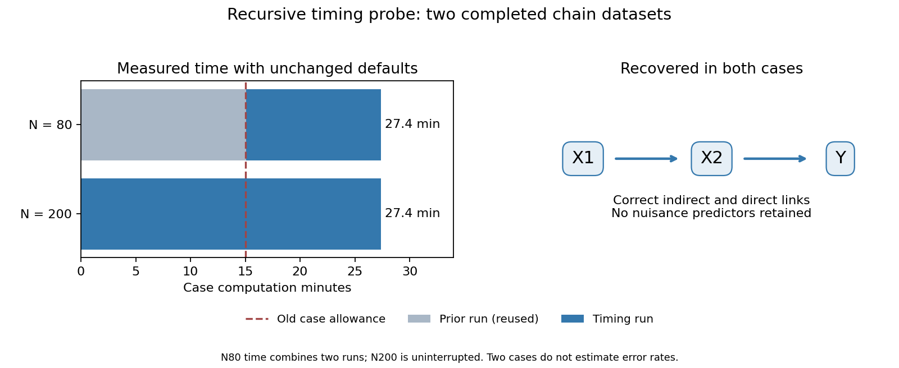

# Both timing cases completed and recovered the expected recursive chain

Timing [run38629900589](https://github.com/imh-ds/open/actions/runs/38629900589), attempt1, sourcee4798c8febfb7a92b81f574c8c93ce61cf7b9183, succeeded. The job took43minutes10seconds including installation, checkpoint verification, two case computations, audits and upload. It stayed below the82-minute job and72-minute combined-computation step limits. No per-dataset deadline was imposed and no later validation stage was launched.

## What this means simply

The recursive engine finished both examples and found the intended chain, **X1 -> X2 -> Y**, with X2at depth1and X1at depth2. It retained no nuisance predictors, extra edges or joint groups. These are two successful examples of direct/indirect recovery, not an estimate of the method's general success rate.

|Case|Measured case time|What was newly run here|Assessments|
|---|---:|---|---:|
|N80, original case160|27min22.156sec cumulative|12min18.375sec continuation;15min3.781sec came from the previous failed timing attempt|300total:144reused,156new|
|N200, original case240|27min24.094sec uninterrupted|The whole case|300new|

N80is elapsed computation accumulated across two runs, not a fresh uninterrupted runtime. Its original144assessments and all their original data/checkpoint/start/finish files remained byte-identical. N200was the previously unstarted case, run once. No old fixed-fixture fit was repeated. Both cases used all shipped statistical settings, including100resamples,5-fold performance CV repeated twice,3-fold tuning and.70retention.

Each case assessed three target layers:100assessments forY,100forX2and100forX1. The last target still needs evaluation to determine that no further candidate qualifies. Each full case recorded900000tuning fits. N80andN200had similar runtime in these examples; that does not establish equal runtime for larger samples or different structures.

## Independent verification and saved evidence

Local no-fit replay independently checked both complete networks, all600checkpoints and1076653observation-loss records. Saved source/config/data/split/attempt identities, fitted-parameter reuse, broad/unique/pair/group arithmetic, layer finalization and fit-count records passed. There were zero assessment warnings, missing checkpoint attempts or unknown costs in the completed-case audits. Case structures/depths matched both intended chains exactly.

The completed cases contain42112outer and1800000tuning fit records in total. Of these,12191outer/507000tuning fits were prior work reused unchanged;29921outer/1293000tuning fits were newly performed in this timing job. The local audit performed zero model fits. Installation/source checking, final artifact upload and the run itself all succeeded. Earlier failed preflights remain failed; the report retains `scientific_gate_accepted=false` and `original_preflight_reclassified=false`.

`raw/timing-cases.zip` contains every case input, config, complete network, checkpoint and attempt receipt. The uploaded loose case copies were checked byte-for-byte against this ZIP before moving the redundant download to ignored local storage. The compact tracked evidence also preserves timing/control/original receipt, both frozen manifests, runtime, complete logs and run/jobs/artifact API snapshots. `audit/raw-sha256.json` fingerprints all retained raw files. `audit/verification.json`, `audit/timing-summary.csv` and PNG/SVG figures preserve the independent checks and interpretations.

Reproduce from the repository root using the pinned installed Python environment:

```powershell
python -I examples/results/2026-10-14-recursive-preview-validation/timing-completed-38629900589/audit/reproduce.py
```

This recomputes saved losses/structure/timing summaries and plots. It does not fit models or resume scientific analysis.

## Implication for the full validation plan

The15-minute case allowance was insufficient; these chain cases needed about1.83times that amount. Two such cases need about55minutes of computation, so the original two-case40-minute shard cannot complete them even before setup and preservation. This is an execution-budget finding, not a negative statistical finding.

Revise job layout and the study budget before another dispatch. One dataset per job would avoid the current two-case bottleneck, but it does not reduce total runner-minutes. Longer jobs likewise do not make the study cheaper. The160planned chain datasets alone would project to roughly4382computation runner-minutes at these two observed rates, before setup/audit/preservation. This is a scenario-specific planning extrapolation, not a measured completion time or worst-case bound.

We should not multiply this chain rate by all480datasets and call it the study forecast: noise and correlated-direct structures can involve different target counts and costs. Build a conservative budget by scenario, then scale down independent replications or stage the claims if the10000-minute ceiling cannot accommodate it. Keep within-analysis settings unchanged. Fewer independent datasets widen uncertainty and may make the original confidence-bound criteria harder to achieve; approve any revised protocol before observing additional results. No additional run or scientific/release acceptance is implied by this timing success.


