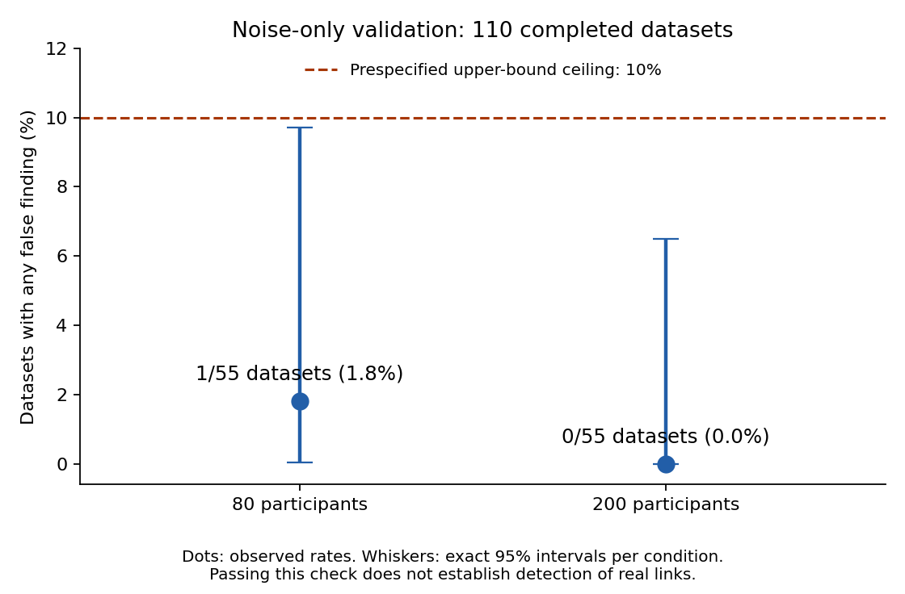

# Combined noise-only validation: passed

All **110 original datasets** now have complete, independently checked results: the original 72 completed cases plus the 38 continued cases. The same 55 datasets per sample-size group remain in the calculation. No model was refitted during this combined audit.

|Participants|Completed|Datasets with any false finding|Correct empty networks|95% upper bound on false-finding frequency|Prespecified check|
|---|---:|---:|---:|---:|---|
|80|55/55|1/55 (1.8%)|54/55|9.72%|Passed|
|200|55/55|0/55 (0%)|55/55|6.49%|Passed|

These datasets contained no real links. In plain terms, the method usually recognized that there was nothing to connect. Both groups passed the rule fixed before the study: the exact 95% interval's upper bound had to be at most 10%. The observed percentages are estimates from 55 independent datasets per condition, not precisely known population error rates. Intervals are marginal per condition.

The one incorrect dataset, `noise-n80-r25`, produced **two** arrows: `X2 -> Y` and `Z1 -> Y`. It counts as one dataset with any incorrect finding, as the original protocol specifies. The engine then evaluated both X2 and Z1 at the next depth and retained no further links. The 70% resampling threshold does not guarantee that a retained arrow is true.

The independent replay checked **11,200 completed assessment blocks and 24,793,600 recorded observation-loss calculations**, with zero warnings and no integrity errors. The continuation reused 3,408 saved partial assessment blocks and computed 592 additional blocks on Actions. The original 72 cases' 7,200 blocks were retained. The local audit performed zero fits.

## Why the Actions aggregate failed

The workflow did attempt to fetch both runs. Its configured downloader returned only the first **100 of 112 producer artifacts**. Seven required completed original datasets were absent from that first page. The frozen aggregate raised `StopIteration` before doing the combined numerical replay. This was an input-transport failure, not a statistical failure or a missing scientific dataset.

Recovery downloaded all available artifacts, then reran the unchanged frozen audit locally under its pinned installed runtime. The separate [pagination utility](../../../qualification_artifacts.py) enumerates every page, rejects missing/duplicate/expired artifacts, and downloads exact required names. Eight regression tests plus the existing 18 qualification tests passed: **26 tests**. The historical workflow/source manifests remain unchanged, and both historical Actions runs remain failed. This successful local recovery does not silently change either run's status.

## What this establishes and what comes next

This is encouraging evidence that the shipped default Elastic Net method does not frequently invent a network under these continuous Gaussian noise conditions. It does **not** establish how reliably the method finds real direct or indirect links, interaction performance, other engines, causal direction, or a universal minimum sample size.

The next scientific step is validation on data containing known links. Before dispatch, the gate must recognize this audited combination of two runs and the remaining compute allocation must be revised: the original signal-stage plan is no longer fully funded. The existing signal workflow still expects a successful single-run null gate; this recovery report does not automatically satisfy it. No signal run or other model job was launched during this recovery.



## Evidence and reproduction

See [the audited report](audit/audit.json), [case table](cases.csv), [archive inventory](archive-inventory.json), [SHA256 inventory](sha256.json), and the retained original failure reports and API receipts in `raw/`. Raw original and continuation archives retain their original bytes. Neither timing pilots nor replacement identities are included.

With the pinned installed Python 3.11.9 package/runtime specified by the original workflow, use **fresh staging and output directories**:

```powershell
python -I examples/results/2026-10-14-recursive-qualification/combined-38676310704/reproduce.py --stage-preserved .superpowers/combined-replay-inputs-2 --out .superpowers/combined-replay-audit-2
```

The script stages preserved canonical archives without extracting or fitting, checks the original frozen source/runtime, verifies every saved network and case receipt, and uses the recorded completed GitHub job receipts for transport validation. Existing staging/output directories are never overwritten. To reuse an independently downloaded layout, pass `--inputs` and `--producer-inputs` with a fresh `--out` instead.
