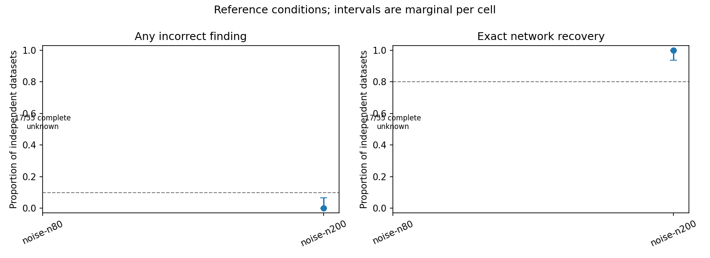

# Fresh noise-stage result: incomplete

Later completion: [the combined original-plus-continuation audit passed](../combined-38676310704/interpretation.md) with110/110 datasets. This original run and its38 incomplete receipts remain unchanged; the report below records its historical failure rather than the later recovered result.

[Run 38655036215](https://github.com/imh-ds/open/actions/runs/38655036215) failed its completion gate. These datasets contain only noise: a correct result has no retained links.

|Participants per dataset|Finished|Unfinished|Incorrect networks among finished cases|
|---|---:|---:|---:|
|200|55/55|0|0/55|
|80|17/55|38/55|0/17|

With 200 participants, this is encouraging: every dataset finished and the method invented no links. The exact 95% interval's upper bound is 6.49%, below the prespecified 10% ceiling for this cell. This supports the noise check for these default elastic-net settings; it does not establish sensitivity to real links, interaction performance, or a universal sample-size rule.

With 80 participants, we do not yet have a usable complete result. Thirty-six cases reached the internal deadline before another batch, one finished computation after its allowance, and one was interrupted by the 10-minute compute-step timeout. These are our workflow allowances, not GitHub's six-hour maximum. A timing pilot did not capture the variation across these datasets.

**Unfinished does not mean statistically correct.** The completed 17 cases may be easier than the unfinished ones. In particular, `noise-n80-r25` completed 100 root assessments and started 40 depth-one assessments for X2. This shows recursion advanced after selecting X2 in noise; the final network remains unknown. Across the 38 incomplete cases, 3,408 assessments have both start and finish records, but their receipts still mark overall fit cost unknown. Saved starts and finishes alone do not certify safe continuation or full numerical correctness.

The entire null stage remains unqualified. The signal stage has not launched. This is neither evidence that the recursive engine cannot run nor evidence that the method is ready for release.

**Recommended next step:** investigate a bounded continuation of these same 38 cases using verified checkpoints, without refitting completed work or changing defaults. First independently replay the partial checkpoints, reconcile the interruption and late-completion cases, calculate a feasible remaining budget, and design explicit continuation provenance. Preserve this original failed run and all 55 identities per cell. The existing once-only workflow cannot simply be rerun, and no continuation is authorized by this result check.

Evidence: [local byte/provenance verification](verification.json), [SHA256 inventory](sha256.json), [original CI audit](raw/qualification-noise-audit/audit.json), and all 110 original case archives in `raw/`. Completed-case numerical replay was performed by CI; local preservation checks archive CRC, hashes, receipts, inventories and provenance. No new scientific fits were run locally.

