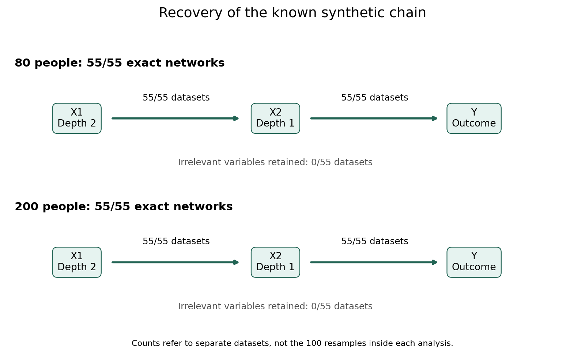

# Known-chain verification completed

The independent verification is complete. No models were refitted.

|People per dataset|Datasets checked|Entire chain and depths correct|Datasets with an extra connection|Qualified|
|---|---:|---:|---:|---|
|80|55/55|55/55|0/55|True|
|200|55/55|55/55|0/55|True|

## What this means simply

The method found the direct connection X2 -> Y and then followed it backward to find X1 -> X2. It put X2 and X1 at the intended depths and tested the irrelevant variables without needing to retain them.

This complements the earlier noise-only check: the noise check asked whether it invents connections, and this check asked whether it can recover connections that exist. These are separate benchmarks; their denominators are not pooled.

## What it does not establish

These datasets contain a fairly strong, simple linear chain with continuous Gaussian variables and two irrelevant covariates. This supports the shipped ElasticNet recursive workflow under those conditions. It does not show that 80 people is enough for weaker effects, many predictors, measurement error, interactions or correlated/redundant predictors. It does not validate causal direction in real observational data.

The 110 correlated-predictor reference cases remain pending. They are the recommended next scientific validation before treating this as broad first-release evidence; no additional study was launched.

## Verification and retained evidence

All 33,000 target-resample assessment blocks and 59,208,959 recorded observation-loss checks passed the independent replay, with 0 recorded warnings and no integrity errors. No new model fits or Actions dispatches were used for recovery.

The original Actions run 38690088093 remains failed because its 32-minute verification step timed out. This separate completed local audit supplies the scientific endpoint; it does not rewrite the workflow status.

For each sample size, the frozen pass criteria require at least 50/55 exact networks and at most 1/55 datasets with an incorrect connection. Exact 95% binomial intervals are marginal per condition, not a general error guarantee.
N=80: exact-recovery 95% interval 93.5% to 100.0%; incorrect-connection interval 0.0% to 6.5%.
N=200: exact-recovery 95% interval 93.5% to 100.0%; incorrect-connection interval 0.0% to 6.5%.

Raw inputs, controls, runtime records and SHA256 fingerprints are stored alongside the audit. Per-case verification caches permit resuming without repeating completed checks. See README.md for reproduction.
