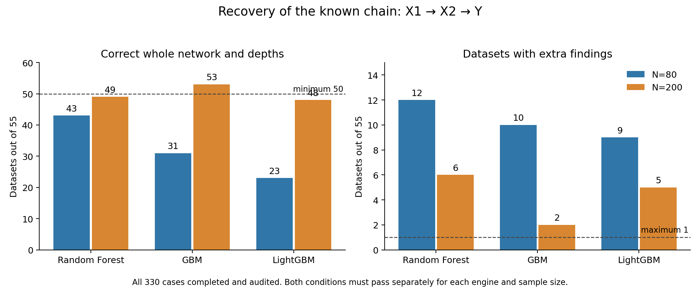

# Matched-chain validation: checked findings

[Completed Actions run](https://github.com/imh-ds/open/actions/runs/38891293628). [Durable raw evidence](https://github.com/imh-ds/open/releases/tag/tree-recursive-signal-2026-10-16-38891293628).

All330 analyses completed and passed independent case replay, with no unknown cases. The recursive framework found the true direct X2 -> Y edge in330/330 cases. All six prespecified cells failed at least one scientific qualification criterion. Successful workflow execution is separate from scientific qualification.

## Simple interpretation

| Engine | Exact whole network at N80 | Extra-finding datasets at N80 | Exact whole network at N200 | Extra-finding datasets at N200 |
|---|---:|---:|---:|---:|
| Random Forest |43/55|12/55|49/55|6/55|
| GBM |31/55|10/55|53/55|2/55|
| LightGBM |23/55|9/55|48/55|5/55|

A pass required at least50 exact networks, at most1 extra-finding dataset, and all55 cases complete per engine/N. These count cutoffs implement the frozen marginal exact95% confidence rules; they were not changed after seeing results.

RF found both true edges and their correct depths in every dataset, at both N values. Its shortfalls all involved adding unrelated variables. GBM missed the indirect X1 -> X2 edge in16/55 datasets at N80, but recovered it in55/55 at N200. LightGBM missed it in25/55 at N80 and2/55 at N200. GBM/LightGBM also added erroneous edges in the counts above; missed and extra links can coexist in the same dataset and should not be added as disjoint categories.

GBM at N200 came closest:53/55 exact networks (96.4%) and2/55 datasets with extra links (3.6%). Its recovery requirement passed, but two errors give an exact95% upper error bound of12.53%, exceeding the10% criterion. This is promising recovery evidence, while remaining insufficient to pass the prespecified error-control gate. It is not an equal-cost model contest or formal statistical proof that GBM outperforms another engine.

The method does expand recursively and can recover genuine indirect paths. At N80, full networks were inconsistent in this tested setup; N200 improved the results but did not qualify an engine. Prior empty-network null success does not establish error control after real links are present. The additional variables entering non-empty networks are a reliability limitation that now needs investigation, rather than a reason to treat repeated appearances as proof of a true relationship. The mechanism behind the false promotions has not yet been diagnosed.

Recommended next step: inspect the saved false-link cases to determine why unrelated variables survived the existing gain and retention rules. Diagnose the error-control behavior with signal present before proposing a separately frozen development/calibration study. Preserve current thresholds, results and failing gates; no scientific rerun or threshold adjustment was performed during this review. These findings apply to this strong linear Gaussian chain at N80/200, four candidate predictors and shipped settings, not universal minimum sample sizes or nonlinear/interaction reliability.

## Verification and preservation

- All340 workflow jobs accounted for:339 successful, registration skipped, all330 scientific cases complete.
- All six cell summaries were independently recomputed from saved audited rows, reproducing every count, interval and scientific pass/fail decision.
- The frozen source SHA and manifest match the approved launch.
- All11 small published report/inventory/verification assets matched GitHub release SHA256 metadata. Every one of330 audited case archive hashes matches the published raw-bundle inventories. Raw bundles total approximately4.855GB and remain in the durable prerelease; this review did not redownload them.
- One cell transport check recorded a transient GitHub HTTP502. Five sibling checks succeeded. Full saved run/job API records independently satisfy all original source/event/attempt/matrix/upload checks now; `verification.json` records the successful reconciliation. The original published report's transport flag is retained unchanged. Statistical outcomes were already failing independently of that warning.
- Observed summed runner durations approximately13,447 minutes, below the approved30,000 ceiling; job timestamps are elapsed runner time, not billing-adjusted usage. End-to-end workflow elapsed about13.5hours across parallel jobs, not a single job's duration.
- LightGBM case rows retain16,380 warnings in total (7,644 at N80 and8,736 at N200); RF/GBM record zero. The warning messages were not diagnosed in this report, and a warning-free execution is not claimed. Full raw warning evidence remains preserved.
- No model fits, new dataset generation, scientific retries, threshold changes or Actions dispatches occurred during this review. Original reports are preserved unchanged alongside the review.
